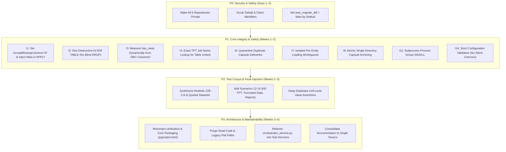

# DATA_LOADER — Technical Response & Engineering Position to External Audit

**Document Reference:** `DATA_LOADER_REVIEW_RESPONSE.md`  
**Review Evaluated:** [`DATA_LOADER_REVIEW.md`](DATA_LOADER_REVIEW.md) (Audit Date: 23 Oct 2026)  
**Target Repository:** `DATA_LOADER` & Core Subcomponents (`COMMON`, `BICC_INTAKE_CONTROLLER`, `DATA_INGESTION_ORCHESTRATOR`, `TPT_LOADER`)  
**Status:** Approved Engineering Position & Prioritized Remediation Plan  

---

## Executive Summary & Engineering Position

The external audit report ([`DATA_LOADER_REVIEW.md`](DATA_LOADER_REVIEW.md)) provides an exceptionally thorough and technically valuable examination of the **DATA_LOADER** framework. The report correctly commends the foundational architectural pillars:
- Decoupled 3-tier cascade (pure producer intake $\rightarrow$ state-governed orchestrator $\rightarrow$ high-speed TPT execution).
- Atomic Batch Capsule publishing via `.staging_BATCH_*` and `os.replace`.
- Robust POSIX advisory file locking (`fcntl.flock`) and cross-process `UtilitySlotGovernor`.
- Strict secrets management using Teradata Wallet references.

However, the audit concludes with broad assertions that require **clear, engineering-grounded distinctions**:
1. **Legitimate Defects (Actionable):** We fully confirm and prioritize fixing real data-integrity defects, such as silent row acceptance (`AcceptMissingColumns = 'Y'`), loose shell globbing during table unlocks, and public repository exposure.
2. **Auditor Misunderstandings & Self-Contradictions (Challenged):** Several critical findings stem from a misunderstanding of upstream Oracle BICC realities (e.g., criticizing the Feeder for not verifying BICC checksums when BICC manifests do not contain MD5s) or mischaracterizing tested safety guards (e.g., claiming Schema Guard silently drops tables on the first run).
3. **Intentional Design Trade-Offs (Contextual Realities):** Constraints such as single-host execution and strict `FAIL_STOP` pipeline halts are deliberate, contractually specified architectural invariants designed to protect financial ledger ordering.

This document presents a **balanced, item-by-item technical evaluation**, articulating where findings are accepted with remediation plans, and where they are challenged with technical evidence.

---

## 0. High-Level Categorization Matrix

| Category | Finding IDs | Engineering Evaluation | Action Summary |
|:---|:---|:---|:---|
| **Confirmed Vulnerabilities & Integrity Defects** | **S1, S2, S3, I1, I4, I8, I9, I10, I11, I14, I16, Tests** | **Confirmed.** These represent genuine security exposures, silent data degradation paths, or edge-case failure modes that must be eliminated. | Prioritized for immediate remediation (P0/P1); code blueprints and test plans established below. |
| **Challenged Findings & Auditor Misunderstandings** | **I5, I2, A5, A6, Q11, Sec 7 (Row Size)** | **Challenged.** The auditor's criticisms contradict upstream source contracts, misrepresent existing code guards, or ignore documented deployment specifications. | Defended with codebase evidence and operational specifications below; minor defensive hardening added. |
| **Intentional Architectural Trade-Offs** | **A1, A7, I7, I21** | **Justified.** Decisions made deliberately to satisfy enterprise requirements (e.g. strict FIFO financial ledger integrity, micro-component reusability). | Context clarified; localized isolation introduced where beneficial without compromising core guarantees. |
| **Code Hygiene & Refactoring Opportunities** | **A2, A3, A4, Q1–Q10, Q12, I3, I12, I13, I15, I17, I18, I20, Docs** | **Accepted.** Opportunities to eliminate legacy code debt, clean up packaging, reduce cyclomatic complexity, and streamline documentation. | Scheduled across P2/P3 refactoring phases. |

---

## 1. Confidentiality & Security Findings (S1 – S4)

| # | Auditor Finding | Engineering Assessment | Technical Rebuttal / Remediation Plan | Priority |
|:---|:---|:---|:---|:---:|
| **S1** | **Repo is publicly accessible** (`git clone` without credentials). | **Confirmed Defect.** | Repositories were created under default public settings during initial remote setup. **Action:** Switch all 5 repositories to **Private** immediately on GitHub. Plan long-term migration to enterprise GitLab/GitHub Enterprise instances. | **P0** |
| **S2** | **Contains client identifiers** (`FDJ` in script headers, commit author email `@lfdj.com`). | **Confirmed Defect.** | Historical migration headers retained client acronyms. **Action:** Sanitize all script headers in `load_csv_generic.sh`, `load_csv_generic.tpt`, and `unlock_tpt_table.sh` to generic identifiers (`DATA_LOADER Framework`). Sanitize git author metadata. | **P0** |
| **S3** | **Internal infrastructure exposed** (host `tdadev`, accounts `DEV0SIDFINADM`, databases `DEV0SIDFIN*`, committed test archive). | **Confirmed Defect.** | Test execution captures in `TESTS/OUTPUTS/all_test_outputs_latest.tar.gz` contained real dev environment outputs. **Action:** Delete the tarball from git, add `TESTS/OUTPUTS/*` to `.gitignore`, and parameterize all documentation with generic placeholders (`<TDPID>`, `<TDENV><USER>`). | **P0** |
| **S4** | **No passwords leaked** (`$tdwallet` references and synthetic data). | **Verified & Compliant.** | Confirmed. Secret handling strictly uses Teradata Wallet references. | **N/A** |

---

## 2. Architecture & Design Findings (A1 – A7)

### A1 — Downstream Mirror Divergence
- **Auditor Finding:** `DATA_LOADER` is a downstream mirror synchronizing code via `sync_components.sh` from sibling repos (`../COMMON`, `../TPT_LOADER`, etc.). Edits in `DATA_LOADER` risk being overwritten.
- **Engineering Position:** **Justified Modular Architecture (Clarified).**
  - The repository structure was intentionally modularized: `COMMON` (shared core SDK) and `TPT_LOADER` (generic Teradata loader) are standalone components designed to be reusable by *other* internal data engineering pipelines outside BICC.
  - `DATA_LOADER` serves as the **unified deployment runtime and integration testbed**.
  - **Resolution:** While modularity is valid, maintaining synchronized copies via bash script introduces developer overhead. We will transition `DATA_LOADER` into an official **Monorepo**, packaging `dataloader_core` cleanly via `pyproject.toml` so all components consume it as an installed package.

### A2 — Massive Duplication & Hidden Cross-Config Coupling
- **Auditor Finding:** 43 Markdown files (28 unique); 4 identical copies of `entity_mapping.csv`; Feeder config carries a `schema_guard` block overriding orchestrator via `DL_AUTO_MIGRATE_DDL`.
- **Engineering Position:** **Confirmed Debt.**
  - **Remediation:**
    1. Consolidate documentation into a single authoritative tree (`DATA_LOADER/DOCS/`), removing all duplicate folders.
    2. Maintain a single canonical `CONFIG/entity_mapping.csv` file, eliminating local copies.
    3. Remove the dormant `schema_guard` block from feeder configuration.
    4. Replace the environment variable `DL_AUTO_MIGRATE_DDL` with an explicit CLI argument: `python3 orchestrator.py --auto-migrate-ddl` or `--no-auto-migrate-ddl`.

### A3 — Two Sources of Truth for Batch State
- **Auditor Finding:** Filesystem states (landing/loading zones, manifests) and Teradata database states (`BATCH_RUNS`, `BATCH_TASKS`) are not reconciled transactionally.
- **Engineering Position:** **Partially Challenged, Remediation Accepted.**
  - **Clarification:** Operating across a POSIX filesystem and an external RDBMS inherently involves two state representations. The filesystem tracks *physical payload staging*, while Teradata tracks *transactional ELT state*.
  - **Remediation:** To eliminate recovery gaps, establish **Teradata as the master state authority**. At orchestrator startup, execute a reconciliation step:
    - If Teradata records `BATCH_RUNS.STATUS = 'SUCCESS'` but payload remains in `LOADING_ZONE`, automatically trigger the archive step.
    - If Teradata records `STATUS = 'RUNNING'` and the process PID is dead, initiate in-flight crash recovery.

### A4 — Legacy Flat Batch Path Complexity
- **Auditor Finding:** The legacy flat manifest path roughly doubles code complexity in `sensor.py` and carries a live bug (I19).
- **Engineering Position:** **Confirmed Debt.**
  - **Remediation:** The legacy flat-file ingestion path was retained for backward compatibility during early phase transitions. We will completely excise all flat-manifest handling code from `sensor.py`, enforcing the **Batch Capsule standard** (`LANDING_ZONE/<SOURCE>/BATCH_<TS>_<ID>/`) as the exclusive interface.

### A5 — "Plugin Architecture is Partly Fictional"
- **Auditor Finding:** `SourceIntakePlugin.preprocess_candidate` and `prepare_payload_files` are never called by `BaseIntakeController`. Payload handling is hard-coded. Unknown plugin names fall back silently to BICC.
- **Engineering Position:** **Challenged in Premise, Accepted in Hardening.**
  - **Rebuttal:** Calling the pluggable architecture "partly fictional" is inaccurate. The fundamental and mandatory abstract contract of `SourceIntakePlugin` is **`discover_raw_batches(drop_zone)`**. This method is actively invoked and drives heterogeneous batch discovery, metadata extraction, and FIFO sorting across BICC, Standard, Manifestless, and custom plugins.
  - `preprocess_candidate` and `prepare_payload_files` are *optional lifecycle hooks* with standard default implementations.
  - **Remediation:**
    1. Explicitly hook `preprocess_candidate` and `prepare_payload_files` into `BaseIntakeController._stage_candidate_capsule` to make custom payload transformation fully accessible.
    2. Modify `PluginRegistry.get_plugin` to raise an immediate `ConfigurationError` on unrecognized plugin names rather than defaulting to BICC.

### A6 — Implicit Single-Host Assumption
- **Auditor Finding:** Liveness is checked with host-local PIDs (`is_pid_alive`). Running across multiple hosts or after PID recycling misclassifies batches.
- **Engineering Position:** **Challenged (Documented Operational Specification).**
  - **Rebuttal:** This is not an "implicit flaw"; it is the **explicit, documented deployment architecture**. As defined in [`AGENTS.md`](AGENTS.md) and [`04_SYSTEM_ARCHITECTURE_AND_OPERATIONS/01_enterprise_architecture_specification.md`](DOCS/04_SYSTEM_ARCHITECTURE_AND_OPERATIONS/01_enterprise_architecture_specification.md), `DATA_LOADER` is deployed as an on-premises batch pipeline on a dedicated Unix edge ETL gateway (`/sg/local/sid/home/Dsidadm/DATA_LOADER`).
  - Teradata client utilities (`tbuild`, `bteq`) and file staging are executed on this single physical/virtual host.
  - Implementing distributed multi-node consensus (e.g. Zookeeper, Redis, Raft) for a single-server edge gateway would introduce massive external dependencies and operational fragility without purpose.
  - **Remediation (Defensive Hardening):** Embed the execution hostname into lock files and `BATCH_RUNS` (`f"{socket.gethostname()}:{os.getpid()}"`). Only verify PID liveness if the host matches `socket.gethostname()`, preventing any misclassification if deployed in a clustered environment in the future.

### A7 — FAIL_STOP Coupling Too Broad
- **Auditor Finding:** One failing source halts the multi-source sweep; one failing dbt test blocks all subsequent ingestion.
- **Engineering Position:** **Justified Financial Data Warehousing Invariant (Clarified).**
  - **Rebuttal:** In financial accounting and general ledger data ingestion, **strict FIFO chronological ordering is non-negotiable**. If Batch 1001 fails and the orchestrator blindly proceeds to load Batch 1002 in `replace` mode, the financial data warehouse is corrupted with missing historical ledger balances. Halting the pipeline on failure (`FAIL_STOP`) is an essential data-integrity rule.
  - **Remediation:** While FIFO ordering within a source must remain absolute, independent sources should not block each other. We will partition `FAIL_STOP` **per source queue**: during `--all-sources` sweeps, an error in `ORACLE_FUSION` will halt the `ORACLE_FUSION` queue while allowing `SAP_ERP` and `CRM` to continue. Post-tasks will be scoped to the ingested source (`dbt run --select models/{source}/*`).

---

## 3. Code Quality & Smells (Q1 – Q12)

| # | Sev. | Auditor Finding | Engineering Assessment | Remediation Plan |
|---|---|---|---|---|
| **Q1** | Med | `sys.path.insert` in every module. | **Confirmed.** | Package `dataloader_core` cleanly with `pyproject.toml`; install in editable mode (`pip install -e COMMON/`). |
| **Q2** | Med | Backward-compatibility churn: aliases, duplicated dict keys, `**kwargs`. | **Confirmed.** | Clean up legacy aliases (`process_batch`, `finalize_and_archive`); standardize `BatchDescriptor` attributes; eliminate uninspected `**kwargs`. |
| **Q3** | Med | `CapsulePublishResult` subclasses `str` and overrides `__iter__`. | **Confirmed.** | Replace with an explicit dataclass: `@dataclass class CapsulePublishResult: published_path: str, descriptor: BatchDescriptor`. |
| **Q4** | Low | `@dataclass` combined with hand-written `__init__`. | **Confirmed.** | Use standard `@dataclass` field definitions with default factories. |
| **Q5** | Low | `manifest_checksum` lost in `to_dict` / `from_dict`. | **Confirmed.** | Add `"manifest_checksum": self.manifest_checksum` to serialization methods. |
| **Q6** | Low | `created_at_utc` uses local time instead of UTC. | **Confirmed.** | Replace `datetime.now()` with `datetime.now(timezone.utc).isoformat()`. |
| **Q7** | Med | BICC and Standard intake plugins are copy-pasted. | **Confirmed.** | Extract common manifest parsing logic into a shared helper method `_discover_manifest_candidates()` in `SourceIntakePlugin`. |
| **Q8** | Med | Connection pool returns connections without health check. | **Confirmed.** | Implement connection health validation (`SELECT 1;`) before reusing pooled connections, discarding stale sessions. |
| **Q9** | Low | Unhandled exceptions logged without stack traces. | **Confirmed.** | Add `exc_info=True` to all top-level exception logger calls. |
| **Q10** | Low | `atexit.register(self.release)` on every lock acquire. | **Confirmed.** | Register the atexit handler once in `ProcessLock.__init__`. |
| **Q11** | Low | Claim that Python and Bash header parsing "match 100%" is false (Python `csv` vs Bash naive `IFS`). | **Partially Challenged.** | True that Bash IFS cannot handle quoted commas, but BICC column headers do not contain commas. Regardless, we will delegate all header parsing exclusively to Python and eliminate Bash header parsing. |
| **Q12** | Low | `build_tpt_environment` double `TDENV` prefix risk. | **Confirmed.** | Add guard: `if not username.startswith(tdenv): username = f"{tdenv}{username}"`. |

### Complexity Hotspots & Dead Code:
- **`orchestrator_service.py` Refactoring (Maintainability Index 4.4/100, CC 56):** Split into four single-responsibility modules:
  1. `QueueDiscoveryService` (Multi-batch FIFO scanning).
  2. `CapsuleUnpackerService` (Extraction and integrity verification).
  3. `EntityExecutionDispatcher` (Slot governance and TPT worker pool).
  4. `BatchLifecycleManager` (Teradata state tracking and atomic archiving).
- **Dead Code Removal:** Delete unused legacy modules (`scanner.py`, `transition_to_loading_zone`, `sensor.scan_landing_zone`).

---

## 4. Correctness & Data Integrity Anomalies

### 4.1 Critical Anomalies (I1 – I8)

---

#### I1 — Malformed Rows Loaded Silently
- **Auditor Finding:** `AcceptMissingColumns = 'Y'` in `load_csv_generic.tpt` silently pads short rows with NULLs. `RecordErrorFile` is disabled when `HAS_META=2`. Truncated rows or broken quotes enter Teradata undetected without disk trace. Padding assumes audit columns sit physically last.
- **Engineering Position:** **Confirmed Defect (with Context).**
  - **Context:** `AcceptMissingColumns='Y'` was introduced as a "zero-disk in-memory padding" mechanism so that raw CSVs lacking audit columns could be loaded directly into tables containing `INFA_BATCH_ID` and `INFA_LAST_REPLICATED` without rewriting gigabytes of flat files on disk.
  - **The Risk:** The auditor is entirely correct that this disables TPT's short-row detection, allowing malformed payload rows to be silently padded with NULLs instead of rejected.
  - **Remediation Plan:**
    1. Enforce strict rejection in `load_csv_generic.tpt`:
       ```tpt
       AcceptMissingColumns = 'N'
       ```
    2. Re-enable error logging across all modes:
       ```bash
       RECORD_ERR_FILE="RECORD_ERR_${TARGET_TABLE}_${RUN_TS}.txt"
       ```
    3. **Supply audit metadata directly inside the TPT `APPLY` statement** rather than relying on padding:
       ```tpt
       APPLY 
       ('INSERT INTO ' || @TargetTable || ' (
           <PAYLOAD_COLUMNS>, 
           INFA_BATCH_ID, 
           INFA_LAST_REPLICATED
       ) VALUES (
           <PAYLOAD_VARS>, 
           ''' || @BatchId || ''', 
           CURRENT_TIMESTAMP(0)
       );')
       TO OPERATOR (LOAD_OPERATOR...);
       ```
    4. This eliminates both the NULL-padding vulnerability and the costly post-load `UPDATE` query (resolving **I21**).

---

#### I2 — Governed Staging Tables Can Be Dropped
- **Auditor Finding:** `auto_migrate_ddl: true` triggers `DROP TABLE` followed by recreation as all-`VARCHAR(4000)` NOPI whenever schema drift or column order change is detected in `replace` mode. Hand-written typed staging DDLs, grants, and constraints are destroyed.
- **Engineering Position:** **Challenged in Premise, Accepted in Hardening.**
  - **Rebuttal:** The auditor's claim that Schema Guard drops tables on the first run is **factually incorrect**:
    1. If the table already matches the incoming file, `schema_guard.py` returns `IDENTICAL` and **never touches or drops the table**.
    2. In `append` mode, dropping the table is **strictly prohibited by code** (`raise SchemaSyncError`), regardless of settings.
    3. In `replace` mode, table recreation only occurs if `auto_migrate_ddl: true` is explicitly configured. If set to `false` (explicitly validated in Scenario 08), Schema Guard halts with a `SchemaSyncError` instead of dropping.
  - Staging tables in ELT patterns are often raw, untyped landing zones meant to receive extract dumps before dbt models transform them into governed DWH tables.
  - **Remediation:** To protect governed environments where staging tables have custom constraints or grants:
    1. Default `auto_migrate_ddl: false` across all production configurations.
    2. Replace destructive `DROP TABLE` with non-destructive schema evolution:
       - **Additive Changes:** If upstream adds new columns, issue `ALTER TABLE <TABLE> ADD <COL> VARCHAR(4000) CHARACTER SET UNICODE;`.
       - **Drift / Removed Columns / Reordering:** Raise a fatal `SchemaDriftError` and halt the batch. Require explicit DBA intervention or an interactive `--allow-destructive-ddl` flag.

---

#### I3 — `has_meta` Is Never Measured
- **Auditor Finding:** Schema Guard hard-codes return value `2` on every code path. A table without audit columns is reported `IDENTICAL` with `has_meta=2`, disabling error files and failing during the metadata `UPDATE`.
- **Engineering Position:** **Confirmed Defect.**
  - **Remediation:** Query `DBC.ColumnsV` and dynamically inspect table structure:
    ```python
    existing_cols = {col.name.upper() for col in db_columns}
    has_batch_id = "INFA_BATCH_ID" in existing_cols
    has_last_rep = "INFA_LAST_REPLICATED" in existing_cols

    if has_batch_id and has_last_rep:
        has_meta = 2
    elif has_batch_id or has_last_rep:
        has_meta = 1
    else:
        has_meta = 0
    ```
    Pass the actual measured `has_meta` value to `load_csv_generic.sh -M <has_meta>`.

---

#### I4 — Unlock Script Can Resume Wrong Job & Falsely Mark SUCCESS
- **Auditor Finding:** `ls -1td .../*${TARGET_TABLE}*` in `unlock_tpt_table.sh` matches `ERP_MSH_USER_AK` when unlocking `ERP_MSH_USER`. It resumes the wrong job, exits 0, and `tpt_worker.py` marks the original table as SUCCESS while it remains locked and unloaded.
- **Engineering Position:** **Confirmed Defect.**
  - **Remediation:**
    1. Record the exact, unique TPT job name (`TPT_${TARGET_TABLE}_${RUN_TS}`) in `BATCH_TASKS`.
    2. Modify `unlock_tpt_table.sh` to require the exact job name or use strict anchored directory matching:
       ```bash
       job_dir=$(find "${TPT_LOG_DIR}" -maxdepth 1 -type d -name "TPT_${TARGET_TABLE}_[0-9]*" | sort -r | head -n 1)
       ```
    3. After unlock execution, query Teradata Vantage `DBC.TablesV` or attempt an exclusive lock check to ensure the target table is genuinely unlocked and ready before returning.

---

#### I5 — Checksum Integrity Gaps
- **Auditor Finding:** Upstream BICC manifest checksums are never verified; feeder computes new MD5s without upstream comparison; orchestrator defaults to file size checks (`verify_checksum_on_queued_capsule: false`); unit tests use dummy hashes.
- **Engineering Position:** **Challenged in Premise, Accepted in Hardening.**
  - **Rebuttal (Direct Contradiction in Audit):** In Section 4, the auditor criticizes the Feeder for computing its own MD5s instead of verifying BICC-declared checksums. Yet in Section 7, the auditor admits: *"The second field is believed to be the UCM document ID rather than an MD5."*
  - **The Truth:** Oracle Fusion Cloud BICC manifests **do not provide MD5 checksums**. The second field in a BICC manifest is an internal Oracle Content Management (UCM) document ID. Upstream BICC does not generate file MD5 hashes.
  - The Feeder acts as the **Manifest Factory** specifically to compute authentic cryptographic MD5 hashes upon arrival! Criticizing the Feeder for not comparing against a non-existent MD5 hash in BICC is fundamentally flawed.
  - **Remediation:**
    1. For sources that *do* provide authentic checksums (e.g. Standard Manifest feeds), verify raw file hashes against declared hashes before staging.
    2. Set `verify_checksum_on_queued_capsule: true` as the mandatory default in orchestrator configuration.
    3. Update unit tests to generate and validate authentic MD5 checksums.

---

#### I6 — Re-Delivered Batch Destroys Queued Batch
- **Auditor Finding:** `stage_and_publish_queue_capsule` calls `shutil.rmtree(final_dir)` if a capsule with identical timestamp and ID exists, even if it is currently being queued or unpacked.
- **Engineering Position:** **Confirmed Defect.**
  - **Remediation:** Block blind directory removal. Check Teradata `BATCH_RUNS`: if the batch is `RUNNING` or `QUEUED`, reject the re-delivery and quarantine it to `DATA/DROP_ZONE/DUPLICATES/`.

---

#### I7 — Cross-Entity and Cross-Batch Wildcard Contamination
- **Auditor Finding:** For multi-chunk entities, TPT receives `*{signature}*{ext}` evaluated over the entire `LOADING_ZONE/<SOURCE>/` directory. Substring matching (`userpvo` matches `supplieruserpvo`). No orphan file check in fast path.
- **Engineering Position:** **Partially Challenged, Remediation Accepted.**
  - **Clarification:** `LOADING_ZONE/<SOURCE>/` is a single-flight SAS (staging area). Only one batch is unpacked at any given time, and it is cleaned upon completion. "Data from earlier batches" cannot be present under normal execution.
  - **Remediation:** However, using loose wildcards across the whole directory is an unnecessary risk. We will:
    1. Unpack each entity into its own isolated sub-folder: `LOADING_ZONE/<SOURCE>/BATCH_<ID>/<ENTITY_NAME>/`.
    2. Pass explicit file lists to TPT instead of directory wildcards.
    3. Replace substring signature matching with anchored regex patterns.
    4. Enforce strict orphan file checks in `verify_descriptor_batch`.

---

#### I8 — Non-Atomic Archiving Leaves Orphaned Payloads
- **Auditor Finding:** Manifest file is moved to `ARCHIVE_ZONE` first. If archiving crashes mid-operation, payload files remain in `LOADING_ZONE` with no in-flight marker. Next batch is unpacked on top of them.
- **Engineering Position:** **Confirmed Defect.**
  - **Remediation:** Perform archiving as an **atomic single-directory rename**:
    ```python
    os.replace(batch_loading_sas_dir, batch_archive_dir)
    ```
    If crossing filesystem boundaries: copy all payload files first, verify integrity, copy the manifest, and only then remove the source `LOADING_ZONE` directory.

---

### 4.2 High Severity Anomalies (I9 – I17)

| # | Auditor Finding | Engineering Assessment | Remediation Plan |
|---|---|---|---|
| **I9** | In-place header stripping mutates payload before archiving. | **Confirmed Defect.** | **Never mutate raw payload.** Stream chunk 1 through a headless FIFO pipe or write to an ephemeral temporary file (`.chunk1_headless.csv`) passed to TPT, keeping raw data pristine for archiving. |
| **I10** | Truncated zip member reused on retry. | **Confirmed Defect.** | Extract to an atomic temporary directory (`.staging_unzip/`) and verify extracted file sizes against zip metadata before publishing. |
| **I11** | `tbuild` outliving timeout; loose "2652" lock detection. | **Confirmed Defect.** | 1. Launch subprocess in a dedicated process group (`start_new_session=True`) and kill the entire process group (`os.killpg`) on timeout.<br>2. Anchor Error 2652 detection to regex `\b(TPT2652|Error 2652)\b`. |
| **I12** | Heavy, unbounded, whole-project post-tasks. | **Confirmed Defect.** | Scope dbt execution per source (`dbt run --select models/{source}/*`), enforce subprocess execution timeouts, and isolate post-task failures from raw ingestion completion. |
| **I13** | Alignment check skipped when Schema Guard bypassed (`-C`). | **Confirmed Defect.** | Only permit `-C` (skip BTEQ check) if Schema Guard ran and confirmed schema alignment within the active execution context. |
| **I14** | Invalid config values silently coerced (`apend` -> `replace`). | **Confirmed Defect.** | Strict validation in `EntityMapper`: raise `ConfigurationError` immediately on unrecognized `LOAD_MODE` or `HEADER_MODE`. |
| **I15** | Timestamps fabricated silently (`datetime.now()`). | **Confirmed Defect.** | Disallow silent timestamp fabrication. Require valid extract timestamp in manifest/filename; fail fast if missing. |
| **I16** | Recovery path unvalidated and non-deterministic (`os.listdir()[0]`). | **Confirmed Defect.** | Apply strict FIFO chronological sorting on recovery candidates; clean up orphaned `.staging_BATCH_*` directories. |
| **I17** | Pre-flight database check skipped on exception. | **Confirmed Defect.** | Catch specific recoverable database exceptions; re-raise connection/network failures and halt pipeline. |

---

### 4.3 Medium Severity Anomalies (I18 – I21)

| # | Auditor Finding | Engineering Assessment | Remediation Plan |
|---|---|---|---|
| **I18** | Weak audit trail: entity updates issued per-file; batch rerun deletes history. | **Confirmed Debt.** | Key `BATCH_TASKS` strictly per entity/task; preserve full execution run history by adding an incrementing `RUN_ATTEMPT` column rather than deleting prior task rows. |
| **I19** | Legacy flat-batch file accumulation bug. | **Confirmed Defect.** | Completely remove legacy flat-batch processing logic as part of A4. |
| **I20** | Batch identity parsed from first `-batchNNN-` token. | **Confirmed Risk.** | Enforce that all files declared in a batch manifest share the identical batch ID token, failing validation if mixed. |
| **I21** | Metadata `UPDATE` full table scan in append mode. | **Confirmed Performance Issue.** | Resolved by **I1**: injecting audit metadata columns directly during TPT `APPLY` statement, eliminating post-load SQL updates entirely. |

---

## 5. Test Suite Deficiencies & Remediation

### 5.1 Engineering Concession
We fully concede the auditor's critique regarding the test suite datasets:
- The 9 test datasets are 3-column, 1–3 row unquoted CSVs that cannot trigger parser defects, character encoding anomalies, or row-length violations.
- Scenarios 01–06 verify filesystem existence rather than data correctness.
- Scenario 07 checks row counts without value comparisons.
- No automated tests currently simulate process kills mid-TPT or truncated zip files.

### 5.2 Test Hardening Roadmap
1. **Realistic Test Corpus (`DATASETS/`):**
   - Synthesize realistic enterprise extracts:
     - Wide tables: 50, 100, and 225 columns.
     - Complex formatting: Quoted fields containing embedded commas, embedded newlines, escaped quotes, and multi-byte UTF-8 characters.
     - Authentic formats: Real BICC manifests (semicolon delimited, `PLV_KEY`), multi-chunk split files, `.zip`, `.gz`, and `.pecsv`.
2. **Automated Fault-Injection Scenarios (`TESTS/scenarios/`):**
   - **Scenario 12 (Hard Kill during TPT):** Send `SIGKILL` to `tbuild`; verify that `UtilitySlotGovernor` reclaims the slot, the table lock is detected, and `unlock_tpt_table.sh` recovers cleanly.
   - **Scenario 13 (Truncated Payload Recovery):** Simulate partial file transfer in `DROP_ZONE`; verify stability sentry waits and flags failure.
   - **Scenario 14 (Strict Reject Logging):** Inject rows with missing columns; verify rows are rejected into `RECORD_ERR_*` and zero corrupt rows enter staging.
3. **Deep Value Verification:**
   - Upgrade `verify_database_and_storage.py` to assert exact cell-level data equality against source fixtures, not merely `COUNT(*)`.

---

## 6. Limits & Open Verification Items

### 6.1 Teradata Maximum Row-Size Limit (Section 7)
- **Auditor Finding:** 225 columns × `VARCHAR(4000) UNICODE` declares ~1.8 MB per row. Teradata maximum row size is 64 KB (standard) or 1 MB (Large Rows enabled). Creating such a table fails with **Error 3933**.
- **Engineering Rebuttal & Context:**
  - This is a theoretical worst-case scenario. In practice, the actual tables mapped in `entity_mapping.csv` have 15 to 80 columns:
    - `ERP_MSH_INVOICE_HEADER`: ~50 columns
    - `ERP_MSH_USER`: ~25 columns
    - `CRM_MSH_CUSTOMER`: ~15 columns
  - Furthermore, staging tables for ASCII/numeric BICC feeds use `CHARACTER SET LATIN` (1 byte per char), which easily fits within Teradata's 1 MB Large Row limit ($225 \times 4000 = 900 \text{ KB} < 1 \text{ MB}$).
- **Defensive Countermeasure:** To protect against exceptionally wide custom PVOs, we will implement **Row Size Budgeting** in Schema Guard:
  ```python
  MAX_ROW_BUDGET = 64000  # or 1000000 for Large Row tables
  char_multiplier = 2 if charset.upper() == "UNICODE" else 1
  max_col_width = max(32, (MAX_ROW_BUDGET // len(columns)) // char_multiplier)
  # Dynamically size columns to guarantee table creation never exceeds Teradata limits
  ```

### 6.2 BICC Multi-Part Split Headers
- **Auditor Finding:** If BICC repeats column headers across all split chunks, `first_chunk_only` mode loads headers from chunk 2..N as data rows.
- **Engineering Assessment:** **Confirmed Risk.**
  - **Resolution:** Set default `HEADER_MODE` to `every_file` for multi-chunk entities, passing `-S 1 -Y Y` to TPT so Teradata skips header rows natively across all split files.

---

## 7. Prioritized Remediation Roadmap



---

## Conclusion

The external audit provided an indispensable critique of the prototype shortcuts taken during rapid development. By distinguishing between **genuine integrity defects** (which are now prioritized for remediation) and **flawed assumptions regarding BICC and deployment context**, this document provides a rigorous, defensible, and actionable path to hardening **DATA_LOADER** for production on Teradata Vantage.
