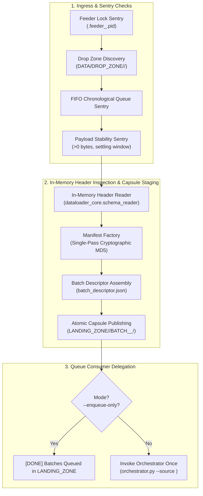

# BICC_INTAKE_CONTROLLER - User How-To & Configuration Guide

## 1. Overview & Operational Role

The **BICC_INTAKE_CONTROLLER** (`feeder.py`) is the Tier-1 intake supervisor of the `DATA_LOADER` ingestion suite. Under the **Phase 03 Decoupled Architecture**, it acts as a **pure flat-file intake producer with zero Teradata database dependency**, governing the ingress of raw, asynchronous data exports generated by **Oracle Fusion Cloud BICC (Business Intelligence Cloud Connector)** and custom enterprise source extracts.



### Core Responsibilities
1. **Single-Flight Process Concurrency**: Enforces per-source mutual exclusion using lock files (`.feeder_<SOURCE>.pid`). If another feeder instance is active, it enters an active polling wait loop rather than aborting or causing collisions.
2. **Zero Teradata Dependency**: Operates purely on flat files, compressed archives, and in-memory streams without database connections. Can run even when Teradata Vantage is offline or under maintenance.
3. **FIFO Ingress Queueing**: Automatically detects multi-batch arrivals in `DROP_ZONE/<SOURCE>/` and prepares them in ascending chronological order (oldest extract first) to preserve temporal data integrity.
4. **File Stability Sentry**: Verifies that files are non-empty (>0 bytes) and that file sizes do not fluctuate during a configurable settling window (guarantees external SFTP/cloud copy completion).
5. **In-Memory Header Extraction**: Inspects CSV/archive headers in memory without extracting payloads to disk, recording column names directly into `batch_descriptor.json`.
6. **Standardized Cryptographic Manifest & Capsule Staging**: Calculates MD5 sums on data payloads, vaults the raw manifest with a canonical JSON intake receipt (`RECEIPT_<SOURCE>_<TS>_<BATCH_ID>.json`), and stages the complete Batch Capsule atomically into `LANDING_ZONE/<SOURCE>/BATCH_<CLEAN_TS>_<BATCH_ID>/`.
7. **Producer / Consumer Decoupling**: Supports `--enqueue-only` for high-frequency intake scheduling, or automatically triggers `orchestrator.py` once to drain the FIFO queue.
8. **FAIL_STOP Delegation**: When chained to `DATA_INGESTION_ORCHESTRATOR`, aborts immediately if any downstream step fails.

---

## 2. Prerequisites & Environment Setup

### 2.1 Runtime Dependencies
- **Operating System**: Linux / Unix POSIX runtime (e.g. Red Hat Enterprise Linux 7/8/9, Debian/Ubuntu).
- **Python**: Python 3.8+ (tested on Python 3.8, 3.9, 3.11, 3.12).
- **Filesystem Access**: Read/write access to `DATA/DROP_ZONE`, `DATA/LANDING_ZONE`, and `LOGS`.
- **Zero Database Requirement**: `teradatasql` is **not** required for running `BICC_INTAKE_CONTROLLER`.

```bash
# Verify Python runtime
python3 --version
```

### 2.2 Shell Environment Variables
In the target Unix production/test environment, standard profile exports are honored:
```bash
export ENV="DEV"
export USER_CHAPEAU="DEVADM"
export LANG="C"
```

---

## 3. Command-Line Syntax & Execution

### 3.1 Invocation Syntax
```bash
python3 feeder.py --config <path_to_config.json> [--enqueue-only] [--skip-post-tasks] [--source <SOURCE>]
```

| Parameter | Required | Type | Description |
|---|---|---|---|
| `--config` | **Yes** | String | Path to the JSON configuration file (relative or absolute). |
| `--enqueue-only` | No | Flag | Pure producer mode: discovers, validates, and publishes Batch Capsules into `LANDING_ZONE/<SOURCE>/` and exits without spawning `DATA_INGESTION_ORCHESTRATOR`. Ideal for high-frequency cron jobs. |
| `--skip-post-tasks` | No | Flag | Forwards `--skip-post-tasks` to downstream `DATA_INGESTION_ORCHESTRATOR` when chained, bypassing post-ingestion models during maintenance or historical re-inits. |
| `--source` | No | String | Overrides the source system code (e.g. `ORACLE_FUSION`, `CRM`) and dynamically enforces sub-directory partitioning across all storage zones (`DROP_ZONE/<SOURCE>/`, `LANDING_ZONE/<SOURCE>/`, and `LOGS/<SOURCE>/`). |

### 3.2 Standard Execution Examples

#### Example 1: Standard Supervised Chained Run
Enqueues all pending batches in `DROP_ZONE` into `LANDING_ZONE` capsules, then triggers `DATA_INGESTION_ORCHESTRATOR` once to drain the FIFO queue:
```bash
cd /sg/local/sid/home/Dsidadm/DATA_LOADER/PROCESSING_TOOLS/BICC_INTAKE_CONTROLLER
python3 feeder.py --config config.json
```

#### Example 2: Asynchronous Intake Producer Mode (`--enqueue-only`)
Stages all batches into `LANDING_ZONE` and exits immediately without triggering Teradata loads:
```bash
python3 feeder.py --config config.json --enqueue-only
```

#### Example 3: Maintenance Ingestion with Post-Tasks Skipped
Load incoming tables without triggering downstream transformations:
```bash
python3 feeder.py --config config.json --skip-post-tasks
```

#### Example 4: Multi-Source Partitioned Ingestion
Process only extracts originating from a specific source partition:
```bash
python3 feeder.py --config config.json --source CRM
```

#### Example 5: Scheduled Automation via Cron (Decoupled Producer)
```cron
# Run BICC Intake Controller producer every 2 minutes
*/2 * * * * cd /sg/local/sid/home/Dsidadm/DATA_LOADER/PROCESSING_TOOLS/BICC_INTAKE_CONTROLLER && python3 feeder.py --config config.json --enqueue-only >> /sg/local/sid/home/Dsidadm/DATA_LOADER/LOGS/cron_feeder.log 2>&1
```

---

## 4. Configuration Reference (`config.json`)

Configuration files support environment variable expansion and relative path resolution relative to `config.json`.

### 4.1 Production Configuration Schema
```json
{
  "feeder": {
    "drop_zone": "../../DATA/DROP_ZONE",
    "logs_dir": "../../LOGS",
    "file_stability_window_seconds": 3,
    "source_system_code": "ORACLE_FUSION",
    "entity_mapping_file": "../../CONFIG/entity_mapping.csv",
    "concurrency": {
      "poll_interval_seconds": 5,
      "lock_timeout_seconds": 7200
    }
  },
  "orchestrator": {
    "orchestrator_dir": "../DATA_INGESTION_ORCHESTRATOR",
    "config_file": "config.json",
    "landing_zone": "../../DATA/LANDING_ZONE",
    "python_executable": "python3",
    "trigger_orchestrator": true
  }
}
```

### 4.2 Parameter Specification

#### `feeder` Block
| Parameter | Type | Default | Description |
|---|---|---|---|
| `drop_zone` | String | `../../DATA/DROP_ZONE` | Path to upstream arrival base directory. Feeder automatically partitions to `DROP_ZONE/<SOURCE>/` (e.g. `DROP_ZONE/ORACLE_FUSION/`). Files dropped at the root of `DROP_ZONE/` are strictly ignored. |
| `logs_dir` | String | `../../LOGS` | Central directory where feeder execution logs are written, automatically partitioned by source (`LOGS/<SOURCE>/`). |
| `file_stability_window_seconds` | Integer | `3` | Settling window (in seconds) to confirm file size stability before intake. |
| `source_system_code` | String | `ORACLE_FUSION` | Default identifier for the source ERP system. |
| `entity_mapping_file` | String | `../../CONFIG/entity_mapping.csv` | Path to entity routing mapping CSV. |
| `concurrency.poll_interval_seconds` | Integer | `5` | Polling interval in seconds when waiting for another active Feeder to finish. |
| `concurrency.lock_timeout_seconds` | Integer | `7200` | Maximum wait timeout (in seconds) before aborting if another feeder remains active. |

#### `orchestrator` Block
| Parameter | Type | Default | Description |
|---|---|---|---|
| `orchestrator_dir` | String | `../DATA_INGESTION_ORCHESTRATOR` | Location of the Orchestrator component. |
| `config_file` | String | `config.json` | Configuration file to pass to `orchestrator.py`. |
| `landing_zone` | String | `../../DATA/LANDING_ZONE` | Target landing zone for publishing Batch Capsules. |
| `python_executable` | String | `python3` | Path or name of Python binary to spawn Orchestrator. |
| `trigger_orchestrator` | Boolean | `true` | When `true` (and `--enqueue-only` is not passed), invokes the Orchestrator once after enqueuing all batches. When `false`, acts strictly as an enqueue-only producer. |

---

## 5. Storage Lifecycles & Batch Capsule Architecture

### 5.1 Queued Batch Capsule Layout
Upon intake, the feeder stages all files into a temporary hidden capsule directory `.staging_BATCH_<CLEAN_TS>_<BATCH_ID>/` and atomically renames it to `BATCH_<CLEAN_TS>_<BATCH_ID>/` inside `LANDING_ZONE/<SOURCE>/`:

```
LANDING_ZONE/<SOURCE>/BATCH_<CLEAN_TS>_<BATCH_ID>/
  ├── file_userpvo-batch9001-.csv          # Payload data files
  ├── MANIFEST_ORACLE_FUSION_..._9001.MF   # Standardized manifest
  ├── batch_descriptor.json                # Pre-extracted metadata & headers
  └── RAW/                                 # Raw vault directory
      ├── MANIFEST-batch9001-.MF           # Pristine original BICC manifest
      └── RECEIPT_ORACLE_FUSION_...json    # Canonical JSON intake receipt
```

### 5.2 Canonical `batch_descriptor.json` Schema
```json
{
  "schema_version": "1.0",
  "batch_id": "9001",
  "source": "ORACLE_FUSION",
  "extract_timestamp_raw": "20261016_100000",
  "extract_timestamp_iso": "2026-10-16 10:00:00",
  "intake_timestamp_iso": "2026-10-16 10:00:05",
  "standardized_manifest": "MANIFEST_ORACLE_FUSION_20261016_100000_9001.MF",
  "raw_manifest": "RAW/MANIFEST-batch9001-.MF",
  "receipt_file": "RAW/RECEIPT_ORACLE_FUSION_20261016_100000_9001.json",
  "entities": {
    "ERP_MSH_USER": {
      "target_table": "ERP_MSH_USER",
      "signature": "userpvo",
      "extension": ".csv",
      "inner_extension": ".csv",
      "header_columns": ["USER_ID", "USER_NAME", "EMAIL"],
      "files": [
        {
          "filename": "file_userpvo-batch9001-.csv",
          "filesize_bytes": 1048576,
          "md5": "3a742629d08dcb9ed4c588929e96e080"
        }
      ]
    }
  }
}
```

---

## 6. Monitoring & Operational Inspection

### 6.1 Supervisor Log Files & Naming Convention
Supervisor logs are written to standard output (`stdout`) and to timestamped log files in `logs_dir/<SOURCE>/`:
```
../../LOGS/<SOURCE>/LOG_FEEDER_<SOURCE>_<EXEC_TS>.log
```
Example: `../../LOGS/ORACLE_FUSION/LOG_FEEDER_ORACLE_FUSION_20261016_173927.log`

### 6.2 Interpreting Controller Logs
A typical successful execution displays:
```text
2026-10-16 17:39:27 | INFO     | BICC_INTAKE_CONTROLLER | Initialized BICC Intake Controller log file: '/sg/.../LOGS/ORACLE_FUSION/LOG_FEEDER_ORACLE_FUSION_20261016_173927.log'
2026-10-16 17:39:27 | INFO     | BICC_INTAKE_CONTROLLER | ======================================================================
2026-10-16 17:39:27 | INFO     | BICC_INTAKE_CONTROLLER | STARTING BICC INTAKE CONTROLLER - PRODUCER RUN (Source: ORACLE_FUSION)
2026-10-16 17:39:27 | INFO     | BICC_INTAKE_CONTROLLER | ======================================================================
2026-10-16 17:39:27 | INFO     | BICC_INTAKE_CONTROLLER | Drop Zone: /sg/.../DATA/DROP_ZONE/ORACLE_FUSION
2026-10-16 17:39:27 | INFO     | BICC_INTAKE_CONTROLLER | Discovered 1 batch(es) in drop zone. Enqueueing in FIFO order:
2026-10-16 17:39:27 | INFO     | BICC_INTAKE_CONTROLLER |   [1/1] Batch ID: 9001, Extract TS: 20261016_100000, Files: 1
2026-10-16 17:39:28 | INFO     | BICC_INTAKE_CONTROLLER | [ERP_MSH_USER] Extracted 3 header column(s) in memory from 'file_userpvo-batch9001-.csv'.
2026-10-16 17:39:29 | INFO     | BICC_INTAKE_CONTROLLER | Published queued Batch Capsule '/sg/.../DATA/LANDING_ZONE/ORACLE_FUSION/BATCH_20261016_100000_9001'.
2026-10-16 17:39:29 | INFO     | BICC_INTAKE_CONTROLLER | Delegating queue execution for source 'ORACLE_FUSION' to DATA_INGESTION_ORCHESTRATOR...
... [Orchestrator live stream] ...
2026-10-16 17:39:56 | INFO     | BICC_INTAKE_CONTROLLER | [SUCCESS] DATA_INGESTION_ORCHESTRATOR completed successfully.
```

---

## 7. Troubleshooting Runbook

### Failure Mode 1: Unstable File / Transfer in Progress
- **Symptom**:
  ```text
  Payload stability check failed for batch 000000012: File 'file_invoiceheaderextractpvo-...zip' size changed during settling window (1048576 -> 2097152 bytes). Upload in progress.
  Halting pipeline under FAIL_STOP policy to prevent corrupt ingestion.
  ```
- **Root Cause**: Upstream BICC transfer or SFTP process is still actively writing to `DROP_ZONE`.
- **Resolution**:
  - The controller automatically protects against partial loads. No manual file repair is needed.
  - Wait for the upstream upload to finish. The next invocation of `feeder.py` will detect that file sizes have stabilized and will process the batch normally.

---

### Failure Mode 2: Unrecognized Entity in `entity_mapping.csv`
- **Symptom**:
  ```text
  FATAL: File 'file_customentityextractpvo-batch1001-20261015.csv' does not match any recognized entity in '../../CONFIG/entity_mapping.csv'.
  ```
- **Root Cause**: Upstream BICC exported a new extract whose signature is not registered in `entity_mapping.csv`.
- **Resolution**:
  1. Add a new row to `entity_mapping.csv` mapping the signature to the target table:
     ```csv
     ORACLE_FUSION,ERP_CUSTOM_ENTITY,customentityextractpvo,".csv,.zip,.gz",.csv
     ```
  2. Re-run `feeder.py --config config.json`. The Orchestrator's Just-In-Time Schema Guard will automatically inspect headers and create `ERP_CUSTOM_ENTITY` in Teradata.

---

### Failure Mode 3: Concurrent Feeder Collision Detected (PID Active)
- **Symptom**:
  ```text
  Another BICC Intake Controller is currently active (PID 14205). Entering active waiting loop (polling every 5s, timeout: 7200s)...
  Feeder PID 14205 still running. Waiting 5s...
  ```
- **Root Cause**: Two feeder processes were scheduled or triggered simultaneously for the same source.
- **Behavior**:
  - The controller detects `.feeder_<SOURCE>.pid` in `DROP_ZONE/<SOURCE>`.
  - It verifies if PID `14205` is alive using OS process sentry (`is_pid_alive`).
  - While alive, it polls every `poll_interval_seconds` (default: 5s) up to `lock_timeout_seconds` (default: 7200s).
  - As soon as the active feeder finishes and removes its lock, the waiting feeder resumes immediately.
  - If the timeout expires, it aborts cleanly with Return Code `1` to avoid hung jobs.
  - If the PID is dead, the stale lock file is automatically pruned.

---

### Failure Mode 4: Downstream Orchestrator Execution Failure
- **Symptom**:
  ```text
  CRITICAL: FATAL: DATA_INGESTION_ORCHESTRATOR failed with exit code 1 for source 'ORACLE_FUSION'!
  CRITICAL: Applying FAIL_STOP policy: Halting feeder immediately to preserve data lineage.
  ```
- **Root Cause**: One of the batches failed during Orchestrator execution (e.g. TPT utility error, database constraint, syntax failure).
- **Resolution**:
  - Check the Orchestrator log referenced in the console output: `LOGS/<SOURCE>/<YYYY-MM>/BATCH_<ID>_<TS>/LOG_ORCHESTRATOR_*.log`.
  - Fix the underlying data or Teradata issue.
  - Re-run `orchestrator.py` directly; it will automatically recover the failed batch in `LOADING_ZONE/<SOURCE>/` and then continue with any remaining batches in `LANDING_ZONE/<SOURCE>/`.
