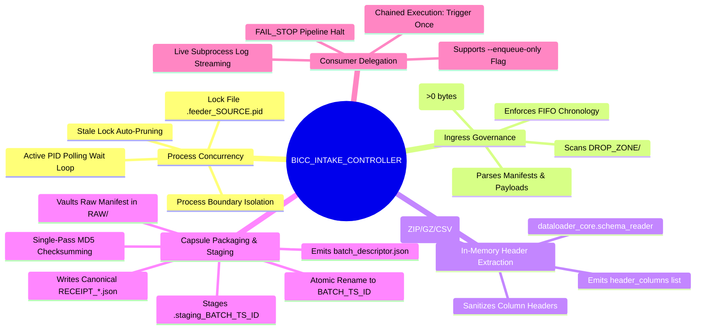
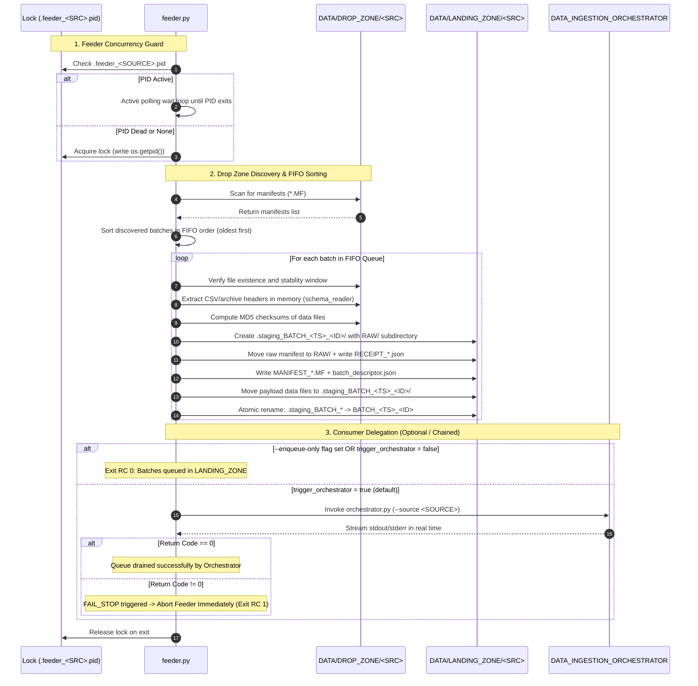

# BICC_INTAKE_CONTROLLER - Functional Specification

## 1. Business & Functional Objective

The **BICC_INTAKE_CONTROLLER** serves as the intake gateway for the **DATA_LOADER** flat-file ELT ecosystem feeding Teradata Vantage from **Oracle Fusion Cloud BICC (Business Intelligence Cloud Connector)** extracts.

### Upstream Context
Oracle Fusion Cloud BICC exports data asynchronously in batches consisting of:
- A manifest metadata file indicating the export timestamp and declared payload files.
- One or more data extract files (formatted as `.csv`, `.pecsv`, `.zip`, or `.gz`), which may be chunked into multiple parts.
- Active Keys extracts (`.pecsv`), representing primary keys of active records for change data capture.

### Problem Addressed & Decoupled Pluggable Architecture (Phases 03 & 04)
Upstream cloud extracts often arrive with variable delays, partial multi-file uploads, and multiple batches arriving out of order. Ingestion directly into high-speed utility loaders (like Teradata TPT) without strict ingress governance risks:
- Ingesting partial or in-flight uploads.
- Inverting batch chronology (processing a newer batch before an older batch), violating temporal consistency.
- Premature DDL mutations altering tables actively in use by running ingestion pipelines.
- Partial artifacts left in archive zones when loads fail.

Under the **Pluggable Intake Architecture (Phase 04)**, `BICC_INTAKE_CONTROLLER` delegates core intake mechanics to `dataloader_core.intake.BaseIntakeController` and `BICCIntakePlugin`. It acts as a **pure flat-file intake producer with zero Teradata database dependency**. Target table DDL (Just-In-Time Schema Guard), state tracking (`BATCH_RUNS` / `BATCH_TASKS`), in-flight crash recovery, and post-ingestion workflows are strictly relocated to `DATA_INGESTION_ORCHESTRATOR`. Custom or non-BICC sources can be plugged seamlessly using alternative plugins (`StandardManifestIntakePlugin`, `ManifestlessDropIntakePlugin`, or custom implementations).

---

## 2. Core Functional Responsibilities



### What the Controller Does:
- **Enforces Process Mutual Exclusion**: Manages `.feeder_<SOURCE>.pid` inside `DATA/DROP_ZONE/<SOURCE>/` to prevent simultaneous feeder executions on the same source partition.
- **Discovers** incoming manifest files matching standard or legacy BICC naming patterns in `DATA/DROP_ZONE/<SOURCE>/`. Any unpartitioned files at the root of `DROP_ZONE/` are strictly ignored.
- **Extracts** batch IDs and export timestamps from manifest names or declared payload names.
- **Enforces FIFO chronology**: Organizes multi-batch queues in ascending chronological order (`oldest -> newest`).
- **Validates payload stability**: Ensures all manifested files exist, are $>0$ bytes, and have static file sizes over a configurable settling window.
- **Performs zero-disk header inspection**: Reads header lines directly from `.zip`, `.gz`, `.csv`, or `.pecsv` in memory via `dataloader_core.schema_reader`.
- **Calculates single-pass MD5 checksums**: Hashes all payload files once during intake.
- **Packages Batch Capsules**: Assembles `.staging_BATCH_<CLEAN_TS>_<BATCH_ID>/` containing:
  - Standardized manifest `MANIFEST_<SOURCE>_<TS>_<BATCH_ID>.MF`
  - Canonical `batch_descriptor.json` with pre-extracted columns and file metadata
  - `RAW/` directory containing the pristine raw BICC manifest and audit receipt `RECEIPT_<SOURCE>_<TS>_<BATCH_ID>.json`
  - Payload data files moved from `DROP_ZONE/<SOURCE>/`
- **Publishes capsules atomically**: Performs atomic directory rename (`.staging_BATCH_*` -> `BATCH_*`) into `DATA/LANDING_ZONE/<SOURCE>/`.
- **Supports Decoupled & Chained Execution**: Operates in `--enqueue-only` mode (intake producer only) or chained mode (triggers `DATA_INGESTION_ORCHESTRATOR` once to drain the FIFO queue).
- **Enforces FAIL_STOP policy**: When chained to the Orchestrator, halts immediately if any batch returns a non-zero exit code.

### What the Controller Does NOT Do:
- Does NOT connect to Teradata Vantage or import `teradatasql` (zero database dependency).
- Does NOT execute DDL or modify Teradata tables (relocated to Orchestrator JIT Schema Guard).
- Does NOT inspect `LOADING_ZONE` or `.orchestrator.pid` (Orchestrator manages its own workspace).
- Does NOT query or mutate Teradata `BATCH_RUNS` or `BATCH_TASKS` tables.
- Does NOT write directly to `ARCHIVE_ZONE` (capsules reside in `LANDING_ZONE` until Orchestrator archives them).
- Does NOT execute or generate `POST_TASKS_*.json` files (post-tasks are defined in Orchestrator configuration).

---

## 3. End-to-End Processing Lifecycle & Sequence



---

## 4. Ingestion Contracts & Data Rules

### 4.1 Manifest Format Recognition
The controller supports standard and historical Oracle BICC manifest naming patterns:

| Pattern Type | Filename Pattern | Example |
|---|---|---|
| **Standard Manifest** | `MANIFEST_<SOURCE>_<TIMESTAMP>_<BATCH_ID>.MF` | `MANIFEST_ORACLE_FUSION_20261015_120011_000000011.MF` |
| **BICC Timestamped** | `*MANIFEST-YYYYMMDD_HHMMSS.MF` | `DT2_MANIFEST-20261013_131116.MF` |
| **Legacy Raw BICC** | `MANIFEST-batch<ID>-.MF` | `MANIFEST-batch558766085-.MF` |
| **Single-Token** | `MANIFEST_<TOKEN>.MF` | `MANIFEST_1001.MF` |

### 4.2 Batch ID & Timestamp Extraction
If a manifest filename does not embed the batch ID (e.g. `MANIFEST-20261015_120012.MF`), the scanner inspects declared payload filenames:
```
file_invoiceheaderextractpvo-batch000000012-20261015_120012.zip
```
The regex `-batch([A-Za-z0-9_-]+?)-` extracts `000000012` as the authoritative Batch ID.

### 4.3 FIFO Chronological Queue Sorting
When upstream systems transfer multiple batches at once, `sort_batches_fifo()` computes a deterministic tuple key:
```python
sort_key = (timestamp_float, batch_id)
```
Batches are sorted strictly in ascending order. Batch `N` is fully assembled and queued before Batch `N+1` is staged.

---

## 5. In-Memory Header Inspection & Batch Descriptor

### 5.1 In-Memory Header Streaming
To avoid wasteful disk writes on massive compressed archives, `dataloader_core.schema_reader` streams the header line directly from memory:
- **ZIP Archives**: Uses Python's `zipfile.ZipFile` with memory buffer read.
- **GZIP Archives**: Uses `gzip.open` with streaming text reader.
- **PECSV Support**: Inspects `.pecsv` files containing active key records.

### 5.2 Header Sanitation Rules
CSV column headers are sanitized into strict Teradata uppercase identifiers:
- Whitespace and surrounding quotes are stripped.
- Non-alphanumeric characters are converted to single underscores (`_`).
- Consecutive underscores are deduplicated.
- Output is uppercase (e.g. `"Invoice Number (#)"` $\rightarrow$ `INVOICE_NUMBER`).

### 5.3 Batch Descriptor Serialization
The extracted header columns, file sizes, and MD5 hashes are compiled into `batch_descriptor.json`:
```json
{
  "schema_version": "1.0",
  "batch_id": "9001",
  "source": "ORACLE_FUSION",
  "extract_timestamp_raw": "20261016_100000",
  "extract_timestamp_iso": "2026-10-16 10:00:00",
  "intake_timestamp_iso": "2026-10-16 10:00:05",
  "standardized_manifest": "MANIFEST_ORACLE_FUSION_20261016_100000_9001.MF",
  "raw_manifest": "RAW/MANIFEST-batch9001-.MF",
  "receipt_file": "RAW/RECEIPT_ORACLE_FUSION_20261016_100000_9001.json",
  "entities": {
    "ERP_MSH_USER": {
      "target_table": "ERP_MSH_USER",
      "signature": "userpvo",
      "extension": ".csv",
      "inner_extension": ".csv",
      "header_columns": ["USER_ID", "USER_NAME"],
      "files": [
        {
          "filename": "file_userpvo-batch9001-.csv",
          "filesize_bytes": 1048576,
          "md5": "3a742629d08dcb9ed4c588929e96e080"
        }
      ]
    }
  }
}
```

---

## 6. Failure Semantics & Integrity Guarantees

### 6.1 FAIL_STOP Policy
The controller enforces a strict **`FAIL_STOP`** contract:
- If a data file fails stability or existence checks, the pipeline halts immediately.
- If the downstream Orchestrator exits with code $>0$, the controller terminates immediately with exit code `1`.
- Remaining batches in `DROP_ZONE` are left untouched to prevent newer data from being loaded ahead of failed older data.

### 6.2 Raw Manifest Vaulting & Canonical Receipts
The raw manifest is preserved permanently inside the Batch Capsule:
```
LANDING_ZONE/<SOURCE>/BATCH_<TS>_<ID>/RAW/
```
Along with a canonical intake receipt audit document `RECEIPT_<SOURCE>_<EXTRACT_TIMESTAMP>_<BATCH_ID>.json` recording:
- Extraction timestamp, Batch ID, and Source system.
- Intake timestamp.
- File sizes in bytes.
- Cryptographic MD5 checksums.
- Target staging table and deferred schema action (`DEFERRED_TO_ORCHESTRATOR`).

### 6.3 Single-Flight Process Concurrency & Active Polling Loop
- Feeder uses `.feeder_<SOURCE>.pid` inside `DROP_ZONE/<SOURCE>/` to guarantee that only one controller executes per source partition.
- If another process PID is active, the feeder enters an active polling wait loop (`poll_interval_seconds: 5`), logging progress until the running instance completes.
- Stale locks from terminated processes are detected and cleared automatically.
- Upon normal or abnormal termination, a process lock cleanup handler unlinks the PID lock file.

### 6.4 Multi-Source Partition Isolation
All storage tiers (`DROP_ZONE`, `LANDING_ZONE`, and `LOGS`) are partitioned by source system code. Simultaneous executions for different sources operate in total physical and logical isolation without mutual interference.
