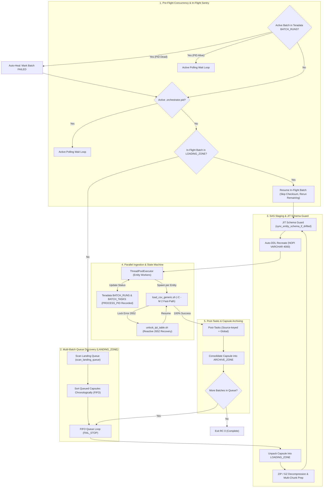

# DATA_INGESTION_ORCHESTRATOR - User How-To & Configuration Guide

## 1. Overview & Operational Role

The **DATA_INGESTION_ORCHESTRATOR** (`orchestrator.py`) is the Tier-2 engine supervisor of the `DATA_LOADER` framework. It implements a **Multi-Batch FIFO Queue Consumer** (with backward compatibility for single-batch flat manifests): it drains 1..N queued Batch Capsules from `LANDING_ZONE/<SOURCE>/` in chronological FIFO order, performs fast-path $O(1)$ size validation, executes Just-In-Time (JIT) Schema Guard DDL synchronization, manages parallel entity loading via TPT fast-path (`-C -M 2`), executes source-keyed and global post-tasks, and archives consolidated Batch Capsules into `ARCHIVE_ZONE`.



---

## 2. Prerequisites & Environment Setup

### 2.1 Dependencies
- **Python**: Python 3.8+ (standard library: `concurrent.futures`, `json`, `argparse`, `shutil`, `zipfile`, `gzip`, `hashlib`, `atexit`, `subprocess`).
- **Core SDK**: `COMMON/dataloader_core` (`ConfigLoader`, `ProcessLock`, `TeradataConnectionManager`, `EntityMapper`, `ManifestHandler`, `CapsulePathResolver`, `LoggingFactory`, `schema_reader`).
- **Teradata Driver**: `teradatasql` (for state tracking against `${TDENV}SIDFINTCH` and catalog inspection on `DBC.ColumnsV`).
- **TPT Loader**: Executable bash script `TPT_LOADER/load_csv_generic.sh`.
- **Teradata TTU**: `tbuild` and `bteq` available on the system `$PATH`.

### 2.2 Unix Environment Variables
The orchestrator leverages the standard profile exports:
```bash
export TDENV="DEV0"
export TDPID="tdadev"
export SID_ADM_USER="SIDFINADM"
export LANG="C"
```

---

## 3. Command-Line Syntax & Execution

### 3.1 Invocation Syntax
```bash
python3 orchestrator.py --config <path_to_config.json> [--skip-post-tasks] [--source <SOURCE>] [--sources <S1,S2>] [--all-sources] [--post-tasks-file <FILE>]
```

| Parameter | Required | Type | Description |
|---|---|---|---|
| `--config` | **Yes** | String | Path to the orchestrator JSON configuration file. |
| `--skip-post-tasks` | No | Flag | Bypasses all post-ingestion tasks (both source-specific and global dbt/analytics models). |
| `--source` | No | String | Single source partition code (e.g. `ORACLE_FUSION`, `CRM`). Dynamically partitions `LANDING_ZONE`, `LOADING_ZONE`, `ARCHIVE_ZONE`, and `LOGS`. |
| `--sources` | No | String | Comma-separated list of sources to process sequentially (e.g. `ORACLE_FUSION,CRM,ERP`). |
| `--all-sources` | No | Flag | Automatically scans `LANDING_ZONE` and processes queued capsules across all discovered source partitions. |
| `--post-tasks-file` | No | String | Path to an external JSON file containing source-specific post-tasks. Merged with source and global tasks. |

### 3.2 Execution Modes

#### Multi-Batch FIFO Queue Execution (Single Source)
The orchestrator scans `LANDING_ZONE/<SOURCE>/` for 1..N queued Batch Capsules (`BATCH_<CLEAN_TS>_<BATCH_ID>/`), orders them chronologically (FIFO), and processes each to completion sequentially:
```bash
cd /sg/local/sid/home/Dsidadm/DATA_LOADER/PROCESSING_TOOLS/DATA_INGESTION_ORCHESTRATOR
python3 orchestrator.py --config config.json --source ORACLE_FUSION
```
If 3 batches are queued (`BATCH_20261016_080000_1001`, `BATCH_20261016_090000_1002`, `BATCH_20261016_100000_1003`), the orchestrator ingests Batch 1001, executes its post-tasks, archives its capsule, and automatically advances to Batch 1002, then 1003.

#### Multi-Source Queue Execution (`--all-sources` / `--sources`)
To drain queued capsules across multiple source directories in a single command:
```bash
# Process all active sources in LANDING_ZONE:
python3 orchestrator.py --config config.json --all-sources

# Process selected sources:
python3 orchestrator.py --config config.json --sources CRM,ORACLE_FUSION
```
Each source executes in its own partitioned lifecycle while sharing the global Teradata utility slot pool.

#### Automated In-Flight Crash Resumption
If a previous execution was interrupted while files were inside `LOADING_ZONE/<SOURCE>` (e.g. server reboot or system kill), executing `orchestrator.py` immediately discovers the uncompleted batch and resumes from the point of failure:
```bash
python3 orchestrator.py --config config.json --source ORACLE_FUSION
```
During in-flight recovery:
- Checksum validation is bypassed (`verify_checksum = False`), preventing false failures on already decompressed archives or files with Chunk 1 headers already stripped.
- The state database queries `BATCH_TASKS` for tasks that are still `PENDING` or `FAILED`.
- Only uncompleted entities are dispatched to TPT workers, avoiding duplicate row loading.
- Once recovered and archived, the orchestrator continues draining any remaining queued batches in `LANDING_ZONE`.

#### Selective Ingestion Run (Post-Tasks Bypassed)
Run Orchestrator directly on staged batches in `LANDING_ZONE` while skipping post-load hooks:
```bash
python3 orchestrator.py --config config.json --skip-post-tasks --source ORACLE_FUSION
```

---

## 4. Configuration Reference (`config.json`)

### 4.1 Production Configuration Schema
```json
{
  "teradata": {
    "host": "${TDPID}",
    "user": "${TDENV}${SID_ADM_USER}",
    "technical_database": "${TDENV}SIDFINTCH",
    "logmech": "TD2",
    "connection_pool_size": 6
  },
  "tpt": {
    "wrapper_script": "../TPT_LOADER/load_csv_generic.sh",
    "unlock_script": "../TPT_LOADER/unlock_tpt_table.sh",
    "default_load_mode": "replace",
    "target_db": "${TDENV}SIDFINSTG",
    "work_db": "${TDENV}SIDFINWRK",
    "timeout_seconds": 3600
  },
  "orchestration": {
    "landing_zone": "../../DATA/LANDING_ZONE",
    "loading_zone": "../../DATA/LOADING_ZONE",
    "archive_zone": "../../DATA/ARCHIVE_ZONE",
    "logs_dir": "../../LOGS",
    "entity_mapping_file": "../../CONFIG/entity_mapping.csv",
    "max_concurrent_jobs": 4,
    "max_global_utility_slots": 8,
    "manifest_pattern": "MANIFEST_*.MF",
    "manifest_regex": "^MANIFEST_([A-Za-z0-9_]+)_(\\d{8}_\\d{6})_([A-Za-z0-9_-]+)\\.MF$",
    "verify_checksum": true,
    "allow_orphan_files": false,
    "auto_migrate_ddl": true,
    "character_set": "UNICODE",
    "concurrency": {
      "poll_interval_seconds": 5,
      "lock_timeout_seconds": 7200
    },
    "post_ingestion_tasks": {
      "ORACLE_FUSION": [
        {
          "type": "shell",
          "command": "echo 'Source post-task completed for batch $CURRENT_BATCH_ID from source $CURRENT_SOURCE'"
        }
      ],
      "default": [
        {
          "type": "shell",
          "command": "echo 'Global post-task completed for batch $CURRENT_BATCH_ID'"
        }
      ]
    }
  }
}
```

### 4.2 Parameter Specification

#### `orchestration` Block
| Parameter | Type | Default | Description |
|---|---|---|---|
| `landing_zone` | String | `../../DATA/LANDING_ZONE` | Multi-batch ingress queue containing `BATCH_<TS>_<ID>/` capsules (or legacy flat manifests). |
| `loading_zone` | String | `../../DATA/LOADING_ZONE` | Private staging directory where active capsule is unpacked, decompressed, and prepared. |
| `archive_zone` | String | `../../DATA/ARCHIVE_ZONE` | Final batch capsule archive destination (`ARCHIVE_ZONE/<SOURCE>/<YYYY-MM>/BATCH_<ID>_<TS>/`). |
| `logs_dir` | String | `../../LOGS` | Log directory (partitioned into `LOGS/<SOURCE>/`). |
| `entity_mapping_file` | String | `../../CONFIG/entity_mapping.csv` | File routing CSV mapping file signatures to target staging tables. |
| `max_concurrent_jobs` | Integer | `4` | Number of parallel worker threads executing TPT concurrently within this orchestrator (`ThreadPoolExecutor`). |
| `max_global_utility_slots` | Integer | `8` | Maximum concurrent Teradata load utility sessions allowed across all orchestrators and sources, governed via `UtilitySlotGovernor`. |
| `manifest_pattern` | String | `MANIFEST_*.MF` | Wildcard pattern used to locate incoming manifests in `LANDING_ZONE`. |
| `manifest_regex` | String | `^MANIFEST_...` | Regex capturing `(SOURCE)_(TIMESTAMP)_(BATCH_ID)` from manifest filenames. |
| `verify_checksum` | Boolean | `true` | When `true`, validates payload files against `batch_descriptor.json` file size ($O(1)$) or MD5 manifest. Automatically disabled during in-flight recovery. |
| `allow_orphan_files` | Boolean | `false` | When `false` (OPS-01 invariant), rejects batches if unmanifested files exist. |
| `auto_migrate_ddl` | Boolean | `true` | Enables JIT Schema Guard Auto-DDL in `replace` mode when target table is missing or columns drift. |
| `character_set` | String | `UNICODE` | Character set for Auto-DDL generated columns (`UNICODE` or `LATIN`). |
| `concurrency.poll_interval_seconds` | Integer | `5` | Polling interval in seconds when waiting for active Orchestrator runs or active Teradata batches to release. |
| `concurrency.lock_timeout_seconds` | Integer | `7200` | Maximum wait timeout (seconds) before aborting if another process remains active. |
| `post_ingestion_tasks` | Dict / List | `{}` | Source-keyed dictionary (`"ORACLE_FUSION": [...], "default": [...]`) or list of tasks executed after 100% entity success. |

#### `tpt` Block
| Parameter | Type | Default | Description |
|---|---|---|---|
| `wrapper_script` | String | `../TPT_LOADER/load_csv_generic.sh` | Path to generic TPT runner script. Passed `-C -M 2` by orchestrator. |
| `unlock_script` | String | `../TPT_LOADER/unlock_tpt_table.sh` | Path to table unlock script (Error 2652). |
| `default_load_mode` | String | `replace` | Ingestion mode: `replace` (FastLoad DELETE ALL) or `append` (MultiLoad). |
| `target_db` | String | `${TDENV}SIDFINSTG` | Target staging database. |
| `work_db` | String | `${TDENV}SIDFINWRK` | Database for TPT utility tables (`LG_`, `ET_`, `UV_`, `WT_`). |
| `timeout_seconds` | Integer | `3600` | Timeout in seconds for individual TPT child processes. |

#### `teradata` Block
| Parameter | Type | Default | Description |
|---|---|---|---|
| `host` | String | `${TDPID}` | Teradata Vantage host / TDPID. |
| `user` | String | `${TDENV}${SID_ADM_USER}` | Technical user login. |
| `technical_database` | String | `${TDENV}SIDFINTCH` | Technical metadata database hosting `BATCH_RUNS` and `BATCH_TASKS`. |
| `logmech` | String | `TD2` | Teradata authentication mechanism. |
| `connection_pool_size` | Integer | `6` | Thread-safe connection pool size managed by `TeradataConnectionManager`. |

### 4.3 Extended Entity Mapping Catalog (`entity_mapping.csv`)

The orchestrator dynamically routes incoming files to target staging tables using [`CONFIG/entity_mapping.csv`](../../CONFIG/entity_mapping.csv). Under the Phase 04 extended specification, each entity can independently configure its delimiter, load mode, and header handling, eliminating hardcoded assumptions while maintaining 100% backward compatibility with legacy 5-column files:

| Column | Status | Default When Omitted | Purpose / Options |
|---|---|---|---|
| `SOURCE` | **Required** | — | Upstream source code (`ORACLE_FUSION`, `CRM`, etc.) or `*` for all. |
| `TARGET_TABLE` | **Required** | — | Staging table name in `${TDENV}SIDFINSTG`. |
| `FILE_SIGNATURE` | **Required** | — | Substring signature matched against incoming filenames (e.g. `userpvo`). |
| `EXTENSION` | Optional | `.csv` | Comma-separated list of outer extensions (e.g. `".csv,.zip,.gz,.csv.gz"`). |
| `INNER_EXTENSION` | Optional | `.csv` | Inner file extension inside archives (`.csv`, `.pecsv`). |
| `DELIMITER` | Optional | `,` | Field delimiter passed to TPT via `-s` (e.g. `,`, `;`, `\|`, `\t`). |
| `LOAD_MODE` | Optional | `replace` | Ingestion mode: `replace` (FastLoad) or `append` (MultiLoad). |
| `SKIP_ROWS` | Optional | `1` | Header lines to skip for single-file loads (passed to TPT via `-S`). |
| `HEADER_MODE` | Optional | `first_chunk_only` | Multi-chunk header strategy:<br/>- `first_chunk_only`: BICC Solution A (strips chunk 1 header, TPT skips 0, `-Y N`).<br/>- `every_file`: Preserves all headers, instructs TPT to skip headers natively (`-S <skip_rows> -Y Y`).<br/>- `none`: Headless files, loads data without skipping (`-S 0 -Y N`). |

---

## 5. Monitoring & Operational Inspection

### 5.1 Batch Log Capsule Naming Convention
Every batch execution cycle writes directly to its dedicated Batch Log Capsule:
```
../../LOGS/<SOURCE>/<YYYY-MM>/BATCH_<ID>_<TS>/LOG_ORCHESTRATOR_<SOURCE>_<EXTRACT_TS>_<BATCH_ID>_<EXEC_TS>.log
```
TPT worker artifacts and tbuild logs are isolated inside the `TPT/` subfolder:
```
../../LOGS/<SOURCE>/<YYYY-MM>/BATCH_<ID>_<TS>/TPT/TPT_<TARGET_TABLE>_<RUN_TS>/
```

### 5.2 Tracking State in Teradata
Query the central technical catalog in `${TDENV}SIDFINTCH`:

```sql
-- Check Batch Run status and Process PID audit
SELECT BATCH_ID, SOURCE, EXTRACT_TIMESTAMP, RUN_DATE, START_TIME, END_TIME, STATUS, PROCESS_PID
FROM DEV0SIDFINTCH.BATCH_RUNS
ORDER BY RUN_DATE DESC, START_TIME DESC;

-- Check Entity Task status and retry history
SELECT BATCH_ID, SOURCE, ENTITY_NAME, FILE_NAME, STATUS, START_TIME, END_TIME, RETRY_COUNT, ERROR_MESSAGE
FROM DEV0SIDFINTCH.BATCH_TASKS
WHERE BATCH_ID = '000000011'
ORDER BY START_TIME ASC;
```

---

## 6. Troubleshooting Runbook

### Failure Mode 1: Boundary Violation (OPS-01) - Unmanifested Files
- **Symptom**:
  ```text
  ValueError: Boundary violation (OPS-01): Unmanifested orphan file(s) found in landing zone: ['stray_file.csv']
  ```
- **Root Cause**: A data file exists in `LANDING_ZONE` that is not declared in the manifest.
- **Resolution**:
  1. Inspect `LANDING_ZONE/<SOURCE>/` for unmanifested files:
     ```bash
     ls -la /sg/local/sid/home/Dsidadm/DATA_LOADER/DATA/LANDING_ZONE/<SOURCE>/
     ```
  2. If the orphan file belongs to the batch, update the manifest in `DROP_ZONE/<SOURCE>/` and re-run.
  3. If it is an accidental stray file, quarantine it:
     ```bash
     mv /sg/local/sid/home/Dsidadm/DATA_LOADER/DATA/LANDING_ZONE/<SOURCE>/stray_file.csv /tmp/quarantine/
     ```

---

### Failure Mode 2: Teradata Table Locked (Error 2652)
- **Symptom**:
  ```text
  TPT Job failed with error 2652: Operation not allowed: table is being Loaded / Paused.
  ```
- **Automated Behavior**: The orchestrator automatically invokes `unlock_tpt_table.sh -t <TABLE> -m <MODE> -B <BATCH_ID> -T <EXTRACT_TS>` and retries the entity task up to `max_retries_per_entity`.
- **Manual Resolution (if retries exhausted)**:
  Run the unlock tool directly:
  ```bash
  cd /sg/local/sid/home/Dsidadm/DATA_LOADER/PROCESSING_TOOLS/TPT_LOADER
  ./unlock_tpt_table.sh -t ERP_MSH_INVOICE_HEADER -m replace -d DEV0SIDFINSTG -u DEV0SIDFINADM -B <BATCH_ID> -T <EXTRACT_TS>
  ```

---

### Failure Mode 3: Schema Drift with Auto-DDL Disabled or Append Mode
- **Symptom**:
  ```text
  SchemaSyncError: Schema drift detected on ERP_AP_INVOICES but auto_migrate_ddl is False
  - OR -
  SchemaSyncError: Cannot auto-migrate schema in append mode for table ERP_AP_INVOICES
  ```
- **Root Cause**: Upstream source added or removed columns, but destructive DDL is blocked to protect existing historical data.
- **Resolution**:
  1. Review the column difference logged in the Orchestrator log.
  2. Perform an explicit `ALTER TABLE` in Teradata Staging database to add the required column(s).
  3. Re-run `orchestrator.py`.

---

### Failure Mode 4: Checksum or File Size Mismatch
- **Symptom**:
  ```text
  ValueError: Checksum mismatch for 'file_userpvo-batch000000011.csv': expected 3a7426..., computed cb4d70...
  ```
- **Root Cause**: The file was corrupted during transit, or modified after manifest generation.
- **Resolution**:
  1. The orchestrator halts immediately before executing any TPT jobs or touching the target database (**FAIL_STOP**).
  2. Verify source file integrity in the Batch Capsule raw vault (`ARCHIVE_ZONE/<SOURCE>/<YYYY-MM>/BATCH_<ID>_<TS>/RAW/`) or re-extract from upstream source.

---

### Failure Mode 5: Orchestrator Process Lock Active (`.orchestrator.pid`)
- **Symptom**:
  ```text
  Another Orchestrator run is actively in progress (PID 18241). Entering active waiting loop (polling every 5s, timeout: 7200s)...
  Orchestrator PID 18241 still running. Waiting 5s...
  ```
- **Root Cause**: Another orchestrator instance is currently operating inside `LOADING_ZONE/<SOURCE>`.
- **Behavior**: The process waits safely for the active run to finish. If the active PID dies unexpectedly, the stale lock is cleared and processing resumes.

---

### Failure Mode 6: Active Teradata Batch Sentry (`BATCH_RUNS`)
- **Symptom**:
  ```text
  Active batch 9005 detected in BATCH_RUNS with running PID 19120. Entering active waiting loop...
  ```
- **Root Cause**: A previous batch is still marked `STATUS = 'RUNNING'` in Teradata with an active PID.
- **Behavior**: Orchestrator polls until the prior batch finishes. If the PID is dead, it reclassifies the batch as `FAILED` and proceeds.
