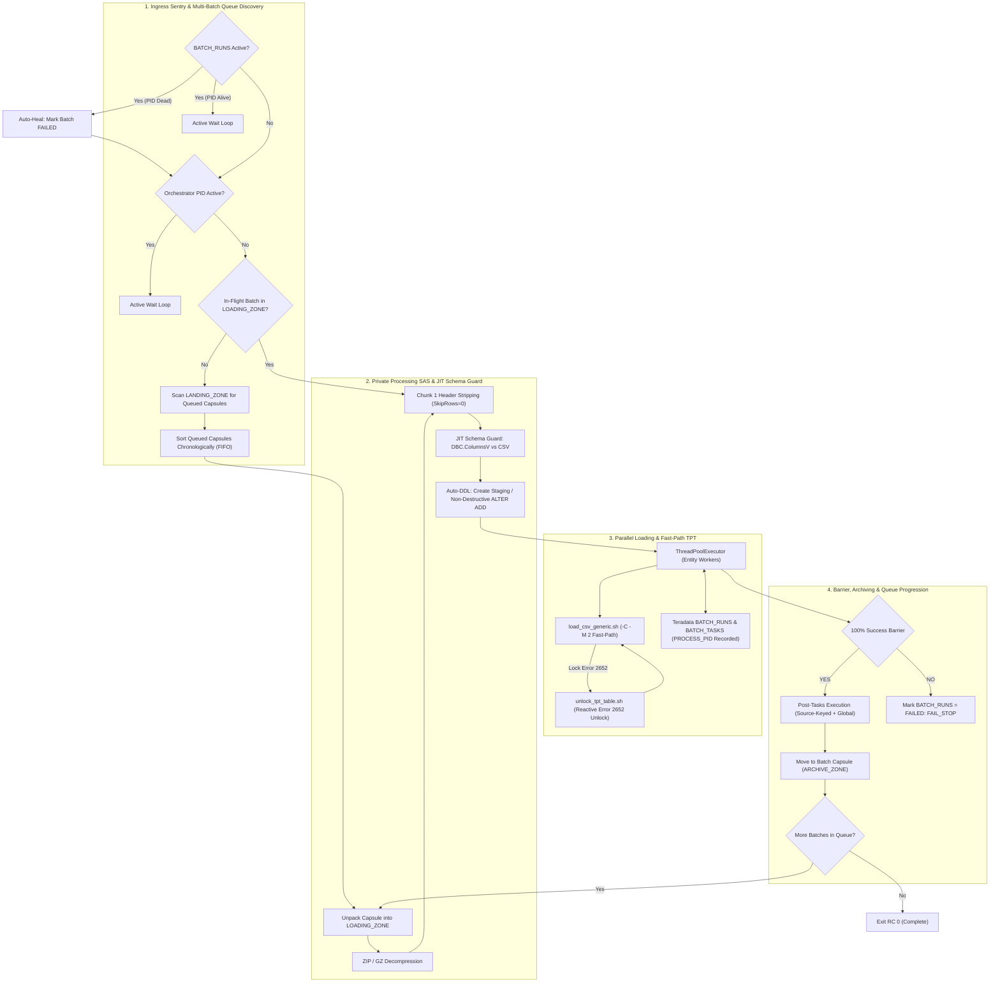
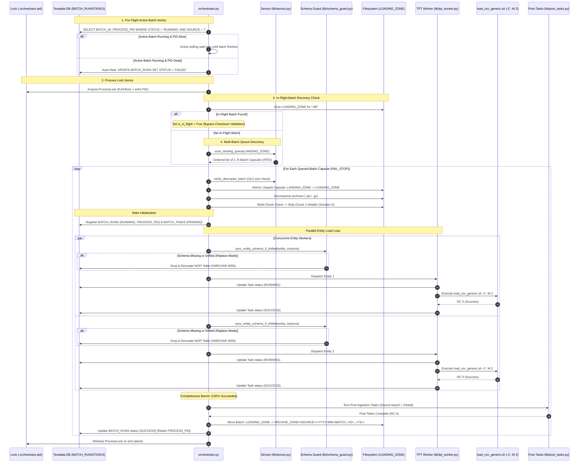

# DATA_INGESTION_ORCHESTRATOR - Functional Specification

## 1. Business & Functional Objective

The **DATA_INGESTION_ORCHESTRATOR** serves as the Tier-2 ingestion engine for the **DATA_LOADER** flat-file ELT ecosystem feeding Teradata Vantage.

### System Purpose
The orchestrator bridges upstream intake preparation (`BICC_INTAKE_CONTROLLER`) with high-speed Teradata utility loaders (`TPT_LOADER`). It operates as a **Multi-Batch FIFO Queue Consumer**: it ingests 1..N queued Batch Capsules per execution cycle in strict chronological ascending order, guaranteeing chronological data isolation, fast-path $O(1)$ batch descriptor verification, Just-In-Time (JIT) Schema Guard DDL synchronization, deterministic crash resumption, and granular state tracking in Teradata Vantage.



---

## 2. Core Functional Responsibilities

### What the Orchestrator Does:
1. **Multi-Batch FIFO Queue Consumption (OPS-01)**:
   - Scans `LANDING_ZONE/<SOURCE>/` for 1..N queued Batch Capsules (`BATCH_<CLEAN_TS>_<BATCH_ID>/`) and legacy flat manifests.
   - Orders batches in ascending chronological order (`extract_timestamp`, then `batch_id`).
   - Iterates through batches sequentially, enforcing **`FAIL_STOP`**: any failure in batch $N$ halts queue processing immediately to prevent out-of-order data corruption.
2. **Fast-Path $O(1)$ Batch Descriptor Verification**:
   - Inspects `batch_descriptor.json` staged within the Batch Capsule to verify file sizes and presence in $O(1)$ time, bypassing redundant cryptographic hashing across large datasets unless explicitly requested.
3. **Just-In-Time (JIT) Schema Guard & Auto-DDL**:
   - Inspects target staging tables in `DBC.ColumnsV` right before entity loading.
   - Compares CSV columns against existing table definitions.
   - If missing or schema drifted and `auto_migrate_ddl = true` in `replace` mode, automatically drops and recreates the target table in `NOPI` with all payload columns as `VARCHAR(4000) CHARACTER SET <UNICODE|LATIN> NOT CASESPECIFIC` plus audit metadata (`INFA_LAST_REPLICATED`, `INFA_BATCH_ID`).
   - Strictly blocks destructive DDL when `auto_migrate_ddl = false` or `load_mode = 'append'`, raising `SchemaSyncError`.
4. **Fast-Path TPT Execution**:
   - Dispatches `load_csv_generic.sh` with `-C` (`SKIP_BTEQ_CHECK`) and `-M 2` (`HAS_META = 2`) to bypass redundant BTEQ pre-checks and enable in-memory audit metadata padding during TPT streaming.
5. **Single-Flight Process Concurrency**:
   - Manages `.orchestrator.pid` in `LOADING_ZONE/<SOURCE>` and queries `${TDENV}SIDFINTCH.BATCH_RUNS` to guarantee that only one orchestrator process loads data for a given source at any moment.
6. **Automated In-Flight Crash Resumption**:
   - Detects uncompleted batches in `LOADING_ZONE/<SOURCE>` from crashed runs, bypasses checksum re-verification, resumes only pending/failed tasks, and completes the lifecycle through archiving.
7. **Zero Unmanifested Orphans (OPS-02)**:
   - Enforces that all payload files inside the capsule or landing directory match the manifest. Rejects undeclared files.
8. **Multi-Chunk Header Normalization & Per-Entity Ingestion Schema**:
   - Leverages the extended 9-column [`CONFIG/entity_mapping.csv`](../../CONFIG/entity_mapping.csv) catalog (`SOURCE, TARGET_TABLE, FILE_SIGNATURE, EXTENSION, INNER_EXTENSION, DELIMITER, LOAD_MODE, SKIP_ROWS, HEADER_MODE`).
   - For BICC Solution A (`header_mode = 'first_chunk_only'`), when an entity consists of multiple chunk files (e.g. `part1.csv`, `part2.csv`), it strips the header from Chunk 1 in-place, writes an idempotent `.<file>.header_stripped` marker, and invokes TPT with wildcard pattern and `SkipRows = 0`. Single-file entities retain their headers and load with `SkipRows = 1`.
   - Supports alternative modes configured via `entity_mapping.csv`: `every_file` (preserves all headers and passes `-S <skip_rows> -Y Y` to TPT) and `none` (headless data files passing `-S 0 -Y N`).
   - Supports per-entity delimiters (e.g., `,`, `;`, `|`, `\t`) passed via `-s` to TPT and per-entity load modes (`replace` / `append`) passed via `-m`.
9. **State Machine Management**:
   - Tracks batch lifecycle in Teradata Vantage tables (`${TDENV}SIDFINTCH.BATCH_RUNS` and `BATCH_TASKS`), permanently recording and retaining `PROCESS_PID` upon completion.
10. **Parallel Worker Execution & Global Workload Governance**:
    - Dispatches entity loading tasks concurrently using `ThreadPoolExecutor`.
    - Bounds concurrent Teradata FastLoad and MultiLoad utility sessions across all orchestrators and sources using `dataloader_core.locking.UtilitySlotGovernor` (`max_global_utility_slots`, default 8), eliminating Teradata Error 2633 (*Too many load tasks*).
11. **Reactive Lock Recovery**:
    - Automatically recovers from Teradata Error 2652 (FastLoad/MultiLoad paused) via `unlock_tpt_table.sh`.
12. **100% Completeness Barrier**:
    - Requires every entity task to succeed before triggering downstream post-tasks or archiving.
13. **Source-Keyed Post-Tasks Execution**:
    - Executes source-specific (`post_ingestion_tasks[source]`) and global (`post_ingestion_tasks["default"]`) tasks, injecting batch context environment variables (`CURRENT_BATCH_ID`, `CURRENT_SOURCE`, `CURRENT_TIMESTAMP`, `TDENV`).
14. **Consolidated Batch Capsule Archiving**:
    - Archives data files, standardized manifest, `batch_descriptor.json`, and raw vaulting receipt into `ARCHIVE_ZONE/<SOURCE>/<YYYY-MM>/BATCH_<ID>_<TS>/`.
15. **Multi-Source Queue Orchestration (`--all-sources` / `--sources`)**:
    - Allows a single master orchestrator invocation to discover and process queued capsules across multiple or all source partitions (`ORACLE_FUSION`, `CRM`, etc.) in sequential FIFO cycles while sharing the global utility slot governor.

---

## 3. End-to-End Processing Sequence



---

## 4. Ingestion Invariants & Architectural Rules

### 4.1 Invariant OPS-01: Multi-Batch FIFO Queue Order
The orchestrator consumes batches strictly in ascending chronological order:
$$\text{Batch}_1 < \text{Batch}_2 < \dots < \text{Batch}_N \iff \text{Timestamp}_1 \le \text{Timestamp}_2$$
If multiple batches have the same timestamp, ties are broken by `batch_id`. Processing halts immediately (**FAIL_STOP**) if any batch fails, preserving chronological integrity.

### 4.2 Invariant OPS-02: Zero Unmanifested Orphans
Every file present in the batch must be explicitly declared in the manifest:
$$\text{Files}_{\text{Batch}} \setminus \{\text{Manifest}\} \subseteq \text{Files}_{\text{Manifest}}$$
If any undeclared file is detected, validation fails immediately before moving files or altering databases.

### 4.3 Invariant OPS-03: Single-Flight Process Concurrency
To eliminate race conditions and prevent concurrent TPT loads from deadlocking Teradata with Error 2652:
- Only one orchestrator may execute per source partition at any time.
- Mutual exclusion is enforced via `dataloader_core.locking.ProcessLock` (`fcntl.flock` + PID tracking) in `LOADING_ZONE/<SOURCE>/.orchestrator.pid` and `BATCH_RUNS` state checks.
- When an active run is detected, incoming processes poll every `poll_interval_seconds` (default: 5s) up to `lock_timeout_seconds` (default: 7200s).

### 4.4 Invariant OPS-04: Automated In-Flight Crash Resumption
If an orchestrator execution terminates abruptly after files have moved into `LOADING_ZONE`:
- Subsequent invocations discover the in-flight manifest in `LOADING_ZONE/<SOURCE>`.
- Checksum re-validation is skipped (`verify_checksum = False`) because archives may already be decompressed and headers stripped.
- The state database identifies already-succeeded tasks vs pending/failed tasks, resuming only incomplete work.
- Upon full completion, the in-flight batch is moved to `ARCHIVE_ZONE`, freeing `LOADING_ZONE` to resume the queued batches.

### 4.5 Invariant OPS-05: JIT Schema Guard & Non-Destructive Protection
- **Table Introspection & `has_meta` Measurement**: `get_teradata_table_columns` inspects `DBC.ColumnsV`, returning `(payload_columns, has_meta)`. If a table has only 1 audit column (e.g., `INFA_BATCH_ID` without `INFA_LAST_REPLICATED`), it raises `SchemaSyncError` immediately.
- **Non-Destructive Evolution**: `schema_guard.py` never executes `DROP TABLE`. 
  - If the table does not exist: creates a NOPI staging table with payload columns typed as `VARCHAR(4000) CHARACTER SET <UNICODE|LATIN> NOT CASESPECIFIC` plus audit columns `INFA_BATCH_ID` and `INFA_LAST_REPLICATED` (if `auto_migrate_ddl = true`).
  - If the table exists: compares CSV columns with existing columns. When new columns are appended at the end of the CSV, issues non-destructive `ALTER TABLE <table> ADD <col> VARCHAR(4000) ...` (if `auto_migrate_ddl = true`).
  - All other structural drifts (columns reordered, dropped, or modified in the middle, or any drift when `load_mode == 'append'` or `auto_migrate_ddl = false`) raise `SchemaDriftError`, halting the batch to preserve data integrity.
- **Declared Row-Size Guard**: Calculates total declared row size (`declared_row_bytes`) before creating tables or adding columns:
  - UNICODE: $4000 \times 2 = 8000$ bytes per column.
  - LATIN: $4000 \times 1 = 4000$ bytes per column.
  - Audit columns: $200 + 8 = 208$ bytes.
  - Enforces `declared_row_bytes <= max_row_bytes` (configured by `"max_row_bytes": 64000`, safe under Teradata's 64 KB block / table limit).
  - Wide PVOs with more than 7–8 UNICODE columns cannot use default `VARCHAR(4000)` auto-DDL and must have explicit, hand-written staging DDL deployed in Teradata with realistic column widths.

---

## 5. Technical Tables in Teradata (`${TDENV}SIDFINTCH`)

### `BATCH_RUNS` Table
Tracks batch-level lifecycle, execution timestamps, status, and OS Process ID:
```sql
CREATE MULTISET TABLE DEV0SIDFINTCH.BATCH_RUNS ,NO FALLBACK ,
     NO BEFORE JOURNAL,
     NO AFTER JOURNAL,
     CHECKSUM = DEFAULT,
     DEFAULT MERGEBLOCKRATIO
     (
        BATCH_ID VARCHAR(100) CHARACTER SET UNICODE NOT CASESPECIFIC NOT NULL,
        SOURCE VARCHAR(50) CHARACTER SET UNICODE NOT CASESPECIFIC NOT NULL,
        EXTRACT_TIMESTAMP VARCHAR(50) CHARACTER SET UNICODE NOT CASESPECIFIC,
        RUN_DATE DATE FORMAT 'YYYY-MM-DD',
        START_TIME TIMESTAMP(0),
        END_TIME TIMESTAMP(0),
        STATUS VARCHAR(20) CHARACTER SET UNICODE NOT CASESPECIFIC,
        PROCESS_PID INTEGER
     )
PRIMARY INDEX ( BATCH_ID ,SOURCE );
```
> [!IMPORTANT]
> `PROCESS_PID` is permanently retained upon batch completion (`SUCCESS` or `FAILED`) for historical auditing and troubleshooting.

### `BATCH_TASKS` Table
Tracks individual entity file loads, exact TPT job names, and retry attempts:
```sql
CREATE MULTISET TABLE DEV0SIDFINTCH.BATCH_TASKS ,NO FALLBACK ,
     NO BEFORE JOURNAL,
     NO AFTER JOURNAL,
     CHECKSUM = DEFAULT,
     DEFAULT MERGEBLOCKRATIO
     (
        BATCH_ID VARCHAR(100) CHARACTER SET UNICODE NOT CASESPECIFIC NOT NULL,
        SOURCE VARCHAR(50) CHARACTER SET UNICODE NOT CASESPECIFIC NOT NULL,
        EXTRACT_TIMESTAMP VARCHAR(50) CHARACTER SET UNICODE NOT CASESPECIFIC,
        ENTITY_NAME VARCHAR(100) CHARACTER SET UNICODE NOT CASESPECIFIC NOT NULL,
        FILE_NAME VARCHAR(500) CHARACTER SET UNICODE NOT CASESPECIFIC,
        STATUS VARCHAR(20) CHARACTER SET UNICODE NOT CASESPECIFIC,
        START_TIME TIMESTAMP(0),
        END_TIME TIMESTAMP(0),
        RETRY_COUNT INTEGER DEFAULT 0 ,
        ERROR_MESSAGE VARCHAR(1000) CHARACTER SET UNICODE NOT CASESPECIFIC,
        TPT_JOB_NAME VARCHAR(128) CHARACTER SET UNICODE NOT CASESPECIFIC
     )
PRIMARY INDEX ( BATCH_ID ,SOURCE );
```
