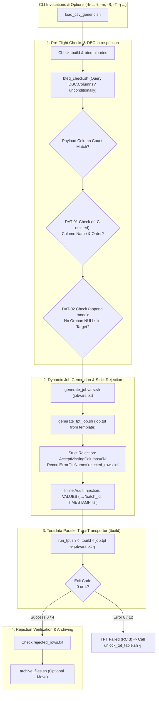

# TPT_LOADER - User How-To & CLI / Jobvars Reference

## 1. Overview & Operational Role

The **TPT_LOADER** framework (`load_csv_generic.sh`) is the Tier-3 high-performance data ingestion engine of the `DATA_LOADER` architecture. It wraps the **Teradata Parallel Transporter (`tbuild`)** utility, dynamically generating runtime schemas, enforcing pre-flight column validations, loading at wire speed via FastLoad/MultiLoad, and populating technical audit metadata inline during the load.



---

## 2. Prerequisites & Environment Setup

### 2.1 Teradata Tools and Utilities (TTU)
The following Teradata client utilities must be present on the system `$PATH`:
- `tbuild`: Teradata Parallel Transporter driver.
- `bteq`: Batch Teradata Query processor.
- `tdwallet`: Teradata secure credentials wallet (optional if `$TD_PASSWORD` is used).
- `python3`: Python 3 runtime for header extraction (`parse_header.py`).

```bash
# Verify binaries
command -v tbuild >/dev/null && echo "tbuild OK" || echo "tbuild MISSING"
command -v bteq >/dev/null && echo "bteq OK" || echo "bteq MISSING"
command -v python3 >/dev/null && echo "python3 OK" || echo "python3 MISSING"
```

### 2.2 Shell Environment Variables
The loader reads global environment settings from `/sg/local/sid/home/Dsidadm/DATA_LOADER/PROCESSING_TOOLS/TPT_LOADER/config/global.env` and user profile exports:
- `TDPID`: Teradata system name / gateway COP.
- `TDENV`: Database environment prefix (e.g. `DEV0`).
- `SID_ADM_USER`: Admin user name (e.g. `SIDFINADM`).
- `TD_USER`: Defaults to `${TD_LOGON_USER:-${TDENV}${SID_ADM_USER}}`.
- `DB_STG`: Default staging database suffix (`SIDFINSTG`).
- `DB_WRK`: Default utility work database suffix (`SIDFINWRK`).

---

## 3. Command-Line Reference

### 3.1 Syntax
```bash
./load_csv_generic.sh (-f <file|pattern> | -L <listfile>) -t <table> [options]
```

### 3.2 CLI Options Reference Table

| Flag | Argument | Default | Description |
|---|---|---|---|
| `-f` | `<path\|pattern>` | None | Data file path or quoted wildcard (e.g. `"*invoice*.csv"`). Mutually exclusive with `-L`. |
| `-L` | `<listfile>` | None | Path to a text file containing explicit absolute file paths (one per line). Mutually exclusive with `-f`. |
| `-t` | `<table>` | *Mandatory* | Target staging table name (e.g. `ERP_MSH_INVOICE_HEADER`). |
| `-m` | `replace\|append` | `replace` | Ingestion mode: `replace` (FastLoad `DELETE ALL`) or `append` (MultiLoad). |
| `-j` | `<job_name>` | `TPT_${TABLE}_${RUN_TS}` | Unique TPT job name used by `tbuild` and for lock recovery. |
| `-d` | `<database>` | `${TDENV}SIDFINSTG` | Target staging database. |
| `-k` | `<utility_db>` | `${TDENV}SIDFINWRK` | Database hosting utility tables (`LG_`, `ET_`, `UV_`, `WT_`). |
| `-u` | `<user>` | `${TD_LOGON_USER:-${TDENV}${SID_ADM_USER}}` | Teradata logon username. |
| `-s` | `<delimiter>` | `,` | Text field delimiter character. |
| `-S` | `<skip_rows>` | `1` | Number of header rows to skip (set to `0` for headless CSVs). |
| `-Y` | `<Y\|N>` | `N` | Skip header rows on every file when loading multiple files (`SkipRowsEveryFile`). |
| `-B` | `<batch_id>` | Auto-extracted | Value for `INFA_BATCH_ID` audit column. Mandatory if `HAS_META=2`. |
| `-T` | `<timestamp>` | Auto-extracted | Value for `INFA_LAST_REPLICATED` audit column (`YYYY-MM-DD HH:MM:SS`). Mandatory if `HAS_META=2`. |
| `-e` | `<error_limit>` | `1` | Max allowable rejected rows before aborting job. |
| `-r` | `<instances>` | `1` | DataConnector reader instances. |
| `-l` | `<instances>` | `1` | Load/Update operator instances. |
| `-x` | `<sessions>` | `8` | Maximum Teradata sessions for the consumer operator. |
| `-w` | `<work_dir>` | `tmp/tpt_work` | Local directory for temporary job artifacts (`jobvars.txt`, `job.tpt`, and `rejected_rows.txt`). |
| `-C` | None | `N` | Bypass column name comparison in BTEQ pre-check when pre-synchronized by Orchestrator (column count is still verified). |
| `-M` | `<0\|2>` | `2` | Explicit `HAS_META` audit columns count override when used with `-C`. |
| `-a` | `<archive_dir>` | None | Optional directory to move source files after successful load. |
| `-v` | `<file>` | None | Job variables config file providing default values. |

---

## 4. Execution Examples

### Example 1: Standard Single-File Load (Replace Mode)
```bash
./load_csv_generic.sh \
  -f /sg/local/sid/home/Dsidadm/DATA_LOADER/DATA/LOADING_ZONE/file_userpvo-batch000000011.csv \
  -t ERP_MSH_USER \
  -B 000000011 \
  -T "2026-10-15 12:00:11" \
  -m replace \
  -S 1
```

### Example 2: Multi-Chunk Load via Explicit File List (`-L`)
```bash
./load_csv_generic.sh \
  -L /sg/local/sid/home/Dsidadm/DATA_LOADER/DATA/LOADING_ZONE/invoice_files.lst \
  -t ERP_MSH_INVOICE_HEADER \
  -j TPT_ERP_MSH_INVOICE_HEADER_20261023_120000 \
  -B 000000011 \
  -T "2026-10-15 12:00:11" \
  -m replace \
  -S 1 \
  -Y Y
```

### Example 3: Incremental Load (Append Mode)
```bash
./load_csv_generic.sh \
  -f /sg/local/sid/home/Dsidadm/DATA_LOADER/DATA/LOADING_ZONE/file_userpvo-delta.csv \
  -t ERP_MSH_USER \
  -B 000000012 \
  -T "2026-10-15 13:00:00" \
  -m append \
  -S 1
```

---

## 5. Explicit Schema Generation & Inline Audit Injection

### 5.1 Dynamic Schema Generation (`generate_tpt_job.sh`)
Unlike legacy loaders that relied on Teradata's dictionary padding, TPT Loader synthesizes an explicit typed payload schema for each execution:
```tpt
DEFINE SCHEMA PAYLOAD_SCHEMA
(
    INVOICE_ID VARCHAR(4000),
    INVOICE_NUM VARCHAR(4000),
    ...
);
```
Payload columns match only the fields present in the file. Technical audit columns are excluded from `PAYLOAD_SCHEMA`.

### 5.2 Strict Rejection Guardrails
TPT Loader enforces zero-tolerance data integrity:
- `AcceptMissingColumns = 'N'`: Rows with fewer fields than declared are rejected.
- `AcceptExcessColumns = 'N'`: Rows with extra fields are rejected.
- `TruncateColumnData = 'N'`: Data exceeding column length limits is not silently truncated.
- `RecordErrorFileName = '${RUN_DIR}/rejected_rows.txt'`: All rejected rows are written to disk for operator inspection.

### 5.3 Inline Audit Column Population
When `HAS_META == 2`, the generated `APPLY $INSERT` statement binds file payload columns and injects literal audit expressions directly:
```sql
APPLY $INSERT INTO @TargetTable (
    INVOICE_ID,
    INVOICE_NUM,
    ...
    INFA_BATCH_ID,
    INFA_LAST_REPLICATED
)
VALUES (
    :INVOICE_ID,
    :INVOICE_NUM,
    ...
    '000000011',
    TIMESTAMP '2026-10-15 12:00:11'
);
```
This guarantees that audit metadata is written atomically with data rows, eliminating the need for post-load table scans or BTEQ updates.

---

## 6. Table Lock Recovery Utility (`unlock_tpt_table.sh`)

When a FastLoad or MultiLoad job terminates abnormally, Teradata places the target staging table in a **Locked / Paused** state (Error 2652).

### Syntax
```bash
./unlock_tpt_table.sh -t <table> -m replace|append [-j <job_name>] [-d <database>] [-u <user>] [-w <work_dir>]
```

### Replace Mode Lock Release (FastLoad Paused)
In `replace` mode, the exact failed TPT job must be resumed to release the lock. The `-j <job_name>` option is mandatory and directs the utility to `${WORK_DIR}/${JOB_NAME}`, resuming `tbuild` using the preserved `jobvars.txt` and `job.tpt`:
```bash
./unlock_tpt_table.sh \
  -t ERP_MSH_INVOICE_HEADER \
  -m replace \
  -j TPT_ERP_MSH_INVOICE_HEADER_20261023_120000 \
  -w /path/to/work_dir
```

### Append Mode Lock Release (MultiLoad Paused)
In `append` mode, the script issues an administrative `RELEASE MLOAD` statement via BTEQ:
```bash
./unlock_tpt_table.sh -t ERP_MSH_USER -m append -d DEV0SIDFINSTG
```

---

## 7. Troubleshooting & Return Codes

| Exit Code | Meaning | Typical Cause & Diagnostic | Resolution |
|:---:|---|---|---|
| **0** | Success | TPT finished with code 0 or 4 (warning). | Normal completion. |
| **1** | Usage / Pre-Check Error | Missing source file, column count mismatch, DAT-01 column order mismatch, missing `-B`/`-T`, or missing `-j` in replace unlock. | Inspect CSV header and `DBC.ColumnsV`. Verify delimiter (`-s`), skip rows (`-S`), or supply `-j`. |
| **2** | Connection / Table Error | Invalid logon credentials or target table does not exist in staging database. | Verify `$TDPID`, tdwallet password, and verify table exists via BTEQ. |
| **3** | TPT Execution Failure | TPT job failed (RC 8 or 12), Error 2652 table lock, or row rejection limit exceeded. | Check `PrivateLog` via `tlogview -j <jobid> -f load_log` and check `${RUN_DIR}/rejected_rows.txt`. Run `unlock_tpt_table.sh -j <job_name>`. |
