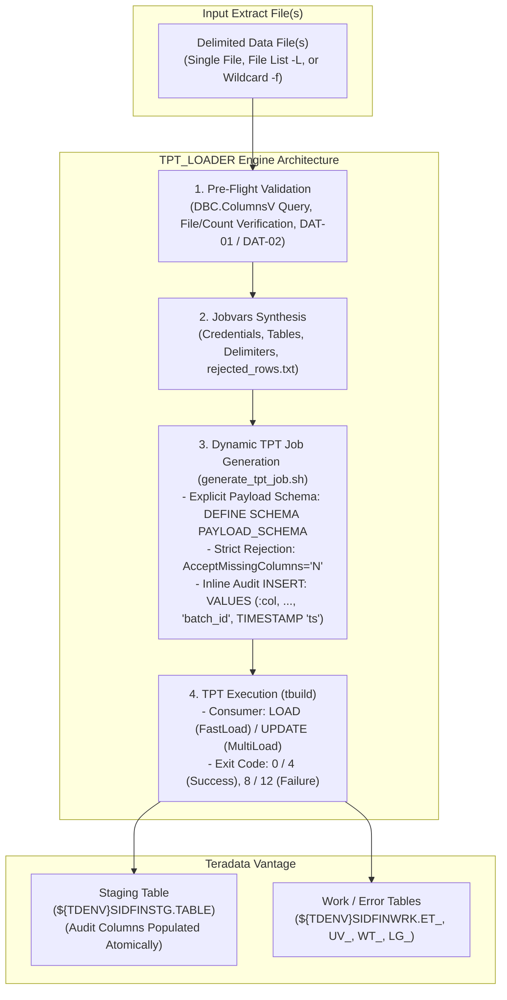
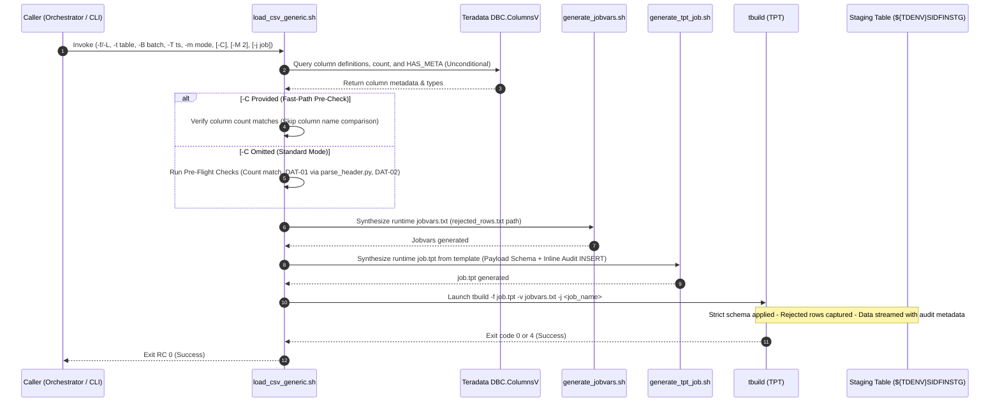

# TPT_LOADER - Functional Specification

## 1. Business & Functional Objective

The **TPT_LOADER** (`load_csv_generic.sh`) provides a generic, metadata-driven bulk loading framework feeding **Teradata Vantage** from flat-file extracts. Rather than requiring distinct, handcrafted load scripts for every database table, TPT Loader leverages dynamic TPT job generation, strict row validation, fast-path schema pre-check bypass (`-C -M 2`), and inline audit column population to load any staging table using a single, parameterized engine.



---

## 2. Core Functional Responsibilities

### What TPT Loader Does:
1. **Explicit Typed Payload Schema Generation (`generate_tpt_job.sh`)**:
   - Queries Teradata catalog `DBC.ColumnsV` to retrieve table column definitions (excluding technical audit columns `INFA_BATCH_ID` and `INFA_LAST_REPLICATED`).
   - Generates an explicit `DEFINE SCHEMA PAYLOAD_SCHEMA ( ... )` matching the exact field count and data types of the incoming file.
2. **Strict Row Rejection Guardrails**:
   - Sets `AcceptMissingColumns = 'N'`, `AcceptExcessColumns = 'N'`, and `TruncateColumnData = 'N'`.
   - Any malformed line (missing delimiters, extra fields, truncated text) is rejected by Teradata DataConnector and written to `${RUN_DIR}/rejected_rows.txt`.
   - With `ErrorLimit = 1` (default), any malformed line halts the job immediately, preventing silent data truncation or column misalignment.
3. **Inline Audit Column Population (No Post-Load UPDATE)**:
   - When the staging table contains audit columns (`HAS_META = 2`), the generated `APPLY` statement inserts incoming payload columns and injects literal audit expressions directly:
     ```sql
     APPLY $INSERT INTO @TargetTable ( ... , INFA_BATCH_ID, INFA_LAST_REPLICATED )
     VALUES ( :COL1, :COL2, ... , '${BATCH_ID}', TIMESTAMP '${META_TS}' );
     ```
   - Audit columns are populated atomically during block transfer, eliminating post-load table updates and table scans.
4. **Unconditional Structural Pre-Flight Verification**:
   - BTEQ queries `DBC.ColumnsV` unconditionally to fetch physical column definitions and measure `HAS_META`.
   - Compares the file column count against Teradata catalog `DBC.ColumnsV` payload column count.
   - **Fast-Path Bypass (`-C`)**: When `-C` is provided by `DATA_INGESTION_ORCHESTRATOR`, positional column name comparison is skipped (as JIT Schema Guard already synchronized names), but column count checks and `DBC.ColumnsV` queries always run.
   - **DAT-01 named column alignment**: When `-C` is omitted and `SkipRows > 0`, invokes POSIX-safe Python helper `parse_header.py` to compare CSV header column names against `DBC.ColumnsV` in identical ordinal positions.
   - **DAT-02 append safety**: In append mode, checks that no pre-existing rows have `INFA_BATCH_ID IS NULL` before loading, preventing accidental metadata corruption.
5. **Dual Loading Engines**:
   - **Replace Mode (`FastLoad`)**: Issues `DELETE ALL` on the target table, then loads at maximum wire speed using Teradata's block-level `LOAD_OPERATOR`.
   - **Append Mode (`MultiLoad`)**: Inserts new records into existing tables without dropping prior data using Teradata's `UPDATE_OPERATOR`.
6. **Support for Explicit File Lists (`-L`) and Wildcards (`-f`)**:
   - Ingests single files, multi-file lists generated by the orchestrator (`-L <listfile>`), or wildcard patterns (`-f <pattern>`).
7. **Automatic Cleanup & Work Table Management**:
   - Drops leftover utility tables (`ET_`, `UV_`, `WT_`, `LG_`) from prior runs before loading.

---

## 3. End-to-End Processing Sequence



---

## 4. Pre-Flight Integrity Contracts (DAT-01 & DAT-02)

### 4.1 DAT-01: Positional & Named Column Alignment Check
In flat-file loading, a file might have the correct *number* of columns, but an upstream ERP extract change might have reordered them (e.g. `INVOICE_DATE` and `GL_DATE` swapped). Without validation, FastLoad silently loads data into wrong columns.
- **Contract**: When `SkipRows > 0` and `-C` is not passed, `bteq_check.sh` invokes `parse_header.py` on line 1 of the data file, sanitizing each header column name via `clean_column_name()` in full parity with `schema_reader.py`, and verifies that every column name matches `DBC.ColumnsV` in the exact ordinal position.
- **Behavior**: If column 14 is `INVOICE_NUM` in CSV but `VENDOR_ID` in the table, the job immediately aborts with exit code `1` before launching TPT.

### 4.2 DAT-02: Append Mode Metadata Guard
In `append` mode, if a prior job crashed or an uncommitted batch left rows with `INFA_BATCH_ID IS NULL`, subsequent loads could result in unidentifiable or corrupt rows.
- **Contract**: Before launching MultiLoad in `append` mode (even when `-C` is specified), `bteq_check.sh` queries:
  ```sql
  SELECT COUNT(*) FROM target_table WHERE INFA_BATCH_ID IS NULL;
  ```
- **Behavior**: If count $>0$, the script halts with exit code `1`, requiring an operator to inspect or repair the table.

---

## 5. Dual Engine Architecture: Replace vs. Append

| Feature | Replace Mode (`-m replace`) | Append Mode (`-m append`) |
|---|---|---|
| **TPT Consumer Operator** | `LOAD_OPERATOR` (FastLoad) | `UPDATE_OPERATOR` (MultiLoad) |
| **Preparation Phase** | `DELETE ALL` on target table via DDL operator | Target table preserved |
| **Throughput** | Maximum wire speed (block-level direct write) | High-speed multi-session parallel inserts |
| **Table Lock State** | FastLoad Paused on crash | MultiLoad Paused on crash |
| **Unlock Mechanism** | Resume job via `unlock_tpt_table.sh -m replace -j <job_name>` | `RELEASE MLOAD` via `unlock_tpt_table.sh -m append` |
| **Audit Population** | Inline during load (`VALUES (..., 'batch_id', TIMESTAMP 'ts')`) | Inline during load (`VALUES (..., 'batch_id', TIMESTAMP 'ts')`) |
| **Use Case** | Full snapshot extracts (default staging) | Delta / CDC extracts |

---

## 6. Audit Metadata Population

All staging tables contain two mandatory technical audit columns:
1. `INFA_BATCH_ID VARCHAR(100)`: The unique batch identifier of the extract.
2. `INFA_LAST_REPLICATED TIMESTAMP(0)`: The exact timestamp when Oracle Fusion exported the data.

### Inline Injection Logic
1. **Batch ID**: Passed via `-B <id>` or extracted from the filename pattern `-batch<id>-`.
2. **Timestamp**: Passed via `-T "<YYYY-MM-DD HH:MM:SS>"` or extracted from the filename `YYYYMMDD_HHMISS`.
3. **Execution**: Populated directly in the generated `job.tpt` script within the `APPLY $INSERT` block:
   ```sql
   APPLY $INSERT INTO DEV0SIDFINSTG.ERP_MSH_INVOICE_HEADER (
       INVOICE_ID,
       INVOICE_NUM,
       ...
       INFA_BATCH_ID,
       INFA_LAST_REPLICATED
   )
   VALUES (
       :INVOICE_ID,
       :INVOICE_NUM,
       ...
       '000000011',
       TIMESTAMP '2026-10-15 12:00:11'
   );
   ```
This completes the audit trail with zero post-load DML overhead, ensuring that downstream dbt models and data marts can track data lineage back to the precise upstream BICC export.
