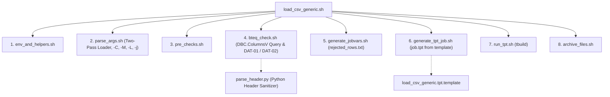

# TPT_LOADER - Technical Manual & Codebase Inventory

## 1. Internal Architecture & Modular Framework

The **TPT_LOADER** framework is implemented as a modular POSIX Bash framework (`lib/`) orchestrating the Teradata client tool suite:

```
TPT_LOADER/
├── load_csv_generic.sh           # Main Entrypoint Wrapper
├── unlock_tpt_table.sh           # Standalone Table Unlock Utility (Error 2652)
├── jobvariables_template.txt     # Template for TPT job variables
├── config/
│   └── global.env                # Default environment variables & DB names
└── lib/                          # Specialized modular bash components
    ├── env_and_helpers.sh        # Logging (log, die), path normalization, SQL identifier validation
    ├── parse_args.sh             # Two-pass configuration & CLI argument parsing (-C, -M, -L, -j)
    ├── pre_checks.sh             # Binary presence, file/list validation, regex parsing
    ├── bteq_check.sh             # Unconditional DBC.ColumnsV query & DAT-01/02 pre-checks
    ├── parse_header.py           # POSIX Python CSV header extractor with parity sanitization
    ├── generate_jobvars.sh       # Runtime jobvars.txt synthesis & rejected_rows.txt configuration
    ├── load_csv_generic.tpt.template # Parameterized generic TPT template
    ├── generate_tpt_job.sh       # Dynamic job.tpt generator with typed payload schema & inline audit
    ├── run_tpt.sh                # Execution of tbuild, rejected rows monitoring & return code parsing
    └── archive_files.sh          # Post-load file movement to archive
```



---

## 2. Complete Codebase & Script Inventory

### 2.1 Main Wrapper: `load_csv_generic.sh`
- **Path**: `load_csv_generic.sh`
- **Role**: Coordinates the sourcing of modules under strict shell safety (`set -o pipefail`).
- **Execution Flow**: Sources `env_and_helpers.sh` $\rightarrow$ `parse_args.sh` $\rightarrow$ `pre_checks.sh` $\rightarrow$ `bteq_check.sh` $\rightarrow$ `generate_jobvars.sh` $\rightarrow$ `generate_tpt_job.sh` $\rightarrow$ `run_tpt.sh` $\rightarrow$ `archive_files.sh`.

---

### 2.2 Module: `lib/env_and_helpers.sh`
- **Path**: `lib/env_and_helpers.sh`
- **Role**: Standardized logging, exit handling, SQL identifier validation, and literal escaping.
- **Key Functions**:
  1. `log(level, message)`: Prints timestamped log lines formatted as `YYYY-MM-DD HH:MM:SS [LEVEL] message`.
  2. `die(code, message)`: Logs message at `ERROR` level and exits shell immediately with `exit ${code}`.
  3. `validate_identifier(val, label)`: Enforces `^[A-Za-z0-9_]+$` on SQL identifiers (`TARGET_DB`, `TARGET_TABLE`, `WRK_DB`).
  4. `escape_sql_literal(val)`: Escapes single quotes (`'` $\rightarrow$ `''`) before SQL interpolation.

---

### 2.3 Module: `lib/parse_args.sh`
- **Path**: `lib/parse_args.sh`
- **Role**: Implements a robust **two-pass configuration loader**:
  - **Pass 1**: Loads defaults from `config/global.env` and optional `-v <jobvars>` configuration file (including `SkipRowsEveryFile`, `SkipBteqCheck`, `HasMeta`). Defaults `TD_USER="${TD_LOGON_USER:-${TDENV}${SID_ADM_USER}}"`.
  - **Pass 2**: Parses explicit CLI flags (`-f`, `-L`, `-t`, `-m`, `-B`, `-T`, `-S`, `-Y`, `-C`, `-M`, `-j`), overriding defaults.
  - Sanitizes quotes and whitespace from arguments.
  - Recognizes `-L <listfile>` for explicit file lists, `-j <job_name>` for standardized TPT job names, `-C` (`SKIP_BTEQ_CHECK="Y"`), and `-M <has_meta>` (`CLI_HAS_META="${OPTARG}"`).

---

### 2.4 Module: `lib/pre_checks.sh`
- **Path**: `lib/pre_checks.sh`
- **Role**: Pre-execution validation:
  1. Verifies that `tbuild` and `bteq` executables exist in system `$PATH`.
  2. Validates mutually exclusive file sources: either single file/wildcard (`-f`) or explicit file list (`-L`).
  3. Forces `ReaderInstances=1` for multi-file loads when `SkipRowsEveryFile=N` and `SkipRows>0` to prevent skipping rows across chunk boundaries out of sequence.
  4. Resolves credentials: checks `$TD_PASSWORD` first; if unset, uses Teradata Wallet syntax `\$tdwallet(${TD_USER})`.
  5. Enforces strict audit metadata requirements: when `HAS_META=2`, requires non-empty `-B` (batch ID) and `-T` (timestamp) with no fabricated `date` fallbacks.

---

### 2.5 Module: `lib/bteq_check.sh`
- **Path**: `lib/bteq_check.sh`
- **Role**: Performs pre-flight database introspection via BTEQ:
  1. **Unconditional DBC Introspection**: Always queries `DBC.ColumnsV` for target table column definitions (excluding audit columns), column types, and checks presence of audit columns (`HAS_META`).
  2. **Column Count Enforcement**: Always validates that incoming file column count matches target table payload column count (even when `-C` is passed).
  3. **DAT-01 Named Column Alignment Check**: When `SkipRows > 0` and `-C` is omitted, executes `lib/parse_header.py` to extract and sanitize CSV header columns, verifying 1-to-1 ordinal parity with `DBC.ColumnsV`.
  4. **DAT-02 Append Safety Check**: When `LOAD_MODE = 'append'` and `HAS_META == 2`, queries `SELECT COUNT(*) FROM table WHERE INFA_BATCH_ID IS NULL`. If count $>0$, halts immediately to prevent historical data corruption (enforced even if `-C` is specified).

---

### 2.6 Helper: `lib/parse_header.py`
- **Path**: `lib/parse_header.py`
- **Role**: POSIX-safe Python helper script for CSV header parsing and sanitization:
  - Uses standard Python `csv` reader to correctly handle quoted fields containing commas, tabs, spaces, and escaped characters.
  - Applies `clean_column_name()` in 100% parity with `COMMON/dataloader_core/schema_reader.py`.
  - Outputs space-separated sanitized column names for ingestion by `bteq_check.sh`.

---

### 2.7 Module: `lib/generate_jobvars.sh`
- **Path**: `lib/generate_jobvars.sh`
- **Role**: Synthesizes runtime `jobvars.txt` in an isolated directory `${WORK_DIR}/${JOB_NAME}/`:
  1. Creates job directory with restricted permissions (`chmod 700`).
  2. Selects consumer operator: `LOAD_OPERATOR` (replace) or `UPDATE_OPERATOR` (append).
  3. Supports `FileList = 'Y'` and `FileName = '${FILE_LIST}'` when `-L` is passed.
  4. **Strict Rejection Configuration**: Sets `RECORD_ERR_FILE` unconditionally to `${RUN_DIR}/rejected_rows.txt` to capture any rejected rows.
  5. Writes connection parameters, target table names, work table names (`LG_`, `ET_`, `UV_`, `WT_`), delimiter, skip rows, and tuning limits.
  6. Restricts file permissions to `chmod 600`.

---

### 2.8 Module: `lib/generate_tpt_job.sh` & Template: `lib/load_csv_generic.tpt.template`
- **Path**: `lib/generate_tpt_job.sh` and `lib/load_csv_generic.tpt.template`
- **Role**: Generates the final executable `job.tpt` from the parameterized template:
  1. **Strict Guardrails**: `AcceptMissingColumns = 'N'`, `AcceptExcessColumns = 'N'`, `TruncateColumnData = 'N'`.
  2. **Typed Payload Schema**: Produces `DEFINE SCHEMA PAYLOAD_SCHEMA` matching only the payload columns in the file, with Teradata data types (VARCHAR, INTEGER, DECIMAL, DATE, TIMESTAMP).
  3. **Inline Audit Injection**: When `HAS_META == 2`, generates an `APPLY $INSERT` statement that binds payload fields and directly injects literal audit expressions `'${BATCH_ID}'` and `TIMESTAMP '${META_TS}'`.

---

### 2.9 Module: `lib/run_tpt.sh`
- **Path**: `lib/run_tpt.sh`
- **Role**: Launches `tbuild`:
  ```bash
  tbuild -f job.tpt -v jobvars.txt -j <JOB_NAME>
  ```
- Evaluates exit code:
  - Codes `0` (Success) and `4` (Warning) indicate successful loads.
  - Codes `8` (Fatal) and `12` (Error) trigger job failure and exit code `3`.
- Rejection Accounting: Inspects `${RUN_DIR}/rejected_rows.txt` and logs count of rejected rows.

---

### 2.10 Module: `lib/archive_files.sh`
- **Path**: `lib/archive_files.sh`
- **Role**: If `-a <archive_dir>` was passed, moves loaded files to the destination archive directory.

---

### 2.11 Recovery Tool: `unlock_tpt_table.sh`
- **Path**: `unlock_tpt_table.sh`
- **Role**: Unlocks tables left locked (Error 2652) by crashed TPT runs:
  - In `append` mode: Issues `RELEASE MLOAD <table_name>;` via BTEQ.
  - In `replace` mode: Requires `-j <job_name>` identifying the exact failed TPT job directory `${WORK_DIR}/${JOB_NAME}` containing `jobvars.txt` and `job.tpt`, resuming the job to completion via `tbuild`.

---

## 3. Teradata System Catalog & Utility Tables

### 3.1 Utility Tables in `${TDENV}SIDFINWRK`
Every TPT job manages four technical tables in the utility database:
1. `LG_<TABLE>`: Log table tracking job checkpoints and restart vectors.
2. `ET_<TABLE>`: Error Table 1 (captures phase 1 data conversion and formatting errors).
3. `UV_<TABLE>`: Error Table 2 (captures phase 2 uniqueness constraint violations).
4. `WT_<TABLE>`: Work table used during MultiLoad processing.

### 3.2 Pre-Flight Introspection Query on `DBC.ColumnsV`
```sql
SELECT 'NBCOL=' || TRIM(COUNT(*)) (TITLE '')
FROM DBC.ColumnsV
WHERE DatabaseName = '${TARGET_DB}' AND TableName = '${TARGET_TABLE}';

SELECT 'HAS_META=' || TRIM(COUNT(*)) (TITLE '')
FROM DBC.ColumnsV
WHERE DatabaseName = '${TARGET_DB}' AND TableName = '${TARGET_TABLE}'
  AND ColumnName IN ('INFA_BATCH_ID', 'INFA_LAST_REPLICATED');

SELECT TRIM(ColumnName) || '|' || TRIM(ColumnType) || '|' || TRIM(ColumnLength) || '|' ||
       TRIM(COALESCE(DecimalTotalDigits, 0)) || '|' || TRIM(COALESCE(DecimalFractionalDigits, 0)) || '|' ||
       TRIM(COALESCE(CharType, 0))
FROM DBC.ColumnsV
WHERE DatabaseName = '${TARGET_DB}' AND TableName = '${TARGET_TABLE}'
  AND ColumnName NOT IN ('INFA_BATCH_ID', 'INFA_LAST_REPLICATED')
ORDER BY ColumnId;
```
