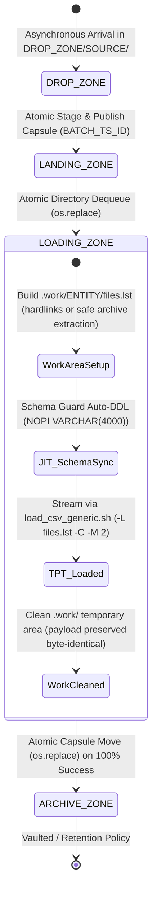
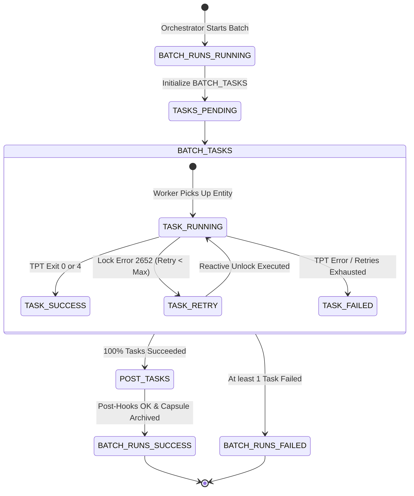
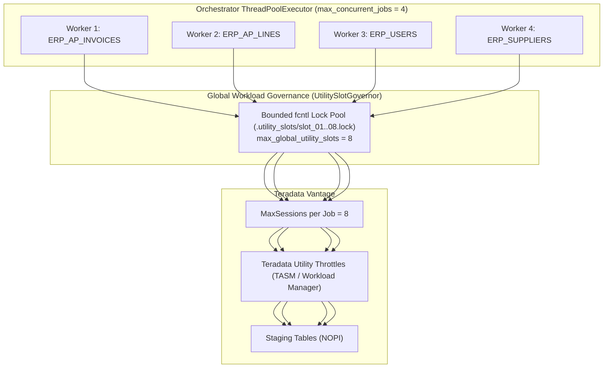

# DATA_LOADER - Enterprise Architecture & Storage Lifecycle Specification

## 1. Global 3-Tier Ingestion Cascade

The **DATA_LOADER** ecosystem is an enterprise flat-file ELT ingestion framework feeding **Teradata Vantage** from upstream cloud extracts (primarily **Oracle Fusion Cloud BICC**). It is architected as a **3-tier cascade** with strict contract enforcement:

```mermaid
flowchart TD
    subgraph TIER1["Tier 1: INTAKE CONTROLLER (feeder.py / BaseIntakeController) - Pluggable Intake Producer"]
        direction TB
        F1["Drop Zone Scanning & Multi-Batch Discovery (SourceIntakePlugin: BICC, Standard, Manifestless)"]
        F2["FIFO Chronological Queue Sorting (Oldest First)"]
        F3["File Stability Sentry (>0 bytes, Settling Window)"]
        F4["Zero Teradata Dependency: In-Memory Header Inspection"]
        F5["Manifest Factory: MD5, batch_descriptor.json & Raw Vaulting"]
        F6["Stages Atomic Capsule: LANDING_ZONE/<SRC>/BATCH_<TS>_<ID>/"]
        F7["Supports --enqueue-only OR FAIL_STOP Orchestrator Delegation"]
        F1 --> F2 --> F3 --> F4 --> F5 --> F6 --> F7
    end

    subgraph STORAGE1["Landing Queue Handoff"]
        Move1["Queued Batch Capsules in LANDING_ZONE"]
    end

    subgraph TIER2["Tier 2: DATA_INGESTION_ORCHESTRATOR (orchestrator.py) - Multi-Batch & Multi-Source Consumer"]
        direction TB
        O1["Consumes 1..N Queued Capsules across Sources in Strict FIFO Order (--all-sources / --sources)"]
        O2["Fast-Path O(1) Batch Descriptor File Size Verification"]
        O3["Private Processing SAS (LOADING_ZONE/<SRC>/)"]
        O4["ZIP/GZ Archive Decompression & Flexible Header Modes (first_chunk_only, every_file, none)"]
        O5["Just-In-Time (JIT) Schema Guard & Auto-DDL (NOPI VARCHAR 4000)"]
        O6["Teradata State Tracking (BATCH_RUNS & BATCH_TASKS, Permanent PID)"]
        O7["Global Workload Governance (UtilitySlotGovernor bounded fcntl.flock)"]
        O8["ThreadPoolExecutor Parallel Dispatch (-s, -S, -Y, -C -M 2 Fast-Path)"]
        O9["100% Completeness Barrier -> Source-Keyed Post-Tasks -> Archiving"]
        O1 --> O2 --> O3 --> O4 --> O5 --> O6 --> O7 --> O8 --> O9
    end

    subgraph STORAGE2["Engine Ingress Handoff"]
        Move2["Invoke load_csv_generic.sh per Entity under Slot Token"]
    end

    subgraph TIER3["Tier 3: TPT_LOADER (load_csv_generic.sh)"]
        direction TB
        T1["Fast-Path BTEQ Pre-Check Bypass (-C -M 2) when Pre-Synchronized"]
        T2["DBC.ColumnsV Pre-Flight (DAT-01 Alignment & DAT-02 Append)"]
        T3["Dynamic Schema Synthesis (FROM TABLE DELIMITED)"]
        T4["In-Memory Metadata Padding (AcceptMissingColumns='Y')"]
        T5["Dual Engines: FastLoad (replace) / MultiLoad (append)"]
        T6["In-Database Audit Backfill (INFA_BATCH_ID / TIMESTAMP)"]
        T7["Error 2652 Table Lock Recovery (unlock_tpt_table.sh)"]
        T1 --> T2 --> T3 --> T4 --> T5 --> T6 --> T7
    end

    TIER1 --> STORAGE1 --> TIER2 --> STORAGE2 --> TIER3
```



---

## 2. Storage Lifecycles & Directory Hierarchy

The filesystem architecture enforces clean segregation between asynchronous cloud drop arrivals, staged queue capsules, isolated processing areas, and final vaulted archives.

```
DATA_LOADER/
├── DATA/
│   ├── DROP_ZONE/<SOURCE>/       # Tier-1: Upstream arrival zone (strictly partitioned by source)
│   ├── LANDING_ZONE/<SOURCE>/    # Tier-2: Multi-batch FIFO queue (BATCH_<CLEAN_TS>_<BATCH_ID>/)
│   │   └── BATCH_<TS>_<ID>/      # Self-contained queued Batch Capsule
│   │       ├── *.csv / *.zip     # Payload data files
│   │       ├── MANIFEST_*.MF     # Standardized manifest
│   │       ├── batch_descriptor.json # Pre-computed metadata & column headers
│   │       └── RAW/              # Raw BICC manifest + RECEIPT_<SOURCE>_<TS>_<ID>.json
│   ├── LOADING_ZONE/<SOURCE>/    # Tier-3: Private processing SAS (decompression, header stripping, TPT)
│   └── ARCHIVE_ZONE/<SOURCE>/<YYYY-MM>/BATCH_<ID>_<TS>/ # Permanent resting Batch Capsules
│       ├── *.csv / *.zip         # Loaded payload data files
│       ├── MANIFEST_*.MF         # Standardized manifest
│       ├── batch_descriptor.json # Batch metadata
│       └── RAW/                  # Vaulted raw BICC manifest + RECEIPT_<SOURCE>_<TS>_<ID>.json
├── LOGS/
│   └── <SOURCE>/                 # Partitioned by source
│       ├── LOG_FEEDER_<SOURCE>_<EXEC_TS>.log # Feeder supervisor log
│       └── <YYYY-MM>/BATCH_<ID>_<TS>/        # Batch Log Capsule
│           ├── LOG_ORCHESTRATOR_<SOURCE>_<EXTRACT_TS>_<BATCH_ID>_<EXEC_TS>.log
│           └── TPT/              # TPT job variables, tbuild outputs, logs (TPT_<TARGET>_<RUN_TS>)
└── CONFIG/                       # Centralized routing rules (entity_mapping.csv)
```

### Storage Transition Matrix

> [!IMPORTANT]
> **Same-Filesystem Requirement**: `LANDING_ZONE`, `LOADING_ZONE`, and `ARCHIVE_ZONE` must reside on the same physical filesystem. The Orchestrator verifies device identifiers (`os.stat().st_dev`) at startup to ensure directory-level transitions are executed as atomic POSIX renames (`os.replace`) without cross-device copying.



| Lifecycle Zone | Access Characteristics | File Ingestion State | Retention Policy |
|---|---|---|---|
| `DROP_ZONE/<SOURCE>/` | Read/Write (BICC/SFTP & Feeder) | Unstable / Asynchronous Multi-Batch | Cleared as batches are staged. (Files at root of `DROP_ZONE` are ignored; duplicates quarantined). |
| `LANDING_ZONE/<SOURCE>/` | Read/Write (Feeder & Orchestrator) | 1..N Queued Capsules (`BATCH_<TS>_<ID>/`) | Atomic single directory move (`os.replace`) into `LOADING_ZONE`. Stray root files strictly forbidden. |
| `LOADING_ZONE/<SOURCE>/` | Private Isolated SAS (Orchestrator) | Self-contained capsule (`BATCH_<TS>_<ID>/`) with `.work/` | The capsule's presence in LOADING **is** the in-flight marker. Renamed to `ARCHIVE_ZONE` upon completion. |
| `ARCHIVE_ZONE/<SOURCE>/<YYYY-MM>/BATCH_<ID>_<TS>/` | Append-Only (Orchestrator) | Consolidated Batch Capsules containing byte-identical payload files, standardized manifest, `batch_descriptor.json`, and `RAW/` vault | Configurable retention (e.g. 90 days / permanent). Existing batches moved aside to `.previous_<epoch>`. |

---

## 3. Teradata State Machine Tracking Architecture

Every batch and granular entity task is tracked inside Teradata Vantage in the technical database `${TDENV}SIDFINTCH`:



### Table 1: `BATCH_RUNS`
| Column Name | Datatype | Constraints | Description |
|---|---|---|---|
| `BATCH_ID` | `VARCHAR(100)` | `COMPOSITE NON-UNIQUE PI, NOT NULL` | Batch identifier (unique per source). |
| `SOURCE` | `VARCHAR(50)` | `COMPOSITE NON-UNIQUE PI, NOT NULL` | Upstream source code (e.g. `ORACLE_FUSION`). |
| `EXTRACT_TIMESTAMP` | `VARCHAR(50)` | | Export timestamp from manifest. |
| `RUN_DATE` | `DATE FORMAT 'YYYY-MM-DD'` | | Calendar date of pipeline run. |
| `START_TIME` | `TIMESTAMP(0)` | | Exact timestamp when batch ingress began. |
| `END_TIME` | `TIMESTAMP(0)` | | Exact timestamp when archiving completed. |
| `STATUS` | `VARCHAR(20)` | `NOT NULL` | Terminal state: `RUNNING`, `SUCCESS`, or `FAILED`. |
| `PROCESS_PID` | `INTEGER` | | Operating system PID. Permanently retained upon batch completion (`SUCCESS` or `FAILED`) for auditability. |

### Table 2: `BATCH_TASKS`
| Column Name | Datatype | Constraints | Description |
|---|---|---|---|
| `BATCH_ID` | `VARCHAR(100)` | `COMPOSITE NON-UNIQUE PI, NOT NULL` | Associated batch run. |
| `SOURCE` | `VARCHAR(50)` | `COMPOSITE NON-UNIQUE PI, NOT NULL` | Upstream source code. |
| `EXTRACT_TIMESTAMP` | `VARCHAR(50)` | | Extract timestamp. |
| `ENTITY_NAME` | `VARCHAR(100)` | `NOT NULL` | Target staging table name. |
| `FILE_NAME` | `VARCHAR(500)` | `NOT NULL` | Ingested file name or wildcard pattern. |
| `STATUS` | `VARCHAR(20)` | `NOT NULL` | Task state: `PENDING`, `RUNNING`, `SUCCESS`, `FAILED`. |
| `START_TIME` | `TIMESTAMP(0)` | | Start time of entity task. |
| `END_TIME` | `TIMESTAMP(0)` | | Completion time of entity task. |
| `RETRY_COUNT` | `INTEGER` | `DEFAULT 0` | Retry counter. |
| `ERROR_MESSAGE` | `VARCHAR(1000)` | | Diagnostics if task failed. |

---

## 4. Architectural Invariants

### 4.1 Invariant OPS-01: Multi-Batch FIFO Queue Invariance
- `DATA_INGESTION_ORCHESTRATOR` discovers 1..N queued Batch Capsules in `LANDING_ZONE/<SOURCE>/`.
- Batches are executed strictly in order of their extraction timestamps ($TS_1 < TS_2 < TS_3$).
- Newer batches cannot overtake older batches, preserving historical update sequencing.

### 4.2 Invariant OPS-02: Zero Unmanifested Orphans
- All payload files inside the batch must be declared in the manifest.
- Unmanifested files trigger an immediate abort prior to data manipulation.

### 4.3 Invariant FAIL_STOP: Deterministic Pipeline Halting
- Any non-zero exit code from a child process halts execution immediately.
- Erroneous batches freeze in place; subsequent batches remain unstarted.

### 4.4 Invariant Solution A & Generalized Header Normalization
- Entities split into multiple chunk files adhere to the strategy configured in `HEADER_MODE`:
  - `first_chunk_only` (Default / BICC Solution A): line 1 is removed from Chunk 1 in-place, and wildcards are passed to TPT with `SkipRows = 0, SkipRowsEveryFile = 'N'`. Single-chunk files preserve their headers and load with `SkipRows = 1`.
  - `every_file`: all chunk headers remain untouched, and TPT skips headers natively across every file part via `-S <skip_rows> -Y Y`.
  - `none`: headless data files load directly via `-S 0 -Y N`.
- Per-entity delimiters (`DELIMITER`) and load modes (`LOAD_MODE`) are dynamically passed from `entity_mapping.csv` into TPT.

---

## 5. Concurrency Model & Resource Governance



- **Entity Parallelism**: Different entities within the *same* batch load concurrently via Python's `ThreadPoolExecutor`.
- **Global Utility Slot Governance (`UtilitySlotGovernor`)**: Cross-process bounded slot allocator (`dataloader_core.locking.UtilitySlotGovernor`, configured via `max_global_utility_slots = 8`) regulating concurrent FastLoad and MultiLoad utility sessions across all orchestrator processes and data sources. Prevents Teradata Error 2633 (*Too many load/unload tasks running*) with zero-leak OS-level file locking.
- **Pooled State Connections (`TeradataConnectionManager`)**: `TeradataStateDB` maintains a thread-safe connection pool (`dataloader_core.db.TeradataConnectionManager`, default `connection_pool_size = 6`) so concurrent worker threads reuse persistent Teradata sessions instead of opening a new TCP logon on every task state transition.
- **POSIX Advisory File Locking (`ProcessLock`)**: Mutual exclusion on `.feeder_<SOURCE>.pid` and `.orchestrator.pid` combines OS-level `fcntl.flock(LOCK_EX | LOCK_NB)` with PID liveness verification (`os.kill(pid, 0)`) and active wait polling, preventing TOCTOU race conditions while auto-recovering stale locks from crashed runs.
- **Session Limits**: Each TPT job bounds its Teradata sessions via `MaxSessions = 8` to prevent consuming all cluster utility slots.
- **NOPI Staging**: Staging tables use `NO PRIMARY INDEX`, preventing row redistribution across AMPs and ensuring maximum load parallelism.

---

## 6. Security Architecture & Credential Isolation

1. **Teradata Wallet (`tdwallet`)**:
   - Production scripts connect using `\$tdwallet(${TD_USER})`.
   - Passwords never appear in process listings (`ps -ef`) or command-line logs.
2. **Encrypted Password Files**:
   - Python connections leverage `ENCRYPTED_PASSWORD(file:key, file:pass)` from `~/.dbt/`.
3. **Restricted Work Directories**:
   - Temporary job variables files (`jobvars.txt`) containing connection profiles are generated inside private directories with `chmod 700` and `chmod 600` permissions.
4. **POSIX User Isolation**:
   - The entire stack runs under dedicated service account `Dsidadm`, with filesystem permissions restricting cross-tenant visibility.

---

## 7. Automated Test Suite & Empirical Production Validation

An integrated automated test framework (`DATA_LOADER/TESTS`) provides continuous integration and validation directly on Unix against Teradata Vantage:
- **Master Test Runner**: [`run_all_tests.sh`](../../TESTS/run_all_tests.sh) / [`run_all_tests.py`](../../TESTS/run_all_tests.py)
- **11 Automated Scenarios**:
  1. `scenario_01_nominal_pipeline`: Full cascade with Schema Guard auto-DDL, FastLoad, and vaulting.
  2. `scenario_02_skip_post_tasks`: Hybrid decoupling with `--skip-post-tasks`.
  3. `scenario_03_concurrency_lock`: Single-flight mutual exclusion & active polling loop.
  4. `scenario_04_crash_recovery`: Dead PID detection, lock cleanup, and in-flight resumption.
  5. `scenario_05_multisource_partition`: Multi-source partition isolation (`DROP_ZONE/<source>`) and concurrent multi-source non-blocking execution.
  6. `scenario_06_intake_post_tasks`: Intake Controller source-specific post-tasks (`post_ingestion_tasks`) execution and bypass.
  7. `scenario_07_database_and_storage_audit`: Deep Teradata Vantage audit (`PROCESS_PID` retention, row count, audit metadata) and storage tier cleanliness via `verify_database_and_storage.py`.
  8. `scenario_08_lock_recovery_and_schema_flags`: Phase 01 unit tests, column header sanitization parity, `auto_migrate_ddl: false` and `append` mode safety, and Error 2652 lock recovery audit metadata population.
  9. `scenario_09_unit_and_core_sdk`: Phase 02 `dataloader_core` unit test suite (`TESTS/unit/`), `ProcessLock` advisory locking, and pooled `TeradataConnectionManager` end-to-end validation.
  10. `scenario_10_decoupled_multi_batch_queue`: Phase 03 decoupled Producer/Consumer queueing (`--enqueue-only`), Batch Capsule publishing, multi-batch FIFO consumption, JIT Schema Guard, and deep database/storage audit.
  11. `scenario_11_multisource_plugin_and_slot_governor`: Phase 04 multi-source intake plugins (`SourceIntakePlugin`), extended mapping attributes (`DELIMITER`, `SKIP_ROWS`, `HEADER_MODE`), `--all-sources` master orchestration sweep, and `UtilitySlotGovernor` global slot regulation.
- **Validation Outcome**: 100% PASS (11/11 scenarios verified in Unix `DEV0` environment).
- **Artifact Consolidation**: Automatic capture of logs, deliverables, and summaries into `OUTPUTS/all_test_outputs_latest.tar.gz`.

---

## 8. Batch Capsule Hierarchy & Canonical Naming Standard

### 8.1 Batch Capsule Architecture
All runtime outputs and long-term deliverables are consolidated into isolated, temporal batch capsules:
```
LANDING_ZONE/<SOURCE>/BATCH_<CLEAN_TS>_<BATCH_ID>/
├── *.csv / *.zip / *.gz          # Ingested data payload files
├── MANIFEST_*.MF                 # Normalized intake manifest
├── batch_descriptor.json         # Pre-computed metadata & column headers
└── RAW/                          # Upstream raw manifest + RECEIPT_<SOURCE>_<TS>_<ID>.json

ARCHIVE_ZONE/<SOURCE>/<YYYY-MM>/BATCH_<ID>_<TS>/
├── *.csv / *.zip / *.gz          # Ingested data payload files
├── MANIFEST_*.MF                 # Normalized intake manifest
├── batch_descriptor.json         # Batch metadata
└── RAW/                          # Upstream raw manifest + RECEIPT_<SOURCE>_<TS>_<ID>.json

LOGS/<SOURCE>/
├── LOG_FEEDER_<SOURCE>_<EXEC_TS>.log # Feeder supervisor log
└── <YYYY-MM>/BATCH_<ID>_<TS>/        # Batch Log Capsule
    ├── LOG_ORCHESTRATOR_<SOURCE>_<EXTRACT_TS>_<BATCH_ID>_<EXEC_TS>.log
    └── TPT/                          # Isolated TPT run directory (TPT_<TARGET>_<RUN_TS>)
```

### 8.2 Canonical Naming Convention
All artifacts generated by the system adhere to the canonical syntax:
`[TYPE]_[SOURCE]_[EXTRACT_TS]_[BATCH_ID]_[DETAIL]_[RUN_TS].[ext]`
- **Standardized Manifest**: `MANIFEST_<SOURCE>_<EXTRACT_TS>_<BATCH_ID>.MF`
- **Audit Receipt**: `RECEIPT_<SOURCE>_<EXTRACT_TS>_<BATCH_ID>.json`
- **Batch Descriptor**: `batch_descriptor.json`
- **Orchestrator Log**: `LOG_ORCHESTRATOR_<SOURCE>_<EXTRACT_TS>_<BATCH_ID>_<EXEC_TS>.log`
- **Feeder Log**: `LOG_FEEDER_<SOURCE>_<EXEC_TS>.log`
- **TPT Job Directory & Traces**: `TPT_<TARGET_TABLE>_<RUN_TS>`
