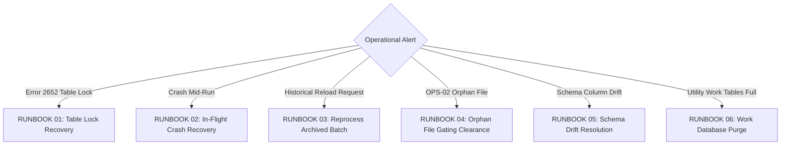

# DATA_LOADER - Production Operations Playbook & Technical FAQ

## 1. Routine Operational Workflows

### 1.1 Scheduling via Cron or Enterprise Scheduler
The entrypoint for the ingestion pipeline is `BICC_INTAKE_CONTROLLER/feeder.py`. It is typically invoked by cron or an enterprise job scheduler (e.g., Control-M, Autosys, Airflow).

```bash
# Recommended production cron schedule (every 15 minutes)
*/15 * * * * cd /sg/local/sid/home/Dsidadm/DATA_LOADER/PROCESSING_TOOLS/BICC_INTAKE_CONTROLLER && python3 feeder.py --config config.json >> /sg/local/sid/home/Dsidadm/DATA_LOADER/LOGS/scheduler.log 2>&1
```

Alternatively, in decoupled environments:
- Producer cron (`feeder.py --enqueue-only`): runs every 5 minutes to stage arrivals into `LANDING_ZONE`.
- Consumer cron (`orchestrator.py --all-sources`): runs on its own schedule to drain the queue across all sources in FIFO order.

### 1.2 Daily Monitoring Checklist
1. **Check for Running / Stuck Batches**:
   ```sql
   SELECT BATCH_ID, SOURCE, START_TIME, STATUS
   FROM DEV0SIDFINTCH.BATCH_RUNS
   WHERE STATUS = 'RUNNING';
   ```
2. **Review Recent Batch Outcomes**:
   ```sql
   SELECT BATCH_ID, RUN_DATE, START_TIME, END_TIME, STATUS, PROCESS_PID
   FROM DEV0SIDFINTCH.BATCH_RUNS
   ORDER BY RUN_DATE DESC, START_TIME DESC
   SAMPLE 10;
   ```
3. **Inspect Central Logs**:
   ```bash
   # Check today's feeder logs for errors across all sources
   grep -E "CRITICAL|ERROR|FATAL" /sg/local/sid/home/Dsidadm/DATA_LOADER/LOGS/*/LOG_FEEDER_*.log
   ```

### 1.3 Housekeeping & Log Retention Policy
Add a daily housekeeping job to purge logs and archives older than retention thresholds:
```bash
# Purge logs older than 30 days
find /sg/local/sid/home/Dsidadm/DATA_LOADER/LOGS/ -name "*.log" -mtime +30 -delete

# Purge processed batch capsules from ARCHIVE_ZONE older than 60 days
find /sg/local/sid/home/Dsidadm/DATA_LOADER/DATA/ARCHIVE_ZONE/ -mindepth 3 -maxdepth 3 -type d -mtime +60 -exec rm -rf {} +

# Purge temporary TPT work logs older than 14 days
find /sg/local/sid/home/Dsidadm/DATA_LOADER/PROCESSING_TOOLS/TPT_LOADER/tmp/ -type f -mtime +14 -delete
```

---

## 2. Emergency Operational Runbooks



---

### RUNBOOK 01: Clearing Teradata Table Locks (Error 2652)
- **Symptom**: `TPT Job failed with Error 2652: Operation not allowed: table is being Loaded / Paused.`
- **Action for Replace Mode (FastLoad Paused)**:
  ```bash
  cd /sg/local/sid/home/Dsidadm/DATA_LOADER/PROCESSING_TOOLS/TPT_LOADER
  ./unlock_tpt_table.sh -t <TABLE_NAME> -m replace -d ${TDENV}SIDFINSTG -u ${TDENV}${SID_ADM_USER} -B <BATCH_ID> -T "<EXTRACT_TS>"
  ```
- **Action for Append Mode (MultiLoad Paused)**:
  ```bash
  cd /sg/local/sid/home/Dsidadm/DATA_LOADER/PROCESSING_TOOLS/TPT_LOADER
  ./unlock_tpt_table.sh -t <TABLE_NAME> -m append -d ${TDENV}SIDFINSTG -u ${TDENV}${SID_ADM_USER}
  ```
- **Fallback Manual SQL Unlock via BTEQ**:
  ```sql
  .logon tdadev/DEV0SIDFINADM,$tdwallet(DEV0SIDFINADM)
  RELEASE MLOAD DEV0SIDFINSTG.<TABLE_NAME>;
  .quit
  ```
  *(If table is FastLoad locked and jobvars are missing, drop and recreate table via Schema Guard or DDL).*

---

### RUNBOOK 02: In-Flight Crash Recovery
- **Symptom**: Server rebooted or process was killed during processing. Manifest and data files remain in `DATA/LOADING_ZONE/<SOURCE>/`.
- **Automated Recovery**:
  Simply launch `orchestrator.py` (or `feeder.py`)! The orchestrator automatically discovers the uncompleted batch in `LOADING_ZONE/<SOURCE>/`, bypasses checksum validation, queries `BATCH_TASKS` for pending/failed entities, resumes execution via TPT, executes post-tasks, and archives the batch:
  ```bash
  cd /sg/local/sid/home/Dsidadm/DATA_LOADER/PROCESSING_TOOLS/DATA_INGESTION_ORCHESTRATOR
  python3 orchestrator.py --config config.json --source <SOURCE>
  ```
- **Verification**: Ensure `DATA/LOADING_ZONE/<SOURCE>/` is empty after execution and capsule exists in `ARCHIVE_ZONE/`.

---

### RUNBOOK 03: Reprocessing an Already Archived Batch
- **Scenario**: Business requests reloading an archived batch due to upstream corrections.
- **Procedure**:
  1. Locate the batch capsule in `DATA/ARCHIVE_ZONE/<SOURCE>/<YYYY-MM>/BATCH_<ID>_<TS>/`.
  2. Clean the technical database tracking state:
     ```sql
     DELETE FROM DEV0SIDFINTCH.BATCH_TASKS WHERE BATCH_ID = '<BATCH_ID>';
     DELETE FROM DEV0SIDFINTCH.BATCH_RUNS WHERE BATCH_ID = '<BATCH_ID>';
     ```
  3. Re-publish the capsule to `LANDING_ZONE/<SOURCE>/`:
     ```bash
     cp -r /sg/local/sid/home/Dsidadm/DATA_LOADER/DATA/ARCHIVE_ZONE/<SOURCE>/<YYYY-MM>/BATCH_<ID>_<TS> \
           /sg/local/sid/home/Dsidadm/DATA_LOADER/DATA/LANDING_ZONE/<SOURCE>/BATCH_<TS>_<ID>
     ```
  4. Run `orchestrator.py`:
     ```bash
     cd /sg/local/sid/home/Dsidadm/DATA_LOADER/PROCESSING_TOOLS/DATA_INGESTION_ORCHESTRATOR
     python3 orchestrator.py --config config.json --source <SOURCE>
     ```

---

### RUNBOOK 04: Handling Unmanifested Orphan Files (OPS-02)
- **Symptom**: `ValueError: Boundary violation: Unmanifested orphan file(s) found in batch: ['stray_file.csv']`.
- **Procedure**:
  1. Identify the unmanifested file:
     ```bash
     ls -la /sg/local/sid/home/Dsidadm/DATA_LOADER/DATA/LANDING_ZONE/<SOURCE>/
     ```
  2. Quarantine the offending file:
     ```bash
     mkdir -p /sg/local/sid/home/Dsidadm/DATA_LOADER/DATA/QUARANTINE/<SOURCE>
     mv /sg/local/sid/home/Dsidadm/DATA_LOADER/DATA/LANDING_ZONE/<SOURCE>/<ORPHAN_FILE> /sg/local/sid/home/Dsidadm/DATA_LOADER/DATA/QUARANTINE/<SOURCE>/
     ```
  3. Resume pipeline execution.

---

### RUNBOOK 05: Resolving Schema Drift
- **Symptom**: `Schema drift detected!` or `Column count mismatch`.
- **Resolution**:
  - In `replace` mode with `auto_migrate_ddl = true` (default), the Orchestrator's Just-In-Time (JIT) Schema Guard handles schema drift **automatically**. It recreates the table in `NOPI VARCHAR(4000)` format with the new column layout.
  - In `append` mode, or if `auto_migrate_ddl = false`, destructive DDL is blocked to protect historical data. To update the schema manually:
    ```sql
    ALTER TABLE DEV0SIDFINSTG.<TABLE_NAME> ADD <NEW_COLUMN> VARCHAR(4000) CHARACTER SET UNICODE NOT CASESPECIFIC;
    ```
    Then re-run `orchestrator.py`.

---

### RUNBOOK 06: Purging Orphan Utility Tables in `${TDENV}SIDFINWRK`
- **Symptom**: Utility database fills with stale `ET_`, `UV_`, `WT_`, or `LG_` tables.
- **Procedure**:
  Connect via BTEQ and drop orphaned work tables:
  ```bash
  bteq <<EOF
  .logon ${TDPID}/${TDENV}${SID_ADM_USER},\$tdwallet(${TDENV}${SID_ADM_USER})
  DATABASE ${TDENV}SIDFINWRK;
  DROP TABLE ET_<TABLE_NAME>;
  DROP TABLE UV_<TABLE_NAME>;
  DROP TABLE WT_<TABLE_NAME>;
  DROP TABLE LG_<TABLE_NAME>;
  .quit
  EOF
  ```

---

### RUNBOOK 07: Performing Selective Initial Loads without Global Transformations
- **Scenario**: A table needs to be reloaded from an initial export, but running the global dbt pipeline would cause unnecessary database load or disrupt other downstream tables.
- **Procedure**:
  1. Deposit the initial extract into `DATA/DROP_ZONE/<SOURCE>/`.
  2. Launch Feeder or Orchestrator with the `--skip-post-tasks` flag:
     ```bash
     cd /sg/local/sid/home/Dsidadm/DATA_LOADER/PROCESSING_TOOLS/DATA_INGESTION_ORCHESTRATOR
     python3 orchestrator.py --config config.json --source <SOURCE> --skip-post-tasks
     ```
  3. The batch is ingested, table updated, and files archived, with all post-tasks safely bypassed.
  4. Manually trigger the targeted dbt model as needed:
     ```bash
     dbt run --select <specific_model>
     ```

---

## 3. Comprehensive Technical FAQ

### 3.1 Developer FAQ

**Q: How do I onboard a new Oracle Fusion BICC extract?**
1. Add an entry to `/sg/local/sid/home/Dsidadm/DATA_LOADER/CONFIG/entity_mapping.csv`:
   ```csv
   ORACLE_FUSION,ERP_AP_PAYMENTS,paymentextractpvo,".csv,.zip,.gz",.csv
   ```
2. Drop sample extract files into `DATA/DROP_ZONE/ORACLE_FUSION/`.
3. Run `feeder.py --source ORACLE_FUSION`. The feeder stages the capsule and triggers the orchestrator. JIT Schema Guard automatically inspects the header and creates the staging table in Teradata Vantage.

**Q: Why are staging tables created with `NO PRIMARY INDEX (NOPI)`?**
Teradata FastLoad and TPT write directly to AMPs at wire speed when tables have NO PRIMARY INDEX. Hash distribution and row redistribution overhead are eliminated, achieving maximum ingest throughput.

**Q: How do I onboard a new source system into DATA_LOADER?**
Under the Phase 04 Pluggable Intake Architecture, onboarding a new source takes hours rather than weeks:
1. **Choose an Intake Strategy**: Use a built-in plugin (`"standard_manifest"`, `"manifestless"`, or `"bicc"`) in `config.json` under `"feeder.intake_plugin"`, or implement a custom `<50` line plugin inheriting from `dataloader_core.intake.SourceIntakePlugin` (see [`02_onboarding_new_data_sources_guide.md`](../00_COMMON_CORE_SDK/02_onboarding_new_data_sources_guide.md)).
2. **Add Routing Rules in `CONFIG/entity_mapping.csv`**: Map incoming file signatures to Teradata staging tables with per-entity delimiter, load mode (`replace`/`append`), skip rows, and header mode (`first_chunk_only`, `every_file`, `none`).
3. **Database Staging**: Let JIT Schema Guard auto-create NOPI staging tables on the fly with all payload columns as `VARCHAR(4000)` plus audit metadata (`INFA_LAST_REPLICATED`, `INFA_BATCH_ID`), or define custom DDL in `${TDENV}SIDFINSTG`.
4. **Execution**: Stage batches into `DATA/DROP_ZONE/<SOURCE>/` and run `python3 feeder.py --source <SOURCE> --enqueue-only`, or sweep all source queues via `python3 orchestrator.py --all-sources`.

**Q: How does the framework support both `.csv` (payload) and `.pecsv` (active keys)?**
`entity_mapping.csv` contains an `INNER_EXTENSION` column. For example:
- `invoiceheaderextractpvo` with `.csv` maps to `ERP_MSH_INVOICE_HEADER`.
- `invoiceheaderextractpvo` with `.pecsv` maps to `ERP_MSH_INVOICE_HEADER_AK`.

**Q: How can I configure source-specific post-tasks in the Orchestrator?**
Add a source-keyed section in `DATA_INGESTION_ORCHESTRATOR/config.json`:
```json
"post_ingestion_tasks": {
  "ORACLE_FUSION": [
    {
      "type": "shell",
      "command": "echo 'Post-task for batch $CURRENT_BATCH_ID completed'"
    }
  ],
  "default": [
    {
      "type": "shell",
      "command": "echo 'Global post-task for batch $CURRENT_BATCH_ID completed'"
    }
  ]
}
```

---

### 3.2 Production & Sysadmin FAQ

**Q: Can I run multiple instances of the orchestrator concurrently for the same source?**
**No.** Mutual exclusion is strictly enforced via POSIX `ProcessLock` (`fcntl.flock` + PID tracking) on `LOADING_ZONE/<SOURCE>/.orchestrator.pid`. If a second instance starts, it detects the active PID and enters an active polling wait loop instead of colliding.

**Q: Can I run orchestrators for different sources concurrently?**
**Yes!** Storage tiers, locks, and state queries are partitioned by source (`DROP_ZONE/<SOURCE>`, `LANDING_ZONE/<SOURCE>`, `LOADING_ZONE/<SOURCE>`). An orchestrator for `ORACLE_FUSION` and another for `CRM` run completely in parallel without blocking each other.

**Q: Why is `BATCH_RUNS.PROCESS_PID` retained after batch completion?**
Permanently storing the operating system process ID in `${TDENV}SIDFINTCH.BATCH_RUNS` provides an immutable audit trail. Active lock detection queries `WHERE STATUS = 'RUNNING'`, so completed (`SUCCESS`) or failed batches with a non-null PID do not trigger false-positive locks.

**Q: How do I run the automated validation test suite on Unix?**
Navigate to the test directory and execute the master runner:
```bash
cd /sg/local/sid/home/Dsidadm/DATA_LOADER/TESTS
python3 run_all_tests.py
```
All 11 scenarios and 14 unit test modules run sequentially and package artifacts into `OUTPUTS/all_test_outputs_latest.tar.gz`.

**Q: What happens if an upstream SFTP drop is interrupted mid-transfer?**
The **Stability Sentry** inspects file size constancy across a settling window (`file_stability_window_seconds`). If a file is incomplete or growing, the controller refuses to touch it and exits safely without corrupting data.

**Q: Where do I look when an ingestion fails?**
1. Feeder logs: `/sg/local/sid/home/Dsidadm/DATA_LOADER/LOGS/<SOURCE>/LOG_FEEDER_<SOURCE>_<EXEC_TS>.log`
2. Orchestrator logs: `/sg/local/sid/home/Dsidadm/DATA_LOADER/LOGS/<SOURCE>/<YYYY-MM>/BATCH_<ID>_<TS>/LOG_ORCHESTRATOR_<SOURCE>_<EXTRACT_TS>_<BATCH_ID>_<EXEC_TS>.log`
3. Teradata state tables: Query `DEV0SIDFINTCH.BATCH_TASKS WHERE STATUS = 'FAILED'`.

---

### 3.3 Teradata DBA FAQ

**Q: How many Teradata utility slots does the loader consume and how is Error 2633 avoided?**
Each running entity task consumes 1 Teradata utility slot. To strictly avoid Teradata Error 2633 (*Too many load/unload tasks running*), the framework features a cross-process **`UtilitySlotGovernor`** (`dataloader_core.locking.UtilitySlotGovernor`). Configured via `max_global_utility_slots` (default 8), all orchestrator instances and entity workers across all sources coordinate through non-blocking bounded OS lock files (`.utility_slots/slot_01..N.lock`). If slots are saturated, workers queue and wait cleanly without crashing or overloading Vantage.

**Q: How are `INFA_BATCH_ID` and `INFA_LAST_REPLICATED` populated?**
The source files do not contain these columns. TPT pads them in memory with `NULL` (`AcceptMissingColumns = 'Y'`). After loading, `update_metadata.sh` executes a targeted SQL update:
```sql
UPDATE DEV0SIDFINSTG.<TABLE>
SET INFA_BATCH_ID = '<ID>', INFA_LAST_REPLICATED = '<TS>'
WHERE INFA_BATCH_ID IS NULL;
```

**Q: Does TPT Loader support append mode for delta loads?**
**Yes.** Specifying `-m append` switches the consumer operator to MultiLoad (`UPDATE_OPERATOR`), preserving existing table data while appending new records.
