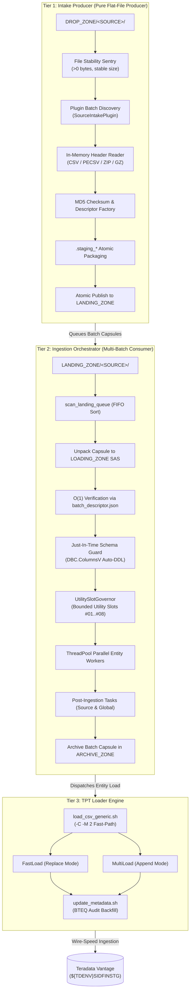

# Step-by-Step Tutorial: Developing a Custom Source-Specific Intake Controller

This tutorial provides an authoritative, end-to-end guide on creating and deploying a new source-specific intake controller within the **DATA_LOADER** enterprise framework.

Using the **Phase 04 Pluggable Intake Architecture** (`dataloader_core.intake`), integrating an upstream data source (such as **SAP ERP**, **Salesforce CRM**, **Workday**, or custom third-party feeds) requires minimal boilerplate while automatically benefiting from the platform's enterprise guarantees:
- **FIFO Chronological Queue Scheduling** (oldest extract processed first).
- **File Stability Sentry** (settling window protecting against partial/in-flight transfers).
- **In-Memory Zero-Disk Header Extraction** (reading `.csv`, `.pecsv`, `.zip`, `.gz` headers without uncompressing to disk).
- **Cryptographic Checksum Verification & Descriptor Factory** (one-pass MD5 computation and fast-path metadata generation).
- **Batch Capsule Publishing** (atomic packaging into `LANDING_ZONE/<SOURCE>/BATCH_<TS>_<ID>/`).
- **Zero Teradata Database Dependency** in Tier 1 (stateless producer).
- **Global Workload Governance** in Tier 2 (cross-process `UtilitySlotGovernor` protecting Teradata utility slots).

---

## 1. Architectural Foundations

### 1.1 The Decoupled 3-Tier Hierarchy

The `DATA_LOADER` platform enforces a strict separation of concerns across three distinct processing tiers:



### 1.2 Golden Rules for Intake Controllers

When developing a new intake controller, you **must adhere to these core principles**:

> [!IMPORTANT]
> **Golden Rules of Tier 1 Intake Controllers:**
> 1. **Zero Teradata Database Dependency**: Never import `teradatasql` or connect to Teradata in Tier 1. Database table state, DDL auto-migration, and lock tracking belong strictly to the Orchestrator (Tier 2).
> 2. **FAIL_STOP Execution Semantics**: Never swallow errors. If a file is unstable, truncated, missing, or if Orchestrator delegation fails with exit code `> 0`, abort the run immediately.
> 3. **Single Responsibility**: An intake controller is a **stateless producer**. Its only job is to discover raw arrival files, validate stability, extract header columns in memory, calculate checksums once, package atomic capsules into `LANDING_ZONE/<SOURCE>/`, and optionally trigger the Orchestrator.
> 4. **Entrypoint Simplicity**: Keep the CLI entrypoint script under **80 lines of code** by delegating all logic to `dataloader_core.intake.BaseIntakeController`.
> 5. **POSIX Standard**: Ensure strict Unix line endings (**LF only**, `CRLF = 0`, `BOM = 0`).

---

## 2. Choosing Your Intake Implementation Strategy

Before writing code, decide which implementation strategy fits your source feed:

| Strategy | When to Use | Development Effort | Key Component |
|:---|:---|:---:|:---|
| **Strategy A: Built-in Plugin (No-Code)** | Source provides standard manifests (`MANIFEST_<SRC>_<TS>_<ID>.MF`) or drops files without manifests. | **0 Python lines** (Config only) | `"intake_plugin": "standard_manifest"` or `"manifestless"` in `config.json`. |
| **Strategy B: Custom Intake Plugin** | Source exports custom manifests (e.g. JSON metadata, XML descriptors, SAP IDoc control files, or non-standard manifest filenames). | **~40–80 Python lines** | Subclass `SourceIntakePlugin` and register via `@PluginRegistry.register`. |
| **Strategy C: Dedicated Standalone Controller** | Source requires dedicated supervisor CLI, custom pre-intake API polling (e.g. REST API download prior to drop), or custom CLI flags. | **~60–100 Python lines** | Dedicated folder, subclass `BaseIntakeController`, thin CLI entrypoint. |

---

## 3. Step-by-Step Implementation: Building a Dedicated Intake Controller

In this tutorial, we will implement a production-grade intake controller for an enterprise source: **`SAP_ERP`**.

### Overview of the `SAP_ERP` Source Contract:
- **Source Code**: `SAP_ERP`
- **Drop Format**: Pairs of CSV files and raw manifest files named `SAP_MANIFEST_<TS>_<BATCH_ID>.txt`.
- **Manifest Format**: Delimited text with pipe separator `|`: `filename|md5_checksum`.
- **Target Tables**: `SAP_GL_ENTRY` (General Ledger), `SAP_VENDOR` (Vendor Master).
- **Delimiter**: Semicolon (`;`).
- **Load Modes**: `replace` for GL entries, `append` for Vendor increments.

---

### Step 1: Storage Tier Setup & Source Partitioning

In `DATA_LOADER`, all storage tiers are partitioned by `<SOURCE>`. Create the partition directories under `DATA/` and `LOGS/`:

```bash
cd /sg/local/sid/home/Dsidadm/DATA_LOADER

# Create partitioned storage zones for SAP_ERP
mkdir -p DATA/DROP_ZONE/SAP_ERP
mkdir -p DATA/LANDING_ZONE/SAP_ERP
mkdir -p DATA/LOADING_ZONE/SAP_ERP
mkdir -p DATA/ARCHIVE_ZONE/SAP_ERP
mkdir -p LOGS/SAP_ERP
```

Verify directory permissions:
```bash
chmod 775 DATA/*_ZONE/SAP_ERP LOGS/SAP_ERP
```

---

### Step 2: Configure Entity Routing (`CONFIG/entity_mapping.csv`)

Register the incoming file patterns and Teradata staging targets in [`CONFIG/entity_mapping.csv`](file:///C:/Users/P992860/data_loader/DATA_LOADER/CONFIG/entity_mapping.csv).

`DATA_LOADER` supports the extended **9-column mapping specification**:
```csv
SOURCE,TARGET_TABLE,FILE_SIGNATURE,EXTENSION,INNER_EXTENSION,DELIMITER,LOAD_MODE,SKIP_ROWS,HEADER_MODE
```

Add the SAP entries to `CONFIG/entity_mapping.csv`:
```csv
SAP_ERP,SAP_GL_ENTRY,gl_entry,".csv,.zip,.gz",.csv,";",replace,1,first_chunk_only
SAP_ERP,SAP_VENDOR,vendor,".csv,.zip,.gz",.csv,";",append,1,every_file
```

#### Column Explanations:
- `SOURCE`: Identifier matching the controller's `source_system_code` (`SAP_ERP`).
- `TARGET_TABLE`: Teradata staging table name in `${TDENV}SIDFINSTG`.
- `FILE_SIGNATURE`: Substring matched against the payload filename (e.g. `file_gl_entry_20261021.csv` matches `gl_entry`).
- `EXTENSION`: Allowed outer extensions.
- `INNER_EXTENSION`: Inner file format if payload is wrapped inside `.zip`.
- `DELIMITER`: Delimiter character passed to TPT via `-s` (`;`).
- `LOAD_MODE`: `replace` (FastLoad) or `append` (MultiLoad).
- `SKIP_ROWS`: Number of header lines to skip (`1`).
- `HEADER_MODE`:
  - `first_chunk_only`: BICC Solution A — strips line 1 from Chunk 1, loads chunks headless with `SkipRows = 0`.
  - `every_file`: Preserves all headers on disk, instructs TPT to skip headers natively via `-S 1 -Y Y`.
  - `none`: Files have no header line, loads directly with `SkipRows = 0`.

---

### Step 3: Implement the Custom Intake Plugin (`SourceIntakePlugin`)

Create the directory for your custom controller:
```bash
mkdir -p PROCESSING_TOOLS/SAP_INTAKE_CONTROLLER/lib
```

Create `PROCESSING_TOOLS/SAP_INTAKE_CONTROLLER/lib/sap_plugin.py`:

```python
"""
lib/sap_plugin.py - Custom Intake Plugin for SAP ERP Feeds
"""

from __future__ import annotations

import os
import re
from typing import Any, Dict, List

from dataloader_core.intake import (
    PluginRegistry,
    RawBatchCandidate,
    SourceIntakePlugin,
)


@PluginRegistry.register("sap_erp")
class SAPIntakePlugin(SourceIntakePlugin):
    """
    Plugin discovering and parsing SAP ERP flat-file exports with pipe-delimited
    manifests: SAP_MANIFEST_<YYYYMMDD_HHMMSS>_<BATCH_ID>.txt
    """

    MANIFEST_REGEX = re.compile(
        r"^SAP_MANIFEST_(\d{8}_\d{6})_([A-Za-z0-9_-]+)\.txt$",
        re.IGNORECASE,
    )

    @property
    def source_system_code(self) -> str:
        return "SAP_ERP"

    def discover_batches(self, drop_zone_path: str) -> List[RawBatchCandidate]:
        """
        Scans DROP_ZONE/SAP_ERP for raw manifests matching MANIFEST_REGEX.
        Returns candidate batches sorted chronologically ascending (FIFO).
        """
        candidates: List[RawBatchCandidate] = []
        if not os.path.exists(drop_zone_path):
            return candidates

        for fname in sorted(os.listdir(drop_zone_path)):
            match = self.MANIFEST_REGEX.match(fname)
            if not match:
                continue

            extract_ts = match.group(1)
            batch_id = match.group(2)
            manifest_file = os.path.join(drop_zone_path, fname)

            # Read pipe-delimited raw manifest to identify declared payload files
            data_files: List[str] = []
            try:
                with open(manifest_file, "r", encoding="utf-8") as f:
                    for line in f:
                        line = line.strip()
                        if not line or line.startswith("#"):
                            continue
                        parts = line.split("|")
                        payload_name = parts[0].strip()
                        if payload_name:
                            data_files.append(payload_name)
            except Exception as exc:
                self.logger.error(f"Error reading SAP manifest '{fname}': {exc}")
                continue

            candidates.append(
                RawBatchCandidate(
                    batch_id=batch_id,
                    extract_ts=extract_ts,
                    source=self.source_system_code,
                    raw_manifest_path=manifest_file,
                    data_files=data_files,
                )
            )

        # Sort strictly ascending by extract timestamp (FIFO)
        candidates.sort(key=lambda c: (c.extract_ts, c.batch_id))
        return candidates

    def extract_batch_metadata(
        self, candidate: RawBatchCandidate, drop_zone_path: str
    ) -> Dict[str, Any]:
        """Returns source-specific audit metadata to record in the audit receipt."""
        return {
            "source": self.source_system_code,
            "plugin": "SAPIntakePlugin",
            "batch_id": candidate.batch_id,
            "extract_ts": candidate.extract_ts,
            "raw_manifest": os.path.basename(candidate.raw_manifest_path or ""),
            "declared_file_count": len(candidate.data_files),
        }

    def validate_batch_files(
        self, candidate: RawBatchCandidate, drop_zone_path: str
    ) -> bool:
        """Verifies that all declared payload files exist and are non-empty."""
        for fname in candidate.data_files:
            fpath = os.path.join(drop_zone_path, fname)
            if not os.path.isfile(fpath):
                self.logger.error(f"Declared file '{fname}' missing from '{drop_zone_path}'!")
                return False
            if os.path.getsize(fpath) == 0:
                self.logger.error(f"Declared file '{fname}' is 0 bytes (truncated arrival)!")
                return False
        return True
```

---

### Step 4: Implement the Intake Controller Service

Create `PROCESSING_TOOLS/SAP_INTAKE_CONTROLLER/lib/intake_service.py`:

```python
"""
lib/intake_service.py - SAP ERP Intake Controller Service
"""

from __future__ import annotations

import os
import subprocess
import sys
from typing import Optional

from dataloader_core.exceptions import OrchestratorExecutionError
from dataloader_core.intake import BaseIntakeController

# Ensure custom plugin is registered
from lib.sap_plugin import SAPIntakePlugin  # noqa: F401


class SAPIntakeControllerService(BaseIntakeController):
    """
    Intake Producer service for SAP ERP, inheriting all core lifecycle capabilities
    from BaseIntakeController (locking, stability verification, in-memory header inspection,
    MD5 calculation, atomic capsule packaging, and Orchestrator delegation).
    """

    def __init__(
        self,
        config_path: str,
        source_override: Optional[str] = None,
        skip_post_tasks: bool = False,
        enqueue_only: bool = False,
    ) -> None:
        super().__init__(
            config_path=config_path,
            source_override=source_override or "SAP_ERP",
            skip_post_tasks=skip_post_tasks,
            enqueue_only=enqueue_only,
        )

    def invoke_orchestration_stage(self) -> int:
        """
        Launches DATA_INGESTION_ORCHESTRATOR subprocess under FAIL_STOP semantics,
        streaming execution logs in real time and forwarding environment flags.
        """
        orch_script = os.path.join(self.orch_dir, "orchestrator.py")
        if not os.path.exists(orch_script):
            raise OrchestratorExecutionError(f"orchestrator.py not found at: '{orch_script}'")

        cmd = [
            self.python_bin,
            orch_script,
            "--config", self.orch_config,
            "--source", self.default_source,
        ]
        if self.skip_post_tasks:
            cmd.append("--skip-post-tasks")

        post_tasks_file = self._write_post_tasks_file()
        if post_tasks_file:
            cmd.extend(["--post-tasks-file", post_tasks_file])

        extra_env = os.environ.copy()
        if "auto_migrate_ddl" in self.schema_cfg:
            extra_env["DL_AUTO_MIGRATE_DDL"] = "true" if self.schema_cfg.get("auto_migrate_ddl") else "false"

        self.logger.info(f"Invoking Orchestrator: {' '.join(cmd)} (cwd: '{self.orch_dir}')")
        proc = subprocess.Popen(
            cmd,
            cwd=self.orch_dir,
            stdout=subprocess.PIPE,
            stderr=subprocess.STDOUT,
            text=True,
            bufsize=1,
            universal_newlines=True,
            env=extra_env,
        )

        try:
            for line in iter(proc.stdout.readline, ""):
                if line:
                    self.logger.info(f"[ORCHESTRATOR] {line.rstrip()}")
        finally:
            if proc.stdout:
                proc.stdout.close()

        rc = proc.wait()
        if rc != 0:
            raise OrchestratorExecutionError(
                f"Orchestrator failed with exit code {rc} under FAIL_STOP."
            )

        self.logger.info("Orchestrator completed successfully with exit code 0.")
        return 0
```

---

### Step 5: Create the Thin CLI Entrypoint (`feeder.py`)

Create `PROCESSING_TOOLS/SAP_INTAKE_CONTROLLER/feeder.py`.

> [!IMPORTANT]
> Keep `feeder.py` strictly below **80 lines of code**! All business logic is encapsulated in `SAPIntakeControllerService`.

```python
"""
feeder.py - SAP ERP Intake Controller CLI Entrypoint (Pure Producer)

Thin CLI delegating DROP_ZONE scanning, settling sentry verification, in-memory
header inspection, MD5 hashing, atomic Batch Capsule packaging in LANDING_ZONE,
and Orchestrator delegation to `lib.intake_service.SAPIntakeControllerService`.
"""

from __future__ import annotations

import argparse
import os
import sys

SCRIPT_DIR = os.path.dirname(os.path.abspath(__file__))
COMMON_DIR = os.path.normpath(os.path.join(SCRIPT_DIR, "..", "COMMON"))
if COMMON_DIR not in sys.path:
    sys.path.insert(0, COMMON_DIR)
if SCRIPT_DIR not in sys.path:
    sys.path.insert(0, SCRIPT_DIR)

from dataloader_core.exceptions import DataLoaderError
from lib.intake_service import SAPIntakeControllerService


def main() -> None:
    parser = argparse.ArgumentParser(description="SAP ERP Intake Controller - Pure Batch Capsule Producer")
    parser.add_argument("--config", type=str, required=True, help="Path to configuration JSON")
    parser.add_argument(
        "--skip-post-tasks",
        action="store_true",
        default=False,
        help="Skip execution of downstream post-ingestion tasks (e.g. dbt)",
    )
    parser.add_argument("--source", type=str, default="SAP_ERP", help="Source system code override")
    parser.add_argument(
        "--enqueue-only",
        action="store_true",
        default=False,
        help="Stage and publish Batch Capsules without invoking the Orchestrator",
    )
    args = parser.parse_args()

    try:
        service = SAPIntakeControllerService(
            config_path=args.config,
            source_override=args.source,
            skip_post_tasks=args.skip_post_tasks,
            enqueue_only=args.enqueue_only,
        )
        sys.exit(service.run())
    except DataLoaderError as exc:
        print(f"FATAL: {exc}", file=sys.stderr)
        sys.exit(1)


if __name__ == "__main__":
    main()
```

---

### Step 6: Configuration File (`config.json` & `config_template.json`)

Create `PROCESSING_TOOLS/SAP_INTAKE_CONTROLLER/config.json`:

```json
{
  "feeder": {
    "drop_zone": "../../DATA/DROP_ZONE",
    "raw_manifest_archive": "../../DATA/ARCHIVE_ZONE",
    "logs_dir": "../../LOGS",
    "file_stability_window_seconds": 3,
    "source_system_code": "SAP_ERP",
    "intake_plugin": "sap_erp",
    "entity_mapping_file": "../../CONFIG/entity_mapping.csv",
    "concurrency": {
      "poll_interval_seconds": 5,
      "lock_timeout_seconds": 7200
    },
    "post_ingestion_tasks": [
      {
        "type": "shell",
        "command": "echo 'SAP ERP post-task completed for batch $CURRENT_BATCH_ID'"
      }
    ]
  },
  "schema_guard": {
    "auto_migrate_ddl": true,
    "default_column_type": "VARCHAR(4000)",
    "character_set": "UNICODE",
    "target_database": "${TDENV}SIDFINSTG"
  },
  "orchestrator": {
    "orchestrator_dir": "../DATA_INGESTION_ORCHESTRATOR",
    "config_file": "config.json",
    "landing_zone": "../../DATA/LANDING_ZONE",
    "python_executable": "python3",
    "trigger_orchestrator": true
  }
}
```

---

## 4. Testing & Verifying Your New Intake Controller

Follow this 3-tier testing approach before promoting your controller to production:

### 4.1 Unit Testing the Custom Plugin

Create a test script `test_sap_plugin.py`:

```python
import tempfile, os, unittest
from lib.sap_plugin import SAPIntakePlugin

class TestSAPPlugin(unittest.TestCase):
    def test_discovery_and_fifo_order(self):
        with tempfile.TemporaryDirectory() as tmp:
            # Create 2 batch manifests with timestamps
            m1 = os.path.join(tmp, "SAP_MANIFEST_20261021_080000_1001.txt")
            m2 = os.path.join(tmp, "SAP_MANIFEST_20261021_090000_1002.txt")
            with open(m1, "w") as f: f.write("gl_entry_1001.csv|md5hash1\n")
            with open(m2, "w") as f: f.write("gl_entry_1002.csv|md5hash2\n")

            plugin = SAPIntakePlugin()
            batches = plugin.discover_batches(tmp)

            self.assertEqual(len(batches), 2)
            # Assert FIFO order
            self.assertEqual(batches[0].batch_id, "1001")
            self.assertEqual(batches[1].batch_id, "1002")

if __name__ == "__main__":
    unittest.main()
```

### 4.2 Decoupled Queue Verification (`--enqueue-only`)

Test staging without touching Teradata or running the Orchestrator:

```bash
# 1. Inject synthetic test files into DROP_ZONE/SAP_ERP
cat << 'EOF' > DATA/DROP_ZONE/SAP_ERP/file_gl_entry_1001.csv
GL_ACCOUNT;AMOUNT;CURRENCY;POSTING_DATE
4000100;1500.50;EUR;2026-10-21
EOF

cat << 'EOF' > DATA/DROP_ZONE/SAP_ERP/SAP_MANIFEST_20261021_120000_1001.txt
file_gl_entry_1001.csv|dummy_md5
EOF

# 2. Run controller with --enqueue-only
cd PROCESSING_TOOLS/SAP_INTAKE_CONTROLLER
python3 feeder.py --config config.json --enqueue-only
```

#### Assertions to Verify:
1. Exit code is `0`.
2. `DATA/DROP_ZONE/SAP_ERP/` is empty.
3. `DATA/LANDING_ZONE/SAP_ERP/BATCH_20261021_120000_1001/` was created.
4. Capsule contains:
   - `file_gl_entry_1001.csv`
   - `MANIFEST_SAP_ERP_20261021_120000_1001.MF`
   - `batch_descriptor.json` containing:
     ```json
     "header_columns": ["GL_ACCOUNT", "AMOUNT", "CURRENCY", "POSTING_DATE"],
     "delimiter": ";",
     "load_mode": "replace"
     ```
   - `RAW/RECEIPT_SAP_ERP_20261021_120000_1001.json`

---

### 4.3 End-to-End Ingestion via Orchestrator

Trigger the Orchestrator to consume the queued SAP capsule:

```bash
cd ../DATA_INGESTION_ORCHESTRATOR
python3 orchestrator.py --config config.json --source SAP_ERP
```

Or run the global multi-source sweep:
```bash
python3 orchestrator.py --config config.json --all-sources
```

#### Verification:
1. `DATA/LANDING_ZONE/SAP_ERP/` and `DATA/LOADING_ZONE/SAP_ERP/` are empty.
2. The batch capsule is archived in `DATA/ARCHIVE_ZONE/SAP_ERP/2026-10/BATCH_1001_20261021_120000/`.
3. Teradata `${TDENV}SIDFINTCH.BATCH_RUNS` has `STATUS = 'SUCCESS'` and `PROCESS_PID` retained.
4. Teradata staging table `${TDENV}SIDFINSTG.SAP_GL_ENTRY` contains 1 row with audit columns:
   - `INFA_BATCH_ID = '1001'`
   - `INFA_LAST_REPLICATED` populated.

---

## 5. Production Operations & Scheduling

### 5.1 Automated Scheduling Options

Depending on your integration architecture, choose between two operational models:

#### Model 1: Synchronous Producer-Trigger (Simple)
The intake controller runs on a 15-minute cron schedule, stages all pending batches, and triggers the Orchestrator once:
```bash
*/15 * * * * cd /sg/local/sid/home/Dsidadm/DATA_LOADER/PROCESSING_TOOLS/SAP_INTAKE_CONTROLLER && python3 feeder.py --config config.json >> /sg/local/sid/home/Dsidadm/DATA_LOADER/LOGS/SAP_ERP/scheduler.log 2>&1
```

#### Model 2: Decoupled Producer / Consumer (Recommended for Multi-Source Scaling)
- **Intake Cron (Producer)**: Runs every 5 minutes with `--enqueue-only`. Publishes capsules into `LANDING_ZONE/SAP_ERP/` without Teradata load:
  ```bash
  */5 * * * * cd /sg/local/sid/home/Dsidadm/DATA_LOADER/PROCESSING_TOOLS/SAP_INTAKE_CONTROLLER && python3 feeder.py --config config.json --enqueue-only
  ```
- **Global Orchestrator Cron (Consumer)**: Runs every 10 minutes to drain all source queues under global slot governance:
  ```bash
  */10 * * * * cd /sg/local/sid/home/Dsidadm/DATA_LOADER/PROCESSING_TOOLS/DATA_INGESTION_ORCHESTRATOR && python3 orchestrator.py --config config.json --all-sources
  ```

---

## 6. Developer Checklist & Quality Gates

Before submitting your new intake controller for code review, verify:

- [ ] **Decoupled Architecture**: No database queries, no Teradata imports in `SAP_INTAKE_CONTROLLER`.
- [ ] **FIFO Ordering**: `discover_batches()` sorts candidates strictly ascending by timestamp.
- [ ] **Stability Sentry**: `file_stability_window_seconds >= 3` in `config.json`.
- [ ] **Entity Routing**: All targets configured in `CONFIG/entity_mapping.csv` with delimiter, load mode, and header mode.
- [ ] **Line Limits**: `feeder.py` strictly $< 80$ lines.
- [ ] **POSIX Compliance**: Line endings are strict Unix LF (`CRLF = 0`, `BOM = 0`).
- [ ] **Locking**: Process lock `.feeder_SAP_ERP.pid` properly handles active polling and dead PID cleanup.
- [ ] **FAIL_STOP**: Subprocess non-zero exit code halts queue processing immediately.
- [ ] **Test Validation**: Tested with unit tests and live ingestion into Teradata Vantage.
