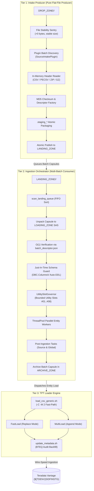
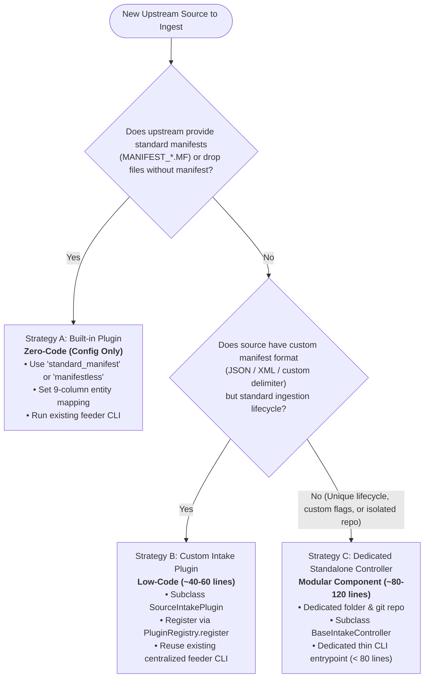

# Step-by-Step Tutorial: Developing Source-Specific Intake Controllers

This tutorial provides an authoritative, end-to-end developer guide for onboarding new data sources and creating custom intake controllers within the **DATA_LOADER** enterprise framework.

Using the **Phase 04 Pluggable Intake Architecture** (`dataloader_core.intake`), integrating an upstream data source (such as **Oracle Fusion BICC**, **SAP ERP**, **Salesforce CRM**, **Workday**, **NetSuite**, or proprietary feeds) requires minimal code while automatically benefiting from the platform's enterprise guarantees:
- **FIFO Chronological Queue Scheduling** (oldest extract processed first).
- **File Stability Sentry** (settling window protecting against partial/in-flight transfers).
- **In-Memory Zero-Disk Header Extraction** (reading `.csv`, `.pecsv`, `.zip`, `.gz` headers without uncompressing to disk).
- **Cryptographic Checksum Verification & Descriptor Factory** (one-pass MD5 computation and fast-path metadata generation).
- **Batch Capsule Publishing** (atomic packaging into `LANDING_ZONE/<SOURCE>/BATCH_<TS>_<ID>/`).
- **Zero Teradata Database Dependency** in Tier 1 (stateless producer).
- **Global Workload Governance** in Tier 2 (cross-process `UtilitySlotGovernor` protecting Teradata utility slots).

---

## 1. Architectural Foundations

### 1.1 The Decoupled 3-Tier Hierarchy

The `DATA_LOADER` platform enforces a strict separation of concerns across three distinct processing tiers:



### 1.2 Golden Rules for Intake Controllers

When developing or configuring any intake controller, you **must adhere to these core principles**:

> [!IMPORTANT]
> **Golden Rules of Tier 1 Intake Controllers:**
> 1. **Zero Teradata Database Dependency**: Never import `teradatasql` or connect to Teradata in Tier 1. Database table state, DDL auto-migration, and lock tracking belong strictly to the Orchestrator (Tier 2).
> 2. **FAIL_STOP Execution Semantics**: Never swallow errors. If a file is unstable, truncated, missing, or if Orchestrator delegation fails with exit code `> 0`, abort the run immediately.
> 3. **Single Responsibility**: An intake controller is a **stateless producer**. Its only job is to discover raw arrival files, validate stability, extract header columns in memory, calculate checksums once, package atomic capsules into `LANDING_ZONE/<SOURCE>/`, and optionally trigger the Orchestrator.
> 4. **Entrypoint Simplicity**: Keep any CLI entrypoint script strictly under **80 lines of code** by delegating all logic to `dataloader_core.intake.BaseIntakeController`.
> 5. **POSIX Standard**: Ensure strict Unix line endings (**LF only**, `CRLF = 0`, `BOM = 0`).

---

## 2. Choosing Your Intake Implementation Strategy

The framework provides three distinct implementation strategies tailored to different source formats, operational requirements, and lifecycle needs.

### 2.1 The 3 Architectural Strategies



### 2.2 In-Depth Decision Matrix & Selection Criteria

Review the table below to select the optimal strategy for your upstream source:

| Dimension | Strategy A: Built-in Plugin | Strategy B: Custom Intake Plugin | Strategy C: Dedicated Controller |
|:---|:---|:---|:---|
| **Primary Use Case** | Sources dropping standardized `.MF` manifests or plain CSV/ZIP files without manifests. | Sources providing proprietary manifest files (e.g., JSON, XML, pipe/semicolon metadata), but standard CLI lifecycle. | Complex enterprise sources requiring dedicated microservice packaging, bespoke CLI arguments, or separate Git repo. |
| **Code Required** | **0 lines** of Python *(Configuration only)*. | **~40–60 lines** of Python *(Single plugin class)*. | **~80–120 lines** of Python *(Plugin + Service + CLI)*. |
| **Key Framework Components** | `StandardManifestIntakePlugin` or `ManifestlessDropIntakePlugin`. | Subclass `SourceIntakePlugin` registered in `PluginRegistry`. | Subclass `BaseIntakeController` with dedicated `feeder.py` entrypoint. |
| **Upstream Manifest Pattern** | `MANIFEST_<SRC>_<TS>_<ID>.MF` or no manifest at all (`.csv`, `.zip`, `.gz`). | `*.json`, `*.xml`, `*.ctl`, non-standard `.txt`, or nested manifest metadata. | Proprietary manifests + custom pre-intake REST API polling, FTP triggers, or bespoke flags. |
| **Deployment Footprint** | Shared deployment under existing controller. | Single plugin file added to `dataloader_core/intake/` or custom module. | Dedicated component directory (e.g. `PROCESSING_TOOLS/<SRC>_INTAKE_CONTROLLER/`). |
| **CLI Entrypoint** | Existing `feeder.py --source <SRC>`. | Existing `feeder.py --source <SRC>`. | Dedicated `feeder.py` (`< 80` lines) in component folder. |
| **Concurrency Lock** | Dynamic `.feeder_<SRC>.pid`. | Dynamic `.feeder_<SRC>.pid`. | Dedicated `.feeder_<SRC>.pid`. |
| **Teradata Database Impact** | **Zero** (Pure Producer). | **Zero** (Pure Producer). | **Zero** (Pure Producer). |
| **Typical Source Examples** | **NetSuite**, **Salesforce Drops**, **CRM Standard**, flat SFTP landing. | **Workday (JSON)**, **Coupa (XML)**, **Custom REST Export**. | **Oracle Fusion BICC**, **SAP ERP**, **Legacy Mainframe**. |

### 2.3 Deciding Conditions & Trade-Offs

#### Adopt Strategy A when:
1. Upstream drops files accompanied by a manifest matching the standard format:
   `MANIFEST_<SOURCE>_<TIMESTAMP>_<BATCH_ID>.MF` containing `filename,checksum` (comma, tab, or pipe delimited).
2. Upstream deposits plain data files (`.csv`, `.zip`, `.gz`) directly into `DROP_ZONE/<SOURCE>/` **without any manifest**. The built-in `manifestless` plugin automatically discovers files, groups them by timestamp, and computes MD5 checksums.
3. You want zero code maintenance and rapid onboarding in under 15 minutes.

#### Adopt Strategy B when:
1. Upstream delivers a non-standard manifest format, such as:
   - A JSON metadata file (e.g., `batch_metadata.json` or `export_manifest.json`).
   - An XML control descriptor (e.g., `batch_manifest.xml`).
   - A non-standard filename convention (e.g., `EXPORT_<ID>_<TS>.ctl`).
2. You do **not** need custom command-line arguments or separate deployment pipelines. You simply want the existing `feeder.py` CLI to recognize and parse the source using the pluggable registry.

#### Adopt Strategy C when:
1. The integration requires an independent Git repository, dedicated versioning (`v1.0.0`, `v2.0.0`), and separate production release cycles.
2. The source requires bespoke command-line flags (e.g., `--pre-fetch-api`, `--validate-accounting-period`) or pre-intake REST API polling prior to file staging.
3. The enterprise team responsible for the source operates independently from other source teams.

---

## 3. Strategy A Walkthrough: Built-in Plugin (Zero-Code / Configuration Only)

In this walkthrough, we onboard **`NETSUITE`** (using the built-in `standard_manifest` plugin) and demonstrate how **`SALESFORCE`** can be onboarded with `manifestless`.

### Scenario Overview:
- **Source Code**: `NETSUITE`
- **Drop Format**: CSV files accompanied by standard manifests: `MANIFEST_NETSUITE_20261023_100000_101.MF`.
- **Target Tables**: `NETSUITE_TRANSACTION`, `NETSUITE_CUSTOMER`.
- **Python Lines to Write**: **0 lines**.

---

### Step A1: Storage Tier Setup & Partitioning

Create the partitioned storage directories under `DATA/` and `LOGS/`:

```bash
cd /sg/local/sid/home/Dsidadm/DATA_LOADER

# Create partitioned storage zones for NETSUITE
mkdir -p DATA/DROP_ZONE/NETSUITE
mkdir -p DATA/LANDING_ZONE/NETSUITE
mkdir -p DATA/LOADING_ZONE/NETSUITE
mkdir -p DATA/ARCHIVE_ZONE/NETSUITE
mkdir -p LOGS/NETSUITE

# Ensure appropriate permissions
chmod 775 DATA/*_ZONE/NETSUITE LOGS/NETSUITE
```

---

### Step A2: Configure Entity Routing (`CONFIG/entity_mapping.csv`)

Add the entity routing definitions to [`CONFIG/entity_mapping.csv`](file:///C:/Users/P992860/data_loader/DATA_LOADER/CONFIG/entity_mapping.csv) using the 9-column format:

```csv
SOURCE,TARGET_TABLE,FILE_SIGNATURE,EXTENSION,INNER_EXTENSION,DELIMITER,LOAD_MODE,SKIP_ROWS,HEADER_MODE
NETSUITE,NETSUITE_TRANSACTION,tran,".csv,.zip",.csv,",",replace,1,every_file
NETSUITE,NETSUITE_CUSTOMER,cust,".csv,.zip",.csv,",",append,1,every_file
```

---

### Step A3: Declarative Configuration (`config.json`)

Create or update the configuration file (e.g., `CONFIG/config_netsuite.json` or within an existing controller):

```json
{
  "feeder": {
    "source_system_code": "NETSUITE",
    "intake_plugin": "standard_manifest",
    "drop_zone": "../../DATA/DROP_ZONE",
    "logs_dir": "../../LOGS",
    "file_stability_window_seconds": 3,
    "entity_mapping_file": "../../CONFIG/entity_mapping.csv",
    "concurrency": {
      "poll_interval_seconds": 5,
      "lock_timeout_seconds": 7200
    }
  },
  "schema_guard": {
    "auto_migrate_ddl": true,
    "target_database": "${TDENV}SIDFINSTG",
    "technical_database": "${TDENV}SIDFINTCH"
  },
  "orchestrator": {
    "orchestrator_dir": "../DATA_INGESTION_ORCHESTRATOR",
    "config_file": "config.json",
    "landing_zone": "../../DATA/LANDING_ZONE",
    "python_executable": "python3",
    "trigger_orchestrator": true
  }
}
```

> [!TIP]
> If your upstream source drops raw files without any manifest (e.g. `SALESFORCE`), simply change:
> ```json
> "intake_plugin": "manifestless"
> ```
> The controller will automatically discover unmanifested data files, group them by timestamp, and calculate cryptographic checksums on the fly!

---

### Step A4: Execution via Existing Intake Feeder

Execute the existing centralized intake runner:

```bash
cd /sg/local/sid/home/Dsidadm/DATA_LOADER/PROCESSING_TOOLS/BICC_INTAKE_CONTROLLER

# Run with --source override and --enqueue-only for queue testing:
python3 feeder.py --config config.json --source NETSUITE --enqueue-only
```

---

### Step A5: Verification of Staged Capsule

Inspect `DATA/LANDING_ZONE/NETSUITE/`:
```bash
ls -l DATA/LANDING_ZONE/NETSUITE/
# Output: BATCH_20261023_100000_101/
```
The batch capsule is fully packaged with `batch_descriptor.json`, standardized manifest, and ready for FIFO consumption by Tier 2!

---

## 4. Strategy B Walkthrough: Custom Intake Plugin (Pluggable Architecture, Shared Controller)

In this walkthrough, we onboard **`WORKDAY`**, where upstream drops CSV files accompanied by a proprietary **JSON metadata descriptor**. We create a custom plugin that plugs into the existing controller without needing a separate standalone microservice.

### Scenario Overview:
- **Source Code**: `WORKDAY`
- **Drop Format**: CSV files + JSON manifest: `WORKDAY_EXPORT_<TS>_<BATCH_ID>.json`.
- **JSON Manifest Structure**:
  ```json
  {
    "source": "WORKDAY",
    "batch_id": "WD_1001",
    "extract_timestamp": "20261023_103000",
    "files": [
      {"filename": "file_worker_1001.csv", "md5": "a1b2c3d4e5f67890123456789abcdef0"},
      {"filename": "file_payroll_1001.csv", "md5": "0fedcba9876543210987654321abcdef"}
    ]
  }
  ```
- **Target Tables**: `WORKDAY_WORKER`, `WORKDAY_PAYROLL`.
- **Development Effort**: ~45 lines of Python.

---

### Step B1: Storage Tier Setup & Partitioning

```bash
cd /sg/local/sid/home/Dsidadm/DATA_LOADER
mkdir -p DATA/DROP_ZONE/WORKDAY
mkdir -p DATA/LANDING_ZONE/WORKDAY
mkdir -p DATA/LOADING_ZONE/WORKDAY
mkdir -p DATA/ARCHIVE_ZONE/WORKDAY
mkdir -p LOGS/WORKDAY
chmod 775 DATA/*_ZONE/WORKDAY LOGS/WORKDAY
```

---

### Step B2: Configure Entity Routing (`CONFIG/entity_mapping.csv`)

Add the Workday routing entries to [`CONFIG/entity_mapping.csv`](file:///C:/Users/P992860/data_loader/DATA_LOADER/CONFIG/entity_mapping.csv):

```csv
SOURCE,TARGET_TABLE,FILE_SIGNATURE,EXTENSION,INNER_EXTENSION,DELIMITER,LOAD_MODE,SKIP_ROWS,HEADER_MODE
WORKDAY,WORKDAY_WORKER,worker,".csv,.zip",.csv,",",replace,1,every_file
WORKDAY,WORKDAY_PAYROLL,payroll,".csv,.zip",.csv,",",append,1,every_file
```

---

### Step B3: Implement the Custom Plugin (`WorkdayIntakePlugin`)

Create `dataloader_core/intake/workday_plugin.py` (or place it in a shared `lib/` directory imported at startup):

```python
"""
dataloader_core/intake/workday_plugin.py - Custom Workday JSON Intake Plugin
"""

from __future__ import annotations

import json
import logging
import os
import re
from typing import Any, Dict, List

from dataloader_core.intake.plugin import (
    PluginRegistry,
    RawBatchCandidate,
    SourceIntakePlugin,
)

logger = logging.getLogger("dataloader_core.intake.workday")


class WorkdayIntakePlugin(SourceIntakePlugin):
    """
    Discovers and parses Workday JSON manifests: WORKDAY_EXPORT_<TS>_<BATCH_ID>.json
    """

    source_code = "WORKDAY"

    MANIFEST_PATTERN = re.compile(
        r"^WORKDAY_EXPORT_(\d{8}_\d{6})_([A-Za-z0-9_-]+)\.json$",
        re.IGNORECASE,
    )

    def discover_raw_batches(self, drop_zone: str) -> List[RawBatchCandidate]:
        if not os.path.exists(drop_zone):
            return []

        candidates: List[RawBatchCandidate] = []
        for fname in os.listdir(drop_zone):
            match = self.MANIFEST_PATTERN.match(fname)
            if not match:
                continue

            manifest_path = os.path.join(drop_zone, fname)
            try:
                with open(manifest_path, "r", encoding="utf-8") as f:
                    manifest_data: Dict[str, Any] = json.load(f)

                batch_id = str(manifest_data.get("batch_id") or match.group(2))
                extract_ts = str(manifest_data.get("extract_timestamp") or match.group(1))
                file_items = manifest_data.get("files", [])

                # Extract declared filenames
                declared_files = [item["filename"] for item in file_items if "filename" in item]

                # Construct chronological sort key (timestamp string, batch_id)
                sort_key = (extract_ts, batch_id)

                candidate = RawBatchCandidate(
                    batch_id=batch_id,
                    source=self.source_code,
                    extract_timestamp_raw=extract_ts,
                    sort_key=sort_key,
                    manifest_path=manifest_path,
                    declared_files=declared_files,
                    metadata=manifest_data,
                )
                candidates.append(candidate)
            except Exception as exc:
                logger.error(f"Failed to parse Workday manifest '{fname}': {exc}")
                continue

        # Sort strictly ascending (FIFO chronological queue)
        return sorted(candidates, key=lambda c: c.sort_key)


# Register plugin in the centralized PluginRegistry
PluginRegistry.register("WORKDAY", WorkdayIntakePlugin)
```

---

### Step B4: Configure and Run

In your controller `config.json`, configure:
```json
{
  "feeder": {
    "source_system_code": "WORKDAY",
    "intake_plugin": "WORKDAY",
    "drop_zone": "../../DATA/DROP_ZONE",
    "logs_dir": "../../LOGS",
    "file_stability_window_seconds": 3,
    "entity_mapping_file": "../../CONFIG/entity_mapping.csv"
  }
}
```

Run the existing controller:
```bash
python3 feeder.py --config config.json --source WORKDAY --enqueue-only
```
The controller dynamically loads `WorkdayIntakePlugin`, discovers the JSON manifests, verifies file stability, reads CSV column headers in memory, and stages batch capsules into `LANDING_ZONE/WORKDAY/`!

---

## 5. Strategy C Walkthrough: Dedicated Standalone Controller (`SAP_ERP`)

In this walkthrough, we build a fully dedicated, autonomous intake controller component for **`SAP_ERP`**, complete with its own directory, custom plugin, dedicated service subclassing `BaseIntakeController`, thin CLI entrypoint, and isolated tests.

### Scenario Overview:
- **Source Code**: `SAP_ERP`
- **Drop Format**: Semicolon-delimited CSV files + pipe-delimited raw manifest: `SAP_MANIFEST_<TS>_<BATCH_ID>.txt`.
- **Manifest Format**: Delimited text with pipe separator `|`: `filename|md5_checksum`.
- **Target Tables**: `SAP_GL_ENTRY` (General Ledger), `SAP_VENDOR` (Vendor Master).
- **Delimiter**: Semicolon (`;`).
- **Load Modes**: `replace` for GL entries, `append` for Vendor increments.

---

### Step C1: Storage Tier Setup & Source Partitioning

```bash
cd /sg/local/sid/home/Dsidadm/DATA_LOADER

mkdir -p DATA/DROP_ZONE/SAP_ERP
mkdir -p DATA/LANDING_ZONE/SAP_ERP
mkdir -p DATA/LOADING_ZONE/SAP_ERP
mkdir -p DATA/ARCHIVE_ZONE/SAP_ERP
mkdir -p LOGS/SAP_ERP

chmod 775 DATA/*_ZONE/SAP_ERP LOGS/SAP_ERP
```

---

### Step C2: Configure Entity Routing (`CONFIG/entity_mapping.csv`)

Register the incoming file patterns and Teradata staging targets in [`CONFIG/entity_mapping.csv`](file:///C:/Users/P992860/data_loader/DATA_LOADER/CONFIG/entity_mapping.csv):

```csv
SOURCE,TARGET_TABLE,FILE_SIGNATURE,EXTENSION,INNER_EXTENSION,DELIMITER,LOAD_MODE,SKIP_ROWS,HEADER_MODE
SAP_ERP,SAP_GL_ENTRY,gl_entry,".csv,.zip,.gz",.csv,";",replace,1,first_chunk_only
SAP_ERP,SAP_VENDOR,vendor,".csv,.zip,.gz",.csv,";",append,1,every_file
```

#### Column Explanations:
- `SOURCE`: Identifier matching the controller's `source_system_code` (`SAP_ERP`).
- `TARGET_TABLE`: Teradata staging table name in `${TDENV}SIDFINSTG`.
- `FILE_SIGNATURE`: Substring matched against the payload filename (e.g. `file_gl_entry_20261021.csv` matches `gl_entry`).
- `EXTENSION`: Allowed outer extensions (`.csv`, `.zip`, `.gz`).
- `INNER_EXTENSION`: Inner file format if payload is wrapped inside `.zip`.
- `DELIMITER`: Delimiter character passed to TPT via `-s` (`;`).
- `LOAD_MODE`: `replace` (FastLoad) or `append` (MultiLoad).
- `SKIP_ROWS`: Number of header lines to skip (`1`).
- `HEADER_MODE`:
  - `first_chunk_only`: Strips line 1 from Chunk 1, loads chunks headless with `SkipRows = 0`.
  - `every_file`: Preserves all headers on disk, instructs TPT to skip headers natively via `-S 1 -Y Y`.

---

### Step C3: Implement the Custom Intake Plugin (`lib/sap_plugin.py`)

Create the directory for your custom controller:
```bash
mkdir -p PROCESSING_TOOLS/SAP_INTAKE_CONTROLLER/lib
```

Create `PROCESSING_TOOLS/SAP_INTAKE_CONTROLLER/lib/sap_plugin.py`:

```python
"""
lib/sap_plugin.py - Custom Intake Plugin for SAP ERP Feeds
"""

from __future__ import annotations

import logging
import os
import re
from typing import Any, Dict, List

from dataloader_core.intake.plugin import (
    PluginRegistry,
    RawBatchCandidate,
    SourceIntakePlugin,
)

logger = logging.getLogger("sap_intake.plugin")


class SAPIntakePlugin(SourceIntakePlugin):
    """
    Plugin discovering and parsing SAP ERP flat-file exports with pipe-delimited
    manifests: SAP_MANIFEST_<YYYYMMDD_HHMMSS>_<BATCH_ID>.txt
    """

    source_code = "SAP_ERP"

    MANIFEST_REGEX = re.compile(
        r"^SAP_MANIFEST_(\d{8}_\d{6})_([A-Za-z0-9_-]+)\.txt$",
        re.IGNORECASE,
    )

    def discover_raw_batches(self, drop_zone: str) -> List[RawBatchCandidate]:
        """
        Scans DROP_ZONE/SAP_ERP for raw manifests matching MANIFEST_REGEX.
        Returns candidate batches sorted chronologically ascending (FIFO).
        """
        if not os.path.exists(drop_zone):
            return []

        candidates: List[RawBatchCandidate] = []
        for filename in os.listdir(drop_zone):
            match = self.MANIFEST_REGEX.match(filename)
            if not match:
                continue

            extract_ts_raw = match.group(1)
            batch_id = match.group(2)
            manifest_path = os.path.join(drop_zone, filename)

            # Read declared payload files from pipe-delimited manifest (filename|checksum)
            declared_files: List[str] = []
            try:
                with open(manifest_path, "r", encoding="utf-8") as f:
                    for line in f:
                        line = line.strip()
                        if line and not line.startswith("#"):
                            parts = line.split("|")
                            declared_files.append(parts[0].strip())
            except Exception as e:
                logger.error(f"Failed to read manifest {filename}: {e}")
                continue

            candidate = RawBatchCandidate(
                batch_id=batch_id,
                source=self.source_code,
                extract_timestamp_raw=extract_ts_raw,
                sort_key=(extract_ts_raw, batch_id),
                manifest_path=manifest_path,
                declared_files=declared_files,
                metadata={"raw_manifest": filename, "source": self.source_code},
            )
            candidates.append(candidate)

        # Enforce FIFO chronological queue order
        return sorted(candidates, key=lambda c: c.sort_key)


# Register in the plugin registry
PluginRegistry.register("SAP_ERP", SAPIntakePlugin)
```

---

### Step C4: Implement the Dedicated Controller Service (`lib/intake_service.py`)

Create `PROCESSING_TOOLS/SAP_INTAKE_CONTROLLER/lib/intake_service.py`:

```python
"""
lib/intake_service.py - SAP ERP Intake Controller Service
"""

from __future__ import annotations

import logging
import os
import sys
from typing import Optional

from dataloader_core.intake import BaseIntakeController
from dataloader_core.logging_utils import LoggingFactory

from .sap_plugin import SAPIntakePlugin

logger = logging.getLogger("sap_intake.service")


class SAPIntakeControllerService(BaseIntakeController):
    """
    Specialized intake controller service for SAP ERP feeds.
    Inherits enterprise lifecycle mechanics from BaseIntakeController:
      1. Advisory lock sentry (.feeder_SAP_ERP.pid) with active polling.
      2. Multi-batch FIFO discovery via SAPIntakePlugin.
      3. File stability sentry (>0 bytes and settled size).
      4. In-memory CSV header extraction and schema validation.
      5. MD5 computation and batch_descriptor.json synthesis.
      6. Atomic Batch Capsule staging in LANDING_ZONE/SAP_ERP/.
      7. Orchestrator bridge invocation with strict FAIL_STOP.
    """

    def __init__(
        self,
        config_path: str,
        source_override: Optional[str] = None,
        skip_post_tasks: bool = False,
        enqueue_only: bool = False,
    ) -> None:
        # Initialize custom SAP plugin instance
        sap_plugin = SAPIntakePlugin()

        super().__init__(
            config_path=config_path,
            source_override=source_override or "SAP_ERP",
            skip_post_tasks=skip_post_tasks,
            enqueue_only=enqueue_only,
            plugin=sap_plugin,
        )
```

---

### Step C5: Create the Thin CLI Entrypoint (`feeder.py`)

Create `PROCESSING_TOOLS/SAP_INTAKE_CONTROLLER/feeder.py` (strictly under 80 lines):

```python
"""
feeder.py - SAP ERP Intake Controller CLI Entrypoint
Stateless Producer staging Batch Capsules in LANDING_ZONE/SAP_ERP.
"""

from __future__ import annotations

import argparse
import os
import sys

SCRIPT_DIR = os.path.dirname(os.path.abspath(__file__))
COMMON_DIR = os.path.normpath(os.path.join(SCRIPT_DIR, "..", "COMMON"))
if COMMON_DIR not in sys.path:
    sys.path.insert(0, COMMON_DIR)
if SCRIPT_DIR not in sys.path:
    sys.path.insert(0, SCRIPT_DIR)

from dataloader_core.exceptions import DataLoaderError
from lib.intake_service import SAPIntakeControllerService


def main() -> None:
    parser = argparse.ArgumentParser(
        description="SAP ERP Intake Controller - Stateless Batch Capsule Producer"
    )
    parser.add_argument("--config", type=str, required=True, help="Path to config JSON")
    parser.add_argument(
        "--skip-post-tasks",
        action="store_true",
        default=False,
        help="Skip downstream post-ingestion tasks",
    )
    parser.add_argument("--source", type=str, default="SAP_ERP", help="Source system code")
    parser.add_argument(
        "--enqueue-only",
        action="store_true",
        default=False,
        help="Stage batch capsules in LANDING_ZONE without invoking Orchestrator",
    )
    args = parser.parse_args()

    try:
        service = SAPIntakeControllerService(
            config_path=args.config,
            source_override=args.source,
            skip_post_tasks=args.skip_post_tasks,
            enqueue_only=args.enqueue_only,
        )
        sys.exit(service.run())
    except DataLoaderError as exc:
        print(f"FATAL: {exc}", file=sys.stderr)
        sys.exit(1)


if __name__ == "__main__":
    main()
```

---

### Step C6: Configuration File (`config.json`)

Create `PROCESSING_TOOLS/SAP_INTAKE_CONTROLLER/config.json`:

```json
{
  "feeder": {
    "source_system_code": "SAP_ERP",
    "drop_zone": "../../DATA/DROP_ZONE",
    "logs_dir": "../../LOGS",
    "file_stability_window_seconds": 5,
    "entity_mapping_file": "../../CONFIG/entity_mapping.csv",
    "concurrency": {
      "poll_interval_seconds": 5,
      "lock_timeout_seconds": 7200
    }
  },
  "schema_guard": {
    "auto_migrate_ddl": true,
    "target_database": "${TDENV}SIDFINSTG",
    "technical_database": "${TDENV}SIDFINTCH"
  },
  "orchestrator": {
    "orchestrator_dir": "../DATA_INGESTION_ORCHESTRATOR",
    "config_file": "config.json",
    "landing_zone": "../../DATA/LANDING_ZONE",
    "python_executable": "python3",
    "trigger_orchestrator": true
  }
}
```

---

## 6. Testing & Verifying Any Intake Strategy

Follow this 3-tier testing approach before promoting your controller to production:

### 6.1 Unit Testing Custom Plugins

Create `TESTS/unit/test_sap_plugin.py`:

```python
import os
import tempfile
import unittest
from lib.sap_plugin import SAPIntakePlugin


class TestSAPPlugin(unittest.TestCase):
    def test_discovery_and_fifo_order(self):
        with tempfile.TemporaryDirectory() as tmp:
            # Create 2 batch manifests with timestamps
            m1 = os.path.join(tmp, "SAP_MANIFEST_20261021_080000_1001.txt")
            m2 = os.path.join(tmp, "SAP_MANIFEST_20261021_090000_1002.txt")
            with open(m1, "w") as f:
                f.write("gl_entry_1001.csv|dummy_md5_1\n")
            with open(m2, "w") as f:
                f.write("gl_entry_1002.csv|dummy_md5_2\n")

            plugin = SAPIntakePlugin()
            batches = plugin.discover_raw_batches(tmp)

            self.assertEqual(len(batches), 2)
            # Assert FIFO chronological order
            self.assertEqual(batches[0].batch_id, "1001")
            self.assertEqual(batches[1].batch_id, "1002")


if __name__ == "__main__":
    unittest.main()
```

### 6.2 Decoupled Queue Verification (`--enqueue-only`)

Test staging without touching Teradata or running the Orchestrator:

```bash
# 1. Inject synthetic test files into DROP_ZONE/SAP_ERP
cat << 'EOF' > DATA/DROP_ZONE/SAP_ERP/file_gl_entry_1001.csv
GL_ACCOUNT;AMOUNT;CURRENCY;POSTING_DATE
4000100;1500.50;EUR;2026-10-21
EOF

cat << 'EOF' > DATA/DROP_ZONE/SAP_ERP/SAP_MANIFEST_20261021_120000_1001.txt
file_gl_entry_1001.csv|dummy_md5
EOF

# 2. Run controller with --enqueue-only
cd PROCESSING_TOOLS/SAP_INTAKE_CONTROLLER
python3 feeder.py --config config.json --enqueue-only
```

#### Assertions to Verify:
1. Exit code is `0`.
2. `DATA/DROP_ZONE/SAP_ERP/` is empty (raw arrival processed).
3. `DATA/LANDING_ZONE/SAP_ERP/BATCH_20261021_120000_1001/` was created.
4. Capsule contains:
   - `file_gl_entry_1001.csv`
   - `MANIFEST_SAP_ERP_20261021_120000_1001.MF`
   - `batch_descriptor.json` containing pre-computed metadata:
     ```json
     {
       "batch_id": "1001",
       "source": "SAP_ERP",
       "delimiter": ";",
       "load_mode": "replace",
       "header_columns": ["GL_ACCOUNT", "AMOUNT", "CURRENCY", "POSTING_DATE"]
     }
     ```
   - `RAW/RECEIPT_SAP_ERP_20261021_120000_1001.json`

---

### 6.3 End-to-End Ingestion via Orchestrator

Trigger the Orchestrator to consume the queued SAP capsule:

```bash
cd ../DATA_INGESTION_ORCHESTRATOR
python3 orchestrator.py --config config.json --source SAP_ERP
```

Or run the global multi-source sweep:
```bash
python3 orchestrator.py --config config.json --all-sources
```

#### Verification:
1. `DATA/LANDING_ZONE/SAP_ERP/` and `DATA/LOADING_ZONE/SAP_ERP/` are empty.
2. The batch capsule is archived in `DATA/ARCHIVE_ZONE/SAP_ERP/2026-10/BATCH_1001_20261021_120000/`.
3. Teradata `${TDENV}SIDFINTCH.BATCH_RUNS` has `STATUS = 'SUCCESS'` and `PROCESS_PID` permanently retained.
4. Teradata staging table `${TDENV}SIDFINSTG.SAP_GL_ENTRY` contains 1 row with audit columns:
   - `INFA_BATCH_ID = '1001'`
   - `INFA_LAST_REPLICATED` populated.

---

## 7. Production Operations & Scheduling Models

Depending on your integration architecture and source volume, choose between two operational models:

### 7.1 Model 1: Synchronous Producer-Trigger (Simple)
The intake controller runs on a 15-minute cron schedule, stages all pending batches, and triggers the Orchestrator once:

```bash
# Crontab: Ingest SAP every 15 minutes and trigger Orchestrator
*/15 * * * * cd /sg/local/sid/home/Dsidadm/DATA_LOADER/PROCESSING_TOOLS/SAP_INTAKE_CONTROLLER && python3 feeder.py --config config.json >> /sg/local/sid/home/Dsidadm/DATA_LOADER/LOGS/SAP_ERP/scheduler.log 2>&1
```

### 7.2 Model 2: Decoupled Multi-Source Producer / Consumer Queue (Recommended for Enterprise Scale)
- **Intake Cron (Producer)**: Runs frequently (every 3 to 5 minutes) with `--enqueue-only`. Publishes capsules into `LANDING_ZONE/<SOURCE>/` with zero Teradata database load:
  ```bash
  # Ingest and queue NetSuite batches
  */5 * * * * cd /sg/local/sid/home/Dsidadm/DATA_LOADER/PROCESSING_TOOLS/BICC_INTAKE_CONTROLLER && python3 feeder.py --config config.json --source NETSUITE --enqueue-only
  # Ingest and queue Workday batches
  */5 * * * * cd /sg/local/sid/home/Dsidadm/DATA_LOADER/PROCESSING_TOOLS/BICC_INTAKE_CONTROLLER && python3 feeder.py --config config.json --source WORKDAY --enqueue-only
  # Ingest and queue SAP ERP batches
  */5 * * * * cd /sg/local/sid/home/Dsidadm/DATA_LOADER/PROCESSING_TOOLS/SAP_INTAKE_CONTROLLER && python3 feeder.py --config config.json --enqueue-only
  ```
- **Global Orchestrator Cron (Consumer)**: Runs every 10 minutes to drain all queued source capsules in strict FIFO order under global slot governance (`UtilitySlotGovernor`):
  ```bash
  */10 * * * * cd /sg/local/sid/home/Dsidadm/DATA_LOADER/PROCESSING_TOOLS/DATA_INGESTION_ORCHESTRATOR && python3 orchestrator.py --config config.json --all-sources >> /sg/local/sid/home/Dsidadm/DATA_LOADER/LOGS/global_orchestrator.log 2>&1
  ```

---

## 8. Developer Checklist & Quality Gates

Before submitting your new intake controller for code review or promoting to production, verify:

- [ ] **Strategy Alignment**: Selected the most appropriate strategy (A, B, or C) avoiding unnecessary custom code.
- [ ] **Zero Database Dependency**: No database queries, no SQL imports, and zero Teradata connectivity in Tier 1.
- [ ] **FIFO Chronological Ordering**: `discover_raw_batches()` sorts candidates strictly ascending by timestamp sort key.
- [ ] **File Stability Sentry**: `file_stability_window_seconds >= 3` in `config.json` to prevent partial file ingestion.
- [ ] **Entity Routing**: All source entities registered in `CONFIG/entity_mapping.csv` with delimiter, load mode, and header mode.
- [ ] **Line Count Limit**: Any CLI entrypoint (`feeder.py`) is strictly $< 80$ lines of code.
- [ ] **POSIX Compliance**: Strict Unix line endings (`CRLF = 0`, `BOM = 0`).
- [ ] **Locking & Concurrency**: Process lock (`.feeder_<SOURCE>.pid`) properly handles active polling and stale PID cleanup.
- [ ] **FAIL_STOP Integrity**: Subprocess non-zero exit code halts queue execution immediately.
- [ ] **Automated Testing**: Verified with unit tests, `--enqueue-only` queue staging, and live Teradata load.
