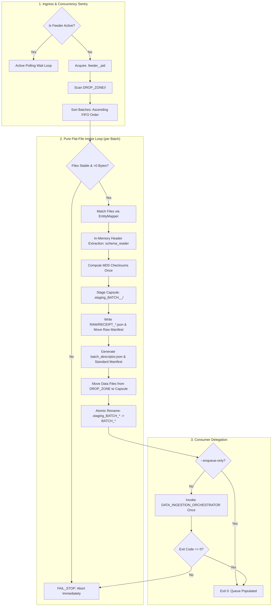

# BICC Intake Controller

[](https://www.python.org/downloads/)
[](https://www.kernel.org/)
[](#)
[](#)

An enterprise intake producer engineered to bridge asynchronous **Oracle Fusion Cloud BICC (Business Intelligence Cloud Connector)** batch exports with the high-throughput **Data Ingestion Orchestrator** and **Generic TPT Loader**.

Under the **Phase 03 Decoupled Architecture**, `BICC_INTAKE_CONTROLLER` functions as a **pure flat-file intake producer with zero Teradata database dependency**. It manages multi-batch intake drop zones, enforces chronological FIFO batch discovery, executes file stability verification, extracts CSV/archive header columns in-memory (`dataloader_core.schema_reader`), computes single-pass cryptographic MD5 checksums, stages complete self-contained Batch Capsules in `LANDING_ZONE/<SOURCE>/BATCH_<CLEAN_TS>_<BATCH_ID>/` with `batch_descriptor.json`, vaults raw Oracle manifests alongside canonical JSON receipts in `RAW/`, and publishes capsules atomically via `.staging_BATCH_*` -> `BATCH_*` directory renaming.

---

## 📚 Complete Documentation Suite

Comprehensive operational, technical, and testing manuals are available in the [`docs/`](docs/) directory:

- 📖 **[User How-To & Configuration Guide](docs/01_user_how_to_guide.md)**: Command-line syntax, `--enqueue-only` vs chained execution, complete `config.json` reference, and runbooks.
- 📐 **[Functional Specification](docs/02_functional_specification.md)**: Pure producer architecture, FIFO queue sequencing, Batch Capsule packaging, and concurrency guards.
- ⚙️ **[Technical Manual & Function Inventory](docs/03_technical_manual_and_inventory.md)**: Internal module structure, function signatures, core SDK delegates, and subprocess bridges.
- 🧪 **[Testing, Validation & QA Guide](docs/04_testing_and_qa_guide.md)**: Test matrices, synthetic dataset synthesis (CSV, ZIP, GZ, PECSV), and automated regression test harnesses.

---

## Table of Contents

- [Key Capabilities](#key-capabilities)
- [Architecture & End-to-End Workflow](#architecture--end-to-end-workflow)
- [Directory Layout & Partitioning](#directory-layout--partitioning)
- [Core Behaviors & Policies](#core-behaviors--policies)
  - [1. Single-Flight Concurrency & Active Polling](#1-single-flight-concurrency--active-polling)
  - [2. Zero Teradata Database Dependency](#2-zero-teradata-database-dependency)
  - [3. FIFO Chronological Batch Ordering](#3-fifo-chronological-batch-ordering)
  - [4. File Stability Sentry (In-Progress Transfers)](#4-file-stability-sentry-in-progress-transfers)
  - [5. In-Memory Header Inspection](#5-in-memory-header-inspection)
  - [6. Atomic Batch Capsule Publishing](#6-atomic-batch-capsule-publishing)
  - [7. Producer / Consumer Decoupling & Orchestrator Delegation](#7-producer--consumer-decoupling--orchestrator-delegation)
- [Configuration Reference (`config.json`)](#configuration-reference-configjson)
- [Entity Mapping Dictionary (`entity_mapping.csv`)](#entity-mapping-dictionary-entity_mappingcsv)
- [Usage & Execution](#usage--execution)
- [Troubleshooting & Exit Codes](#troubleshooting--exit-codes)

---

## Key Capabilities

- **Zero Teradata Dependency**: Operates strictly on the local POSIX filesystem and in-memory streams with zero database connectivity (`teradatasql` is never imported at intake time). Can stage batches during Teradata outages or maintenance windows.
- **Multi-Batch Drop Zone Feeder**: Discovers 1..N asynchronous batches from `DATA/DROP_ZONE/<SOURCE>/` (e.g. `DATA/DROP_ZONE/ORACLE_FUSION/`). Files placed at the root of `DROP_ZONE/` are strictly isolated per source partition to prevent cross-source contamination.
- **Single-Flight Process Concurrency**: Manages per-source lock files (`.feeder_<SOURCE>.pid`) and enters an active polling wait loop if another feeder instance is active, preventing duplicate processing.
- **Strict FIFO Ingress Queue**: Automatically sorts discovered batches in ascending chronological order (oldest extract timestamp first) to maintain state and lineage consistency.
- **Upload Settling Sentry**: Confirms all manifested data files exist, are $>0$ bytes, and have stable file sizes before processing, avoiding partial ingestion during SFTP or cloud transfers.
- **In-Memory Header Extraction**: Inspects CSV/archive headers in-memory (`dataloader_core.schema_reader`), extracting sanitized column names and recording them directly in `batch_descriptor.json` without extracting payloads to disk.
- **Cryptographic Manifest Factory**: Computes MD5 checksums across all data files once during intake and synthesizes standardized `MANIFEST_<SOURCE>_<TIMESTAMP>_<BATCH_ID>.MF` manifests.
- **Regulatory Manifest Vault**: Preserves pristine raw BICC manifests inside `LANDING_ZONE/<SOURCE>/BATCH_<TS>_<ID>/RAW/` alongside a detailed canonical JSON intake audit receipt (`RECEIPT_<SOURCE>_<EXTRACT_TS>_<BATCH_ID>.json`).
- **Atomic Capsule Publishing**: Assembles all artifacts into `.staging_BATCH_<CLEAN_TS>_<BATCH_ID>/` and renames atomically to `BATCH_<CLEAN_TS>_<BATCH_ID>/` (`os.replace`), preventing downstream consumers from reading partial capsules.
- **Producer / Consumer Decoupling**: Supports `--enqueue-only` for rapid intake and queuing without triggering downstream loads, or chained mode triggering `DATA_INGESTION_ORCHESTRATOR` once to drain the FIFO queue.
- **FAIL_STOP Barrier**: When triggering the Orchestrator, halts immediately if any downstream batch fails, preserving order and preventing cascade corruption.

---

## Architecture & End-to-End Workflow



---

## Configuration Reference (`config.json`)

The controller configuration uses portable relative paths and environment variable interpolation:

```json
{
  "feeder": {
    "drop_zone": "../../DATA/DROP_ZONE",
    "logs_dir": "../../LOGS",
    "file_stability_window_seconds": 3,
    "source_system_code": "ORACLE_FUSION",
    "entity_mapping_file": "../../CONFIG/entity_mapping.csv",
    "concurrency": {
      "poll_interval_seconds": 5,
      "lock_timeout_seconds": 7200
    }
  },
  "orchestrator": {
    "orchestrator_dir": "../DATA_INGESTION_ORCHESTRATOR",
    "config_file": "config.json",
    "landing_zone": "../../DATA/LANDING_ZONE",
    "python_executable": "python3",
    "trigger_orchestrator": true
  }
}
```

---

## Entity Mapping Dictionary (`entity_mapping.csv`)

The mapping file defines how source filenames map to target staging tables, supporting `.csv`, `.zip`, `.gz`, and `.pecsv` (active keys):

```csv
SOURCE,TARGET_TABLE,FILE_SIGNATURE,EXTENSION,INNER_EXTENSION
ORACLE_FUSION,ERP_MSH_INVOICE_HEADER,invoiceheaderextractpvo,".csv,.zip,.gz,.csv.gz",.csv
ORACLE_FUSION,ERP_MSH_INVOICE_HEADER_AK,invoiceheaderextractpvo,".pecsv,.zip,.gz,.pecsv.gz",.pecsv
ORACLE_FUSION,ERP_MSH_USER,userpvo,".csv,.zip,.gz,.csv.gz",.csv
ORACLE_FUSION,ERP_MSH_USER_AK,userpvo,".pecsv,.zip,.gz,.pecsv.gz",.pecsv
```

---

## Usage & Execution

### Standard Batch Ingestion (Chained)
Enqueues all pending batches in `DROP_ZONE` into `LANDING_ZONE` capsules, then triggers `DATA_INGESTION_ORCHESTRATOR` once to drain the FIFO queue:
```bash
python3 feeder.py --config config.json
```

### Pure Ingress Mode (`--enqueue-only`)
Stages and publishes Batch Capsules into `LANDING_ZONE` and exits immediately without invoking the Orchestrator:
```bash
python3 feeder.py --config config.json --enqueue-only
```

### Ingestion with Post-Tasks Skipped
Forwards `--skip-post-tasks` to the Orchestrator for maintenance or historical re-inits:
```bash
python3 feeder.py --config config.json --skip-post-tasks
```

### Multi-Source Partition Ingestion
Processes only extracts originating from a specific source partition:
```bash
python3 feeder.py --config config.json --source CRM
```

If `DROP_ZONE` contains no batches, the process exits cleanly with Return Code `0`.

---

## Troubleshooting & Exit Codes

| Exit Code | Meaning | Action |
| :---: | :--- | :--- |
| `0` | All batches enqueued (and processed if chained) successfully, or `DROP_ZONE` is empty (`IDLE`). | Normal operation. |
| `1` | Payload stability failure, lock timeout, or Orchestrator failure (`FAIL_STOP`). | Inspect `LOGS/<SOURCE>/LOG_FEEDER_<SOURCE>_<TIMESTAMP>.log`. |

For detailed failure scenarios and step-by-step remediation procedures, consult **[docs/01_user_how_to_guide.md](docs/01_user_how_to_guide.md)**.
