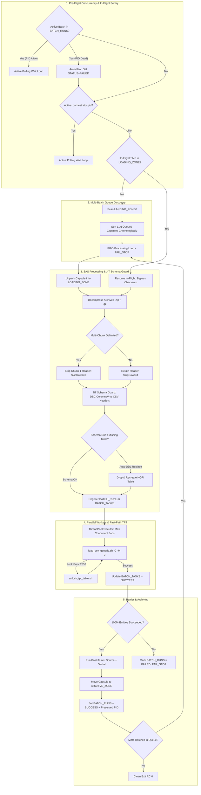

# Data Ingestion Orchestrator

[](https://www.python.org/downloads/)
[](https://www.kernel.org/)
[](https://www.teradata.com/)
[](#)

An enterprise multi-batch ingestion orchestrator engineered to bridge standardized flat-file capsules and manifests with the high-throughput **Generic Teradata Parallel Transporter (TPT) Loader**.

The orchestrator operates as a **Multi-Batch FIFO Queue Consumer** with atomic directory transitions, process-level concurrency locking (`fcntl.flock`), pre-flight Teradata state sentries, automated in-flight crash recovery, $O(1)$ fast-path batch descriptor verification, **Just-In-Time (JIT) Schema Guard & Auto-DDL** synchronization, parallel entity-level worker threads, TPT BTEQ pre-check bypass (`-C -M 2`), automated table unlock & retry capabilities (Error 2652), and unified Batch Capsule archiving.

---

## 📚 Complete Documentation Suite

Comprehensive operational, technical, and testing manuals are available in the [`docs/`](docs/) directory:

- 📖 **[User How-To & Configuration Guide](docs/01_user_how_to_guide.md)**: Command-line syntax, complete `config.json` reference (JIT Schema Guard, source-keyed post-tasks), in-flight recovery runbooks, and Teradata catalog monitoring.
- 📐 **[Functional Specification](docs/02_functional_specification.md)**: Multi-batch FIFO queue consumption (OPS-01), concurrency sentries, JIT Schema Guard Auto-DDL, multi-chunk normalization (Solution A), and state machine lifecycle.
- ⚙️ **[Technical Manual & Function Inventory](docs/03_technical_manual_and_inventory.md)**: Module breakdowns (`schema_guard`, `sensor`, `db_state`, `tpt_worker`, `post_tasks`), function signatures, and state machine DDL.
- 🧪 **[Testing, Validation & QA Guide](docs/04_testing_and_qa_guide.md)**: Test matrices, multi-batch FIFO queue tests, JIT Schema Guard tests, Error 2652 reactive lock recovery tests, concurrency tests, and automated regression harnesses.

---

## Table of Contents

- [Key Architectural Capabilities](#key-architectural-capabilities)
- [Architecture & End-to-End Workflow](#architecture--end-to-end-workflow)
- [Directory Layout & SAS Lifecycle](#directory-layout--sas-lifecycle)
- [Core Invariants & Policies](#core-invariants--policies)
  - [1. Multi-Batch FIFO Queue Consumer (OPS-01)](#1-multi-batch-fifo-queue-consumer-ops-01)
  - [2. Fast-Path O(1) Batch Descriptor Verification](#2-fast-path-o1-batch-descriptor-verification)
  - [3. Just-In-Time Schema Guard & Auto-DDL](#3-just-in-time-schema-guard--auto-ddl)
  - [4. Fast-Path TPT BTEQ Precheck Bypass (-C -M 2)](#4-fast-path-tpt-bteq-precheck-bypass--c--m-2)
  - [5. Single-Flight Concurrency & Active Polling](#5-single-flight-concurrency--active-polling)
  - [6. Pre-Flight Teradata Sentry & Dead-PID Auto-Healing](#6-pre-flight-teradata-sentry--dead-pid-auto-healing)
  - [7. Automated In-Flight Crash Resumption](#7-automated-in-flight-crash-resumption)
  - [8. Multi-Chunk Header Normalization (Solution A)](#8-multi-chunk-header-normalization-solution-a)
  - [9. Reactive Lock Resolution (Error 2652)](#9-reactive-lock-resolution-error-2652)
  - [10. State Machine & PID Audit Trail](#10-state-machine--pid-audit-trail)
- [Configuration Reference (`config.json`)](#configuration-reference-configjson)
- [Entity Mapping Dictionary (`entity_mapping.csv`)](#entity-mapping-dictionary-entity_mappingcsv)
- [Usage & Execution](#usage--execution)
- [Troubleshooting & Exit Codes](#troubleshooting--exit-codes)

---

## Key Architectural Capabilities

- **Multi-Batch FIFO Queue Consumer**: Discovers and consumes 1..N queued Batch Capsules in `LANDING_ZONE/<SOURCE>/BATCH_<TS>_<ID>/` in strict chronological ascending order (oldest extract first), with seamless backward compatibility for legacy flat manifests.
- **Fast-Path $O(1)$ Batch Descriptor Verification**: Leverages `batch_descriptor.json` pre-computed by the Feeder to verify payload file sizes in $O(1)$ time, eliminating redundant MD5 re-hashing across large multi-gigabyte files.
- **Just-In-Time (JIT) Schema Guard & Auto-DDL**: Inspects target table column definitions in `DBC.ColumnsV` right before entity loading. If the table is missing or columns have drifted (under `auto_migrate_ddl = true` and `load_mode = 'replace'`), drops and recreates the table in `NOPI` with all payload columns as `VARCHAR(4000) CHARACTER SET <UNICODE|LATIN> NOT CASESPECIFIC` plus mandatory audit metadata (`INFA_LAST_REPLICATED`, `INFA_BATCH_ID`). Protects data by strictly blocking destructive DDL when `auto_migrate_ddl = false` or `load_mode = 'append'`.
- **Fast-Path TPT BTEQ Precheck Bypass**: Passes `-C` (`SKIP_BTEQ_CHECK`) and `-M 2` (`HAS_META = 2`) to `load_csv_generic.sh`, bypassing redundant BTEQ pre-flight catalog queries and enabling in-memory audit metadata padding during TPT streaming.
- **Single-Flight Process Concurrency**: Manages `.orchestrator.pid` in `LOADING_ZONE/<SOURCE>` backed by `dataloader_core.locking.ProcessLock` (`fcntl.flock` + PID liveness check), polling cleanly until active runs complete.
- **Pre-Flight Teradata Sentry & Auto-Healing**: Queries `${TDENV}SIDFINTCH.BATCH_RUNS` for running batches before execution. If an active PID is alive, it waits; if dead, it automatically reclassifies the orphaned batch as `FAILED`.
- **Automated In-Flight Crash Resumption**: Interrupted runs inside `LOADING_ZONE` are automatically resumed upon re-invocation, bypassing redundant checksum verification and rerunning only pending/failed tasks.
- **Isolated Processing SAS**: Atomically unpacks active batch capsules into private `LOADING_ZONE/<SOURCE>`, ensuring that failed ingestions never corrupt the ingress queue.
- **In-Place Multi-Chunk Normalization (Solution A)**: For multi-chunk extracts, strips line 1 from Chunk 1 in-place with idempotent marker protection (`.<file>.header_stripped`) and executes TPT using wildcard pattern with `SkipRows = 0`. Single-chunk extracts retain headers with `SkipRows = 1`.
- **Concurrent Worker Pool**: Dispatches independent entity load jobs in parallel via `ThreadPoolExecutor` while honoring configurable concurrency limits (`max_concurrent_jobs`).
- **Enterprise Auto-Healing**: Intercepts Teradata Error 2652 (`Table is locked for FastLoad / MultiLoad`), executes automated table unlocking via `unlock_tpt_table.sh`, and retries without manual intervention.
- **Permanent Process PID Audit**: Stores OS `PROCESS_PID` in `BATCH_RUNS` and permanently retains it upon completion (`SUCCESS` or `FAILED`).
- **Source-Keyed Post-Tasks Pipeline**: Executes source-specific (`post_ingestion_tasks[source]`) and global tasks (e.g. dbt models) only after 100% entity load success, supplying isolated `context_env` (`CURRENT_BATCH_ID`, `CURRENT_SOURCE`, `CURRENT_TIMESTAMP`, `TDENV`).
- **Hybrid Decoupling Support**: Accepts `--skip-post-tasks` to bypass analytical models during bulk re-inits or operational maintenance.

---

## Architecture & End-to-End Workflow



---

## Directory Layout & SAS Lifecycle

```
DATA/
├── LANDING_ZONE/<SOURCE>/
│   └── BATCH_<CLEAN_TS>_<BATCH_ID>/      # Queued Batch Capsules
│       ├── *.csv / *.zip                 # Payload data files
│       ├── MANIFEST_*.MF                 # Standardized manifest
│       ├── batch_descriptor.json         # Pre-computed metadata & headers
│       └── RAW/                          # Raw manifest & RECEIPT_<SOURCE>_<TS>_<ID>.json
├── LOADING_ZONE/<SOURCE>/                # Active SAS unpacked for processing
│   ├── .orchestrator.pid                 # Advisory process lock
│   ├── *.csv / *.pecsv                   # Unpacked & normalized payload files
│   ├── .<file>.header_stripped           # Multi-chunk header strip markers
│   └── RAW/                              # Preserved capsule receipts
└── ARCHIVE_ZONE/<SOURCE>/<YYYY-MM>/BATCH_<ID>_<TS>/ # Consolidated Batch Capsule
    ├── *.csv / *.zip                     # Loaded payload data files
    ├── MANIFEST_*.MF                     # Standardized manifest
    ├── batch_descriptor.json             # Batch metadata
    └── RAW/                              # Audit receipt & raw manifest
LOGS/
└── <SOURCE>/
    └── <YYYY-MM>/BATCH_<ID>_<TS>/        # Batch Log Capsule
        ├── LOG_ORCHESTRATOR_<SOURCE>_<EXTRACT_TS>_<BATCH_ID>_<EXEC_TS>.log
        └── TPT/                          # TPT job variables, tbuild outputs, logs
```

---

## Configuration Reference (`config.json`)

```json
{
  "teradata": {
    "host": "${TDPID}",
    "user": "${TDENV}${SID_ADM_USER}",
    "logmech": "TD2",
    "technical_database": "${TDENV}SIDFINTCH",
    "connection_pool_size": 6
  },
  "tpt": {
    "wrapper_script": "../TPT_LOADER/load_csv_generic.sh",
    "unlock_script": "../TPT_LOADER/unlock_tpt_table.sh",
    "timeout_seconds": 3600,
    "target_db": "${TDENV}SIDFINSTG",
    "work_db": "${TDENV}SIDFINWRK",
    "default_load_mode": "replace"
  },
  "orchestration": {
    "landing_zone": "../../DATA/LANDING_ZONE",
    "loading_zone": "../../DATA/LOADING_ZONE",
    "archive_zone": "../../DATA/ARCHIVE_ZONE",
    "logs_dir": "../../LOGS",
    "max_concurrent_jobs": 4,
    "manifest_pattern": "MANIFEST_*.MF",
    "manifest_regex": "^MANIFEST_([A-Za-z0-9_]+)_(\\d{8}_\\d{6})_([A-Za-z0-9_-]+)\\.MF$",
    "entity_mapping_file": "../../CONFIG/entity_mapping.csv",
    "verify_checksum": true,
    "allow_orphan_files": false,
    "auto_migrate_ddl": true,
    "character_set": "UNICODE",
    "concurrency": {
      "poll_interval_seconds": 5,
      "lock_timeout_seconds": 7200
    },
    "post_ingestion_tasks": {
      "ORACLE_FUSION": [
        {
          "type": "shell",
          "command": "echo 'Source post-task for batch $CURRENT_BATCH_ID from source $CURRENT_SOURCE'"
        }
      ],
      "default": [
        {
          "type": "shell",
          "command": "echo 'Global post-task for batch $CURRENT_BATCH_ID'"
        }
      ]
    }
  }
}
```

---

## Entity Mapping Dictionary (`entity_mapping.csv`)

```csv
SOURCE,TARGET_TABLE,FILE_SIGNATURE,EXTENSION,INNER_EXTENSION
ORACLE_FUSION,ERP_MSH_INVOICE_HEADER,invoiceheaderextractpvo,".csv,.zip,.gz,.csv.gz",.csv
ORACLE_FUSION,ERP_MSH_INVOICE_HEADER_AK,invoiceheaderextractpvo,".pecsv,.zip,.gz,.pecsv.gz",.pecsv
ORACLE_FUSION,ERP_MSH_USER,userpvo,".csv,.zip,.gz,.csv.gz",.csv
ORACLE_FUSION,ERP_MSH_USER_AK,userpvo,".pecsv,.zip,.gz,.pecsv.gz",.pecsv
```

---

## Usage & Execution

### Standard Multi-Batch Queue Ingestion
```bash
python3 orchestrator.py --config config.json
```

### Ingestion with Source Partition Override
```bash
python3 orchestrator.py --config config.json --source ORACLE_FUSION
```

### Ingestion with Post-Tasks Skipped
```bash
python3 orchestrator.py --config config.json --skip-post-tasks
```

### Ingestion with External Source Post-Tasks File
```bash
python3 orchestrator.py --config config.json --source ORACLE_FUSION --post-tasks-file /path/to/POST_TASKS.json
```

If `LANDING_ZONE` contains no queued capsules and no flat manifests, the orchestrator exits cleanly with Return Code `0` (`IDLE`).

---

## Troubleshooting & Exit Codes

| Exit Code | Meaning | Action |
| :---: | :--- | :--- |
| `0` | All queued batches loaded, verified, transformed, and archived with 100% success, or `LANDING_ZONE` is empty (`IDLE`). | Normal operation. |
| `1` | Boundary violation (OPS-01), checksum failure, schema drift under `auto_migrate_ddl = false`, lock timeout, or unrecoverable worker failure. | Inspect batch log in `LOGS/<SOURCE>/<YYYY-MM>/BATCH_<ID>_<TS>/` and Teradata `BATCH_TASKS` table. |

For detailed failure scenarios, error runbooks, and recovery instructions, consult **[docs/01_user_how_to_guide.md](docs/01_user_how_to_guide.md)**.
